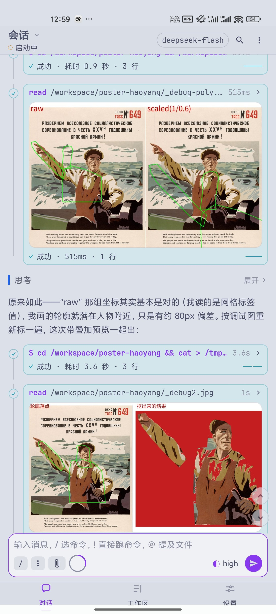
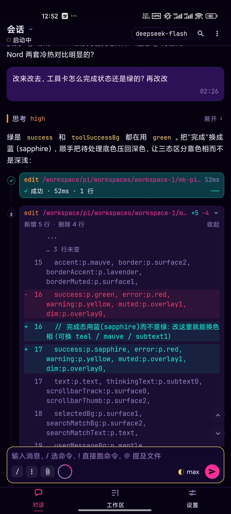
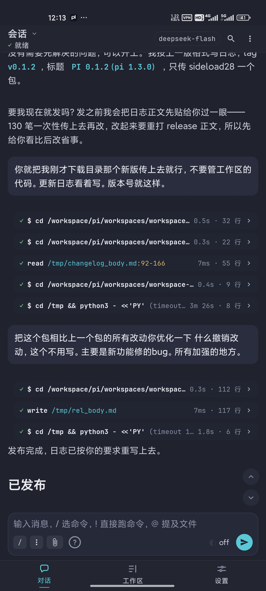
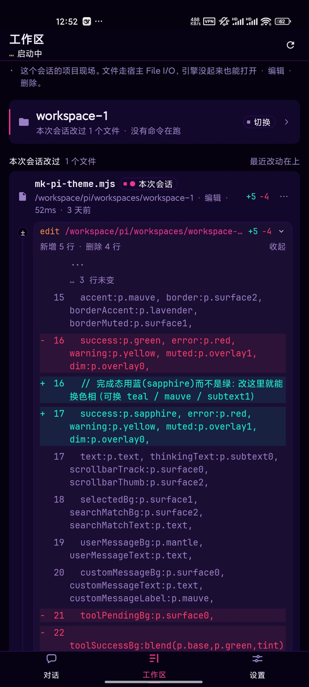
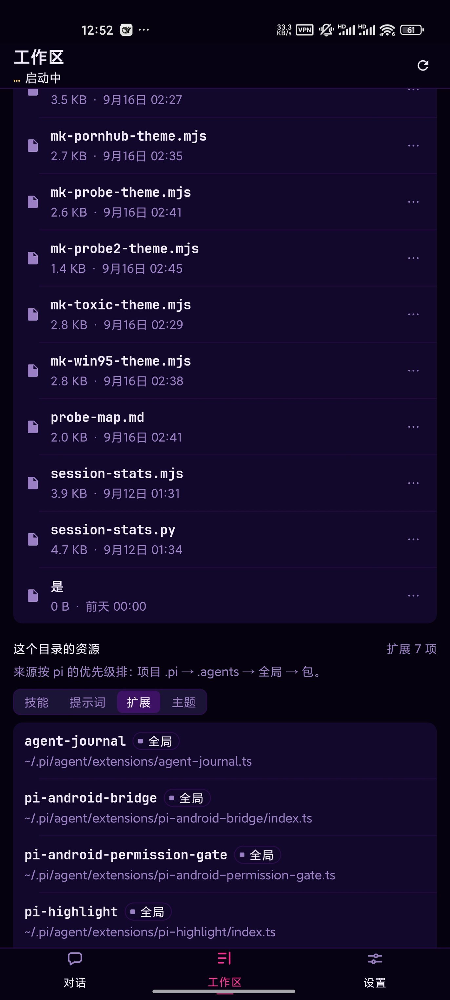

<p align="center">
  
</p>

<h1 align="center">PI</h1>

<p align="center">
  <a href="./docs/screenshots/banner-three-themes.jpg"></a>
</p>

<p align="center">
  
  
  
  
</p>

**[pi](https://github.com/earendil-works/pi) coding agent 的 Android 客户端。** 内置 Linux 环境，免 Root、免 Termux，装上就能在手机本机读代码、改文件、跑命令。

### 本机运行，免 Root，免 Termux

Ubuntu、Node、git、ripgrep、fd 全都打在 APK 里，第一次打开就能开工。引擎是官方的 pi，一行没改。会话、文件、命令、凭证都在你手机上，只有模型请求发往你自己配置的服务。

### 工具结果是卡片

每次调用占一行，耗时、行数、成败都摆在明面上。`read` 读进来的图直接画在卡里。

<p align="center">
  <a href="./docs/screenshots/chat-light-tool-cards.jpg"></a>
</p>

### 思考可折叠，改动看得见

要看再展开，不看就是一行。`edit` 卡自带 diff，改了哪几行一眼就知道。

<p align="center">
  <a href="./docs/screenshots/chat-dark-tool-cards.jpg"></a>
</p>

### 回复中途也能发消息

模型还在干活，你就能接着说。消息排队，按 pi 自己的规则合并；停下时排队的内容回到输入框，草稿不丢。

### 换主题，只换一个文件

主题是一张 JSON。界面、代码高亮、强调色一起换，同一场对话，换完就是另一个样子。

<p align="center">
  <a href="./docs/screenshots/chat-theme-slate.jpg"></a>
  &nbsp;
  <a href="./docs/screenshots/chat-theme-purple.jpg"></a>
</p>

### 工作区，手机上的任意目录

选一个目录就是一个工作区。文件浏览、编辑器（查找、撤销、行号）一应俱全；这次会话改过的文件和 diff 收在一处，技能、提示词、扩展、主题按优先级列出来，每一项都带真实路径。

<p align="center">
  <a href="./docs/screenshots/workspace-session-changes.jpg"></a>
  &nbsp;
  <a href="./docs/screenshots/workspace-resources.jpg"></a>
</p>

### 扩展和电脑上完全一样

扩展、技能、提示词、主题都是普通文件，电脑上能装的这里都能装——生态里已有一万多个扩展（[awesome-pi-coding-agent](https://github.com/shaftoe/awesome-pi-coding-agent) 收录 10430 个扩展、389 个主题）。更省事的是直接说：

> 「找个能联网搜索的扩展装上」
> 「写个技能：每次改完代码跑一遍测试，失败了把出错那几行贴出来」
> 「换一套暗紫色的主题，晚上看着舒服点」

agent 就在这台机器上，手里是真的 Linux shell，搜、装、写、改、验证一趟做完，立刻生效。`mcp`、`codemode`、`tool-search`、`llama.cpp` 四个内置扩展开箱可用。

### 会话树与导出

随时分叉，回到任一节点继续；会话可以导出成 HTML。

### 模型随便配

内置厂商预设，粘上 Key 就能用；不在列表里的，用「自定义供应商」（OpenAI 兼容）填地址和 Key。Ollama、llama.cpp、vLLM 也都能连。

### 长任务不掉线

引擎以前台服务加唤醒锁常驻，切到别的 App 干别的，任务照跑。

### 手机操控（可选）

同一套扩展机制，agent 还能读屏、点按、读写文件、碰剪贴板和通知。30 个端点，默认全关，按类授权，随时撤销。

## 常见问题

**要 root 吗？要装 Termux 吗？**

都不要。Linux 用户态随 APK 一起来，普通手机直接用。

**我的数据放哪？**

全在本机。App 不另存凭证，写的就是 pi 自己的 `auth.json`、`models.json`、`settings.json`、`mcp.json`，pi 怎么读，这里就怎么读。

**扩展从哪来？**

`pi install npm:包名`，或 `pi install git:仓库@tag`，也可以直接让 agent 帮你找、帮你装、帮你写。

**怎么升级 pi？**

跟随上游。版本号只写在一处，构建时按它取包、校验、打进 APK；契约检查会在上游改名或改语义时直接让构建失败，不会悄悄出错。

**手机操控默认开着吗？**

全关。读屏、点按、设备 shell 都是单独授权。这一层就是个普通的 pi 扩展（[`pi-android-bridge`](app/src/main/assets/pi-extensions/pi-android-bridge/)），用公开 API 写的，没有私有通道，你可以读、改，也可以照着写自己的。

## 安装

Android 8.0（API 26）及以上，arm64。到 [Releases](https://github.com/heikeyangle-code/pi-android/releases) 下载 APK 安装即可。首次启动会解包运行时，稍等片刻。

## 问题与建议

欢迎在 [Issues](https://github.com/heikeyangle-code/pi-android/issues) 里提。

## 技术细节

<details>
<summary><b>架构</b>：引擎 · 协议 · 运行时 · 配置</summary>

**引擎。** pi 以官方 npm 包的形式随 APK 分发，App 用 pi 自己的 `--mode rpc` 驱动它（JSONL over stdio），不 fork、不打补丁、不在中间做转换层。会话内核、工具、扩展加载器、provider 工厂全部是上游那一份。

**协议。** 引擎之外是一个独立的纯 Kotlin/JVM 协议核心（[`rpc/`](rpc/) 模块，不带 Android 依赖）：33 条命令、9 种扩展界面方法、按 pi 的规则分帧（只按 `\n` 切、容忍 `U+2028`、增量 UTF-8 解码）。不插手机、不装模拟器就能跑完整套协议测试。

**运行时。** 工具执行的是这台手机上的真 Linux 用户态：

| | |
| :--- | :--- |
| **Ubuntu 24.04 base** | glibc 2.39——npm 的 `linux-arm64` 预编译件能直接跑 |
| **Node.js 24.19** | 官方 glibc 构建，`node` / `npm` 都是原生的 |
| **git · ripgrep · fd · CA 证书** | pi 的 `grep`、`find`、git 工具真正调用的那几个二进制 |
| **proot**（Termux 构建） | 用户态系统调用翻译层，所以**不需要 root** |

每个上游按 SHA-256 锁死，哈希一变构建直接失败。工作区可以是你手机上的任意目录。

**配置。** 写下去的都是 pi 自己的配置文件——`models.json`、`auth.json`、`settings.json`、`mcp.json`。App 不另存凭证，也不自己维护一套模型名单：pi 怎么读，这里就怎么读。13 条 provider 预设里，10 条的 `baseUrl` 与 `api` 逐条照抄 pi 的 provider 工厂（填错会注册成功、第一条消息才失败，正是导入页要挡掉的那类错）。

</details>

<details>
<summary><b>pi 升级</b>：只换版本号，三道检查兜底</summary>

上游 pi 平均不到五天发一个版本，这个仓库的应对方式是：**不改引擎，只换版本号。**

版本号只写在**一处**——`tools/fetch-runtime.mjs` 的 `PI_VERSION`。构建时按它取包、校验、打进载荷。上游加了新模型、新工具、新的会话行为，升版本号就有。

为了让这件事不悄悄出错，仓库里有三道检查：

- **`tools/pi-contract.mjs`**（CI 的独立 job）：把 App 依赖的每一件 pi 事实逐条对着**钉住的那个版本**核对——RPC 命令名、扩展界面方法、provider 预设、内置主题的每个色值、`models.json` 的替换与合并语义、工具结果文本、会话条目面、以及官方模型目录的格式。上游改名、删东西或改语义，**构建直接失败**，而不是发出去以后才发现。每条失败都会打印「该回去重读哪个 App 文件」。
- **diff 工具产物的字节**：判据是「字节相等」而不是「名字还在」——名字还在、语义变了，是这个仓库踩过两次的坑（`docs/known-gaps.md` §M11 / §M12）。
- **全部载荷按 SHA-256 锁定**：Linux 运行时、git 闭包、ripgrep/fd、proroot 的五个二进制记在 [`runtime.lock.json`](runtime.lock.json)；设备逐个载荷比对，只重解包真的变了的那个。

当前钉的是 **pi 1.1.0**。

</details>

<details>
<summary><b>自己编译</b></summary>

```bash
./gradlew :rpc:test                    # 协议核心，不需要设备
./gradlew :app:assembleRelease         # 打包 APK
```

构建会拉取并校验钉住的上游载荷（[`tools/fetch-runtime.mjs`](tools/fetch-runtime.mjs)），产出 APK。

其他常用的：

```bash
node tools/pi-contract.mjs             # 对着钉住的引擎核对全部契约
node tools/fetch-runtime.mjs           # 只组装运行时载荷
bash tools/run-app-pure-checks.sh      # 纯逻辑 harness（不需要设备）
```

`docs/` 下有更细的东西：[pi 契约](docs/pi-contract.md)、[RPC 覆盖](docs/rpc-coverage.md)、[界面规格](docs/pi-android-ui-spec.md)。

</details>

---

## 致谢与许可

这个项目站在几个成熟上游之上，它们各自保留自己的许可与版权：

| 项目 | 它是什么 |
| :--- | :--- |
| **[pi](https://github.com/earendil-works/pi)** | 上游 coding agent，`@earendil-works/pi-coding-agent` **1.1.0**（MIT） |
| **[Ubuntu Base 24.04](https://cdimage.ubuntu.com/ubuntu-base/releases/24.04.3/release/)** | glibc 用户态 |
| **[Node.js 24.19](https://nodejs.org/en/download)** | 官方 glibc 构建 |
| **[proot](https://proot-me.github.io/)**（Termux 构建） | 用户态系统调用翻译层 |
| **[ripgrep](https://github.com/BurntSushi/ripgrep)** · **[fd](https://github.com/sharkdp/fd)** · git · CA 证书 | pi 的工具真正调用的那几个二进制 |

App 代码 MIT。包内的 pi 引擎同样是 MIT。第三方运行时与组件各自保留上游许可，原文随包分发：

- [pi 许可原文](app/src/main/assets/licenses/pi-license.txt)
- [第三方组件清单](app/src/main/assets/licenses/component-list.txt)
- [未随包提供许可文本的依赖](app/src/main/assets/licenses/pi-engine-licence-gaps.txt)
