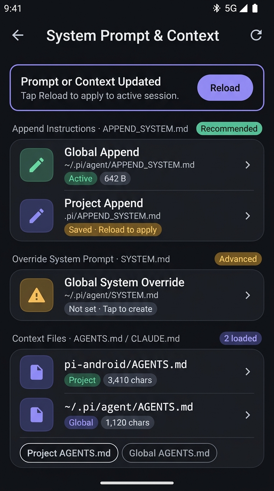
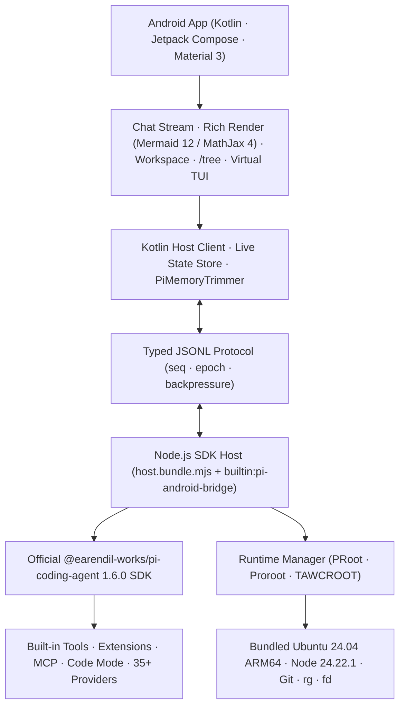

**English** · [简体中文](README.zh-CN.md)

<p align="center">
  
</p>

<h1 align="center">Pi for Android</h1>

<p align="center">
  <b>Your phone isn't an SSH remote. Put a real local Linux workstation + the official Pi Coding Agent in your pocket.</b>
</p>

<p align="center">
  Native Jetpack Compose · Official Pi 1.6.0 SDK · Offline Mermaid 12 &amp; MathJax 4 · 3 Linux Runtimes · Full TUI &amp; Extension Support · Zero Root · Zero Termux
</p>

<p align="center">
  
  
  
  
  
  
  
</p>

<p align="center">
  <a href="https://github.com/heikeyangle-code/pi-android/releases"><b>⬇ Download Latest APK</b></a> ·
  <a href="https://github.com/heikeyangle-code/pi-android/actions/workflows/ci.yml">CI Status</a> ·
  <a href="https://github.com/heikeyangle-code/pi-android/issues">Issues &amp; Ideas</a>
</p>

---

## Why Pi for Android?

Coding with AI on a phone used to mean choosing between a toy chat wrapper (no local files, no shell, no extensions), a fragile SSH session (useless offline, painful on a 6-inch screen), or hours of manual Termux setup.

**Pi for Android packages a complete local Linux userland + the official [Pi Coding Agent](https://github.com/earendil-works/pi) 1.6.0 SDK into one native Android app.** Install the APK, open any real folder on your phone, and go — no root, no Termux, no cloud box, no setup scripts.

| Capability | Mobile AI Chat Apps | Termux / SSH | **Pi for Android** |
| :--- | :---: | :---: | :---: |
| **Local Linux + Node 24 + Git + `rg` + `fd`** | ❌ Text-only chat | ⚠️ Manual setup | ✅ **Built-in, zero root, zero Termux** |
| **Mobile-native reading, diffs & rich blocks** | ⚠️ Plain chat bubbles | ❌ Scrolling wall of ANSI | ✅ **Tonal tool cards, word diffs, Mermaid 12, MathJax 4** |
| **Desktop Pi extensions & interactive TUIs** | ❌ Unsupported | ⚠️ Awkward soft keyboard | ✅ **Virtual TUI projection + touch/mouse + 80-col fit** |
| **Models, MCP & Code Mode ecosystem** | ❌ Closed / partial | ✅ CLI only | ✅ **100% official Pi 1.6.0 SDK · 7 OAuth · 35+ providers** |
| **Optional Android device automation** | ❌ Impossible | ⚠️ Custom scripts | ✅ **Opt-in `builtin:pi-android-bridge` · 0 tokens when off** |

<table align="center">
  <tr>
    <td align="center" width="50%">
      <br />
      <sub><b>Calm tool cards &amp; intra-line word diffs</b> — shell runs, file reads, and edits fold cleanly and expand in place like a mobile code review.</sub>
    </td>
    <td align="center" width="50%">
      <br />
      <sub><b>Live tool control &amp; Codemode</b> — toggle built-in, extension, and MCP tools live, save defaults, and configure Pi 1.6.0 Codemode &amp; shell prefix.</sub>
    </td>
  </tr>
  <tr>
    <td align="center" width="50%">
      <br />
      <sub><b>System prompt &amp; context pipeline</b> — edit global and project <code>SYSTEM.md</code>, <code>APPEND_SYSTEM.md</code>, and <code>AGENTS.md</code> with 1-tap reload.</sub>
    </td>
    <td align="center" width="50%">
      <br />
      <sub><b>Complete provider freedom</b> — 7 OAuth subscription logins, 35+ presets (1,698 chat models), or any OpenAI-compatible endpoint.</sub>
    </td>
  </tr>
</table>

---

## What You Can Actually Do on Your Phone

- **Fix bugs & review diffs offline on the train**: search local repos with `rg` / `fd`, inspect word-level diffs, run test suites, and `git commit` directly on-device.
- **Drop screenshots & multi-file context straight into chat**: paste clipboard images, attach documents, or `@`-mention workspace files with OOM-safe downsampling.
- **Run real desktop Pi extensions & MCP servers**: orchestrate multi-tool scripts with Pi 1.6.0 **Code Mode**, connect MCP servers, or launch interactive fullscreen TUI extensions with touch & virtual gamepad controls.
- **Automate your phone on demand**: opt in to Accessibility, Notifications, Clipboard, Location, Camera, App Control, or Shizuku Shell — and flip them all off in one tap (**strictly 0 prompt tokens when disabled**).

---

## Core Engineering Highlights

### 1. 100% Official Pi 1.6.0 SDK + Real Mobile TUI Projection
- **Direct SDK execution (`host.bundle.mjs`)**: runs `@earendil-works/pi-coding-agent` directly through a typed, epoch-isolated JSONL host — no parallel re-implementations, full desktop `~/.pi/agent/` & `.pi/` compatibility, and automatic upstream model/feature adoption.
- **Virtual TUI surface engine (`ui/surfaces.mjs` → Jetpack Compose)**: extensions calling `ctx.ui.custom()`, `setWidget()`, `setHeader()`, `setFooter()`, or `tui.showOverlay()` mount real Pi TUI components into a mobile overlay — minimizable to a dock, 80-col responsive, supporting `OverlayHandle`, `Focusable`, clickable **OSC 8 hyperlinks**, touchscreen `TuiMouseEvent`, official `KeybindingsManager`, and terminal bells (`BEL` / `OSC 9;4` / `OSC 777`).
- **1:1 official extension renderers**: extension and MCP tool cards render through Pi's own `ToolExecutionComponent` (`resolveToolRenderers`) with per-call state and live reload.

### 2. Native Rich-Rendering Pipeline (100% Offline, Built for Mobile)
- **Mermaid 12.2.0 Chromium/Skia high-DPI engine**: renders 20+ Mermaid 12 diagram families (flowcharts, sequence, class, state, ER, Gantt, mindmap, timeline, gitGraph, quadrant, pie, xychart, sankey, kanban, architecture, C4, packet, block) with true CSS-viewport & DPR scaling, double-rAF layout flush, automatic GPU-cull software retry, pinch-to-zoom, and 1-tap fullscreen viewer.
- **MathJax 4 inline & display LaTeX**: crisp SVG typography for `$...$`, `\(...\)`, `\[...\]`, single/multi-line `$$...$$`, ` ```math ` fences, and standalone `egin{aligned/equation/align/gather/cases/matrix}` environments — with CJK adjacency support and currency-safe parsing.
- **Instant `<1 ms` native syntax highlighting & rich cards**: 35+ languages highlighted synchronously with zero IPC lag, plus native viewers for SVG (static & animated), safe HTML previews, CSV/TSV tables, JSON/YAML/XML trees, stack traces, and intra-line word diffs.
- **Zero-jitter streaming & instant scroll-back**: dual-path GFM AST parser (`Channel.CONFLATED` off-main-thread for long streams + frame-0 sync for short/cached replies), `TailFollow` bottom lock, `RowHeightCache`, and bounded cross-scroll LRU caches (`PiMarkdownDocCache` & `PiCodeHighlightCache`) wired into `PiMemoryTrimmer`.

### 3. Real Local Linux & Three Switchable Runtimes
First boot unpacks a deterministic, digest-verified Linux environment (**Ubuntu 24.04 ARM64 · Node.js 24.22.1 · Git 2.43 · ripgrep 15.2 · fd 10.2 · Pi 1.6.0**). APK upgrades diff per-payload digests and **only refresh changed payloads**, preserving everything you installed inside the guest.

| Runtime | Characteristics |
| :--- | :--- |
| **PRoot** | Battle-tested user-space syscall translation (Termux build) — maximum device compatibility. |
| **Proroot** | Custom linker + in-process hook runtime cutting PRoot syscall overhead. |
| **TAWCROOT** | Single-process `seccomp` backend compiled from pinned upstream source. |

### 4. Sub-Second Cold Start & Official `/tree` + `/resume`
- **12 automated cold-start invariants (`tools/check-startup-perf.mjs`)**: single-file `host.bundle.mjs`, zero cold-start `jiti` / `Babel` / `undici` / `WebView` overhead, `readyHello` embedded in `host.ready`, initial `state` embedded in `session.open`, `planDirect` node launch (no `/bin/bash -c`), parallel pre-spawn I/O, APK version-stamp fast-paths, and staggered background tasks.
- **Official `/tree` & indexed `/resume`**: all 5 official filter modes, collapsible subtrees, in-tree search, clean branching from any node, plus persistent incremental `.session-list-index.json` search across every workspace.
- **100% Official Pi Theme parity**: full `okhsl()` / `oklch()` parsing with automatic WCAG foreground contrast on top of a clean, neutral Material 3 mobile shell with instant zero-restart EN/中文 switching.

### 5. Opt-in Android Device Bridge (`builtin:pi-android-bridge`)
Registered via Pi SDK's native `builtin: true, replaceable: true` mechanism (**Settings → Device Capabilities**):
- **3 focused groups**: Screen Automation (Accessibility), System & Hardware (Notifications, Clipboard, Location, Camera, App Control), and Device Shell (Shizuku).
- **Zero-token & fail-safe**: disabled capabilities are never exposed to the model (**0 tokens**); irreversible operations trigger a native 3-choice confirmation dialog.

---

## Quick Start

| Requirement | Support |
| :--- | :--- |
| **Android** | 8.0 (API 26) or later |
| **ABI** | ARM64 (`arm64-v8a`) |
| **Root / Termux** | **Not required** |
| **Upgrades** | Stable sideload signature — install newer APKs right over older builds |

1. Download the latest `pi-android-*-sideload28-arm64.apk` from **[GitHub Releases](https://github.com/heikeyangle-code/pi-android/releases)**.
2. Install and launch — first boot unpacks the bundled Linux & Node runtime automatically.
3. Connect a model in **Settings → Models & Providers** (OAuth subscription login, API key, or any OpenAI-compatible URL).
4. Pick any folder on your phone and start building.

---

## Architecture & Verification



Every commit is verified across **6 CI jobs** (`tawcroot` NDK build, **326 real-SDK host checks** across bundled / unbundled / `--scandir-fix` modes + cold-start `import-audit`, static guards for Android APIs / i18n / 12 cold-start invariants, JVM unit tests, and both `modern36` + `sideload28` signed APKs):

```bash
git clone https://github.com/heikeyangle-code/pi-android.git
cd pi-android
node tools/sdk-host/contract.mjs
node tools/sdk-host/test.mjs
node tools/check-startup-perf.mjs
./gradlew :protocol:test
node tools/fetch-runtime.mjs
./gradlew :app:assembleRelease
```

**Docs**: [`architecture.md`](docs/sdk-host/architecture.md) · [`protocol.md`](docs/sdk-host/protocol.md) · [`upgrading.md`](docs/sdk-host/upgrading.md) · [`runtime-engines.md`](docs/runtime-engines.md) · [`AGENTS.md`](AGENTS.md)
