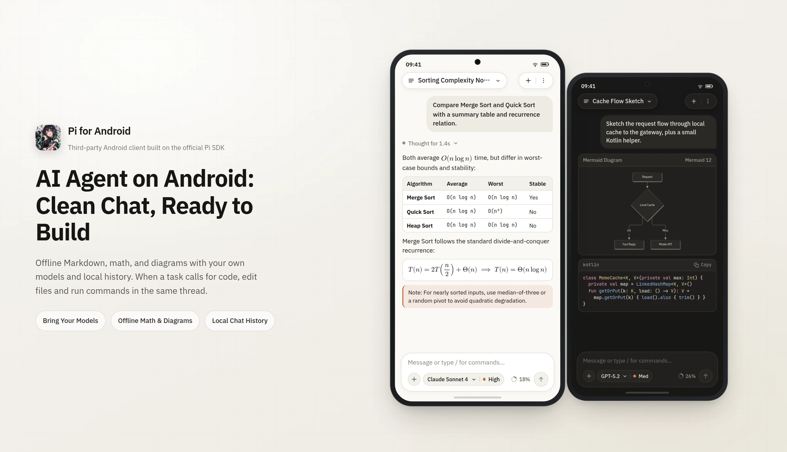
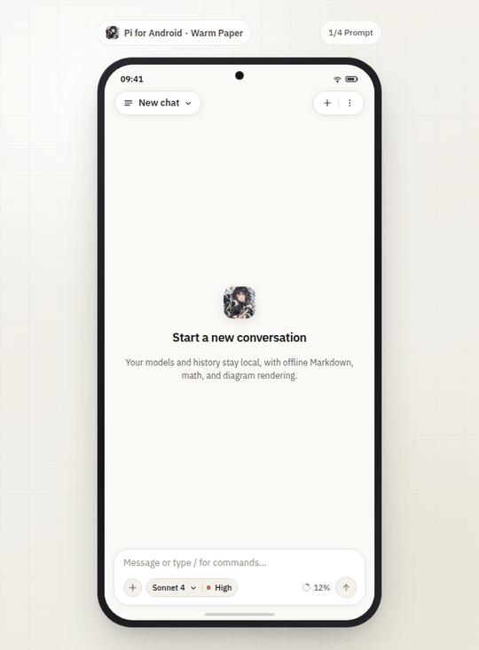
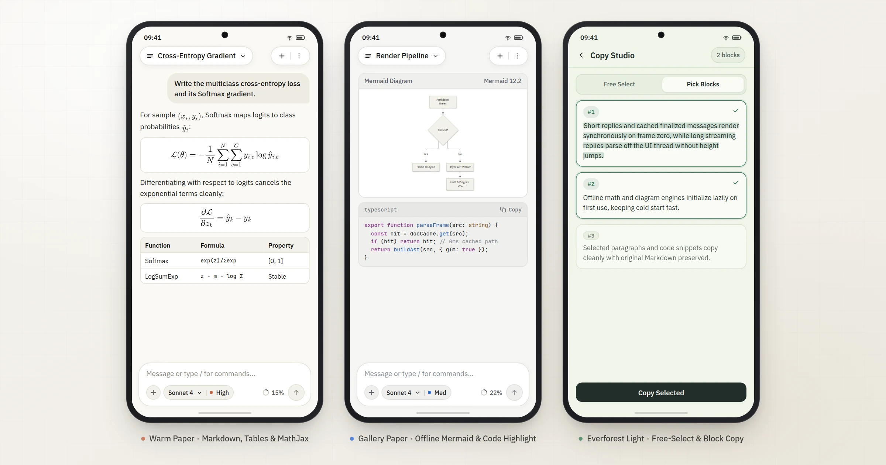
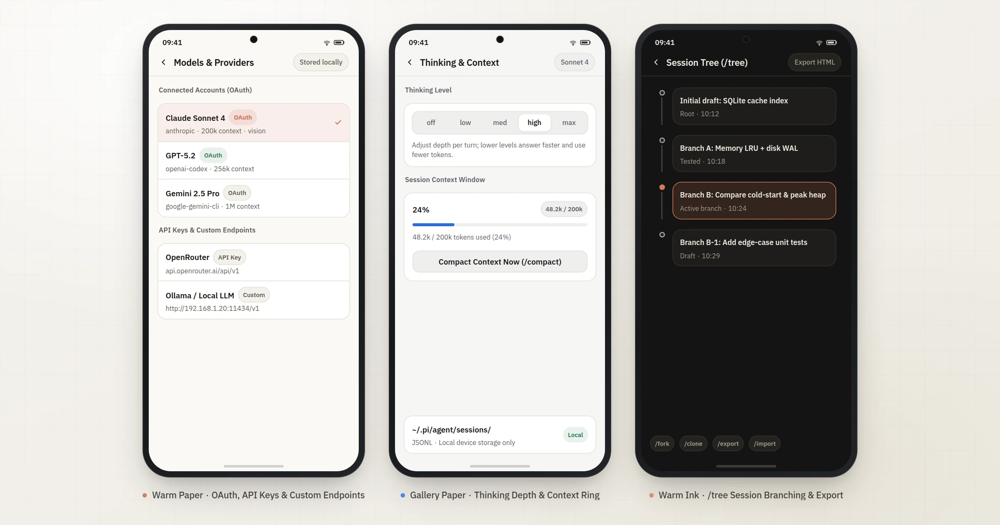
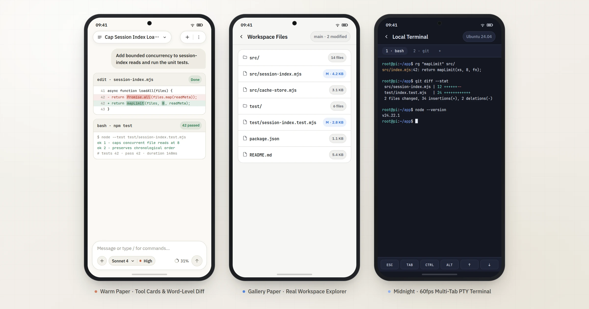
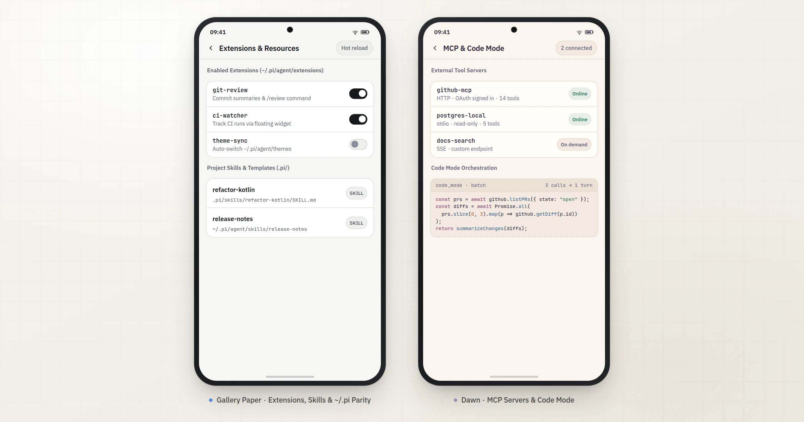
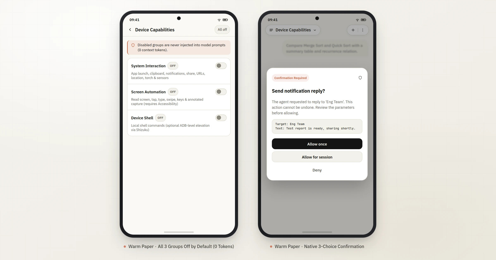
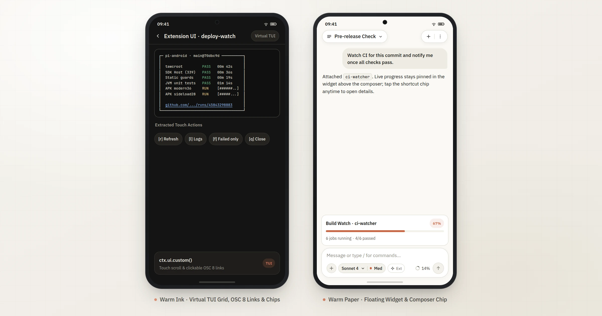
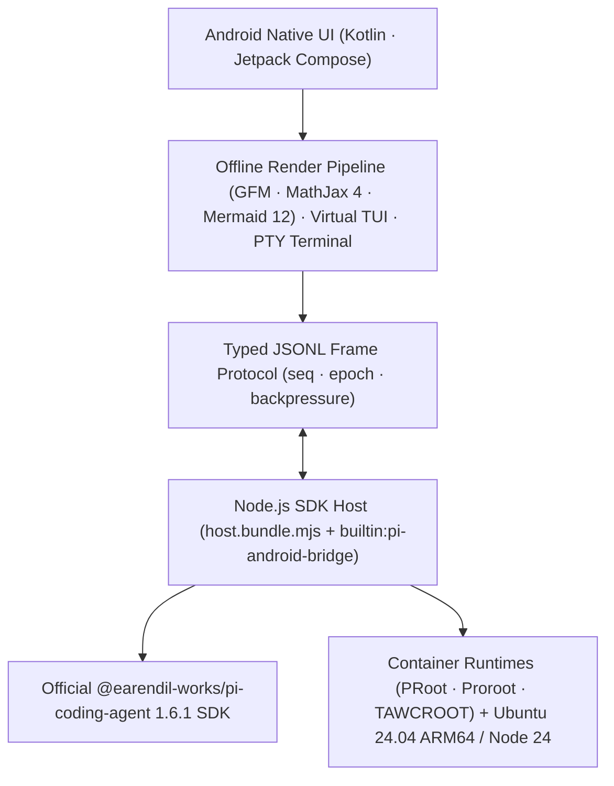

<p align="right"><a href="README.zh-CN.md">简体中文</a> · <strong>English</strong></p>

<div align="center">
<h1>Pi for Android</h1>
<p>An AI agent on your phone: clean chat, ready to build</p>
<p><sub>A third-party Android client built on the official Pi SDK (<code>@earendil-works/pi-coding-agent</code>). Not affiliated with the official Pi team.</sub></p>
<p>
<a href="https://github.com/heikeyangle-code/pi-mobile-agent/releases/latest"></a>
<a href="https://github.com/heikeyangle-code/pi-mobile-agent/releases"></a>
<a href="https://github.com/heikeyangle-code/pi-mobile-agent/actions/workflows/ci.yml"></a>
<a href="https://github.com/heikeyangle-code/pi-mobile-agent/stargazers"></a>
<a href="LICENSE"></a>

</p>
<p><a href="https://github.com/heikeyangle-code/pi-mobile-agent/releases/latest"><strong>Download Latest APK</strong></a> · <a href="#installation">Install</a> · <a href="#frequently-asked-questions">FAQ</a></p>
</div>

<picture><source media="(prefers-color-scheme: dark)" srcset="docs/assets/hero-en-dark.webp" /><source media="(prefers-color-scheme: light)" srcset="docs/assets/hero-en-light.webp" /></picture>

<p align="center"><br /><sub>16-second demo: streaming layout, offline math, and message queueing (<a href="docs/assets/demo-chat-en.mp4">MP4 video</a>).</sub></p>

<p align="center"><a href="#clean-offline-reading">Just Chat</a> · <a href="#hands-on-when-needed">Make It Build</a> · <a href="#for-developers">Under the Hood</a></p>

## What It Is

- **For everyday chat**: Use it as a clean, vendor-neutral chat app with your own model accounts or keys and local history on your phone.
- **When you need action**: Inside the same conversation, open a project folder on your device so the agent can read files, edit code with diffs, and run tests or terminal commands.
- **For tinkerers and developers**: Install Pi extensions, connect external tool servers, switch container runtimes, or build straight from source.

## Clean, Offline Reading

You get offline rendering for Markdown, tables, math formulas, diagrams, and syntax-highlighted code, with steady streaming that avoids scroll jitter. Long replies open into a dedicated copy view for free text selection or block-by-block copying.

<picture><source media="(prefers-color-scheme: dark)" srcset="docs/assets/f1-reading-en-dark.webp" /><source media="(prefers-color-scheme: light)" srcset="docs/assets/f1-reading-en-light.webp" /></picture>

## Your Models, Your History

Sign in directly with OAuth subscription accounts, add your own API keys, or point to a self-hosted compatible endpoint. Adjust thinking depth and context usage right from the composer, with conversations stored locally as files that support branching and export.

<picture><source media="(prefers-color-scheme: dark)" srcset="docs/assets/f2-models-en-dark.webp" /><source media="(prefers-color-scheme: light)" srcset="docs/assets/f2-models-en-light.webp" /></picture>

## Hands-On When Needed

A ready-to-use local Linux environment with standard developer tools is bundled inside the app. Once you pick a workspace folder, the agent can inspect files, show word-level diffs, and run commands while you jump into the built-in multi-tab terminal anytime.

<picture><source media="(prefers-color-scheme: dark)" srcset="docs/assets/f3-coding-en-dark.webp" /><source media="(prefers-color-scheme: light)" srcset="docs/assets/f3-coding-en-light.webp" /></picture>

## Full Pi Ecosystem

Because the app runs the official Pi SDK directly, desktop extensions, skills, prompt templates, and `~/.pi` directory layouts carry over to mobile. You can connect MCP (Model Context Protocol, a standard for exposing external tools and data sources) servers and use Code Mode to batch multiple tool calls in a single turn.

<picture><source media="(prefers-color-scheme: dark)" srcset="docs/assets/f4-ecosystem-en-dark.webp" /><source media="(prefers-color-scheme: light)" srcset="docs/assets/f4-ecosystem-en-light.webp" /></picture>

## Optional Device Copilot

All three phone capability groups (System Interaction, Screen Automation, and Device Shell) are disabled by default and consume zero context tokens while off. When enabled, irreversible actions such as sending replies trigger a native three-choice confirmation dialog before execution.

<picture><source media="(prefers-color-scheme: dark)" srcset="docs/assets/f5-copilot-en-dark.webp" /><source media="(prefers-color-scheme: light)" srcset="docs/assets/f5-copilot-en-light.webp" /></picture>

## Desktop TUI Extensions on Mobile

Many desktop Pi extensions draw text-based panels, progress bars, or status widgets inside a terminal. Pi for Android maps them onto your phone through a Virtual TUI (a rendering layer that turns terminal cell grids into touch-friendly native views) with touch scrolling, clickable links, and extracted quick actions.

<picture><source media="(prefers-color-scheme: dark)" srcset="docs/assets/f6-virtual-tui-en-dark.webp" /><source media="(prefers-color-scheme: light)" srcset="docs/assets/f6-virtual-tui-en-light.webp" /></picture>

## Comparison

| Aspect | Cloud Chat Wrappers | Termux + CLI pi | Pi for Android |
| :--- | :--- | :--- | :--- |
| Reading & formatting | Native UI; math/diagram support varies by vendor | Plain terminal text on a narrow screen | Native UI with offline math, diagrams, and code |
| Local files & shell | Typically file uploads only; no local runtime | Full local environment; manual setup required | Bundled Linux runtime and terminal out of the box |
| Models & history | Accounts and chat logs usually cloud-hosted | Local storage and bring-your-own models | Local storage; OAuth, API keys, and custom endpoints |
| Desktop Pi TUI extensions | Not compatible with Pi extensions | Native terminal display; awkward with soft keyboards | Virtual TUI projection with touch scroll and action chips |
| Optional device automation | Limited to standard OS share intents | Requires manual Termux API or ADB scripts | Built-in opt-in bridge, all off by default, confirm prompts |

## Installation

Requirements: Android 8.0 (API 26) or newer on an `arm64-v8a` device. No Root and no Termux required.

1. Download `pi-android-*-sideload28-arm64.apk` from [GitHub Releases](https://github.com/heikeyangle-code/pi-mobile-agent/releases/latest) and install it.
2. Open the app and wait briefly while the first launch unpacks the bundled runtime.
3. Open **Settings → Models & Providers**, sign in via OAuth or enter an API key, and start chatting (pick a project folder from the top bar menu whenever you want it to edit code).

Choosing a build: pick **`sideload28`** for everyday use (it pins `targetSdk 28` so Android 10+ allows executing the unpacked runtime reliably); `modern36` is provided for testing `targetSdk 36` behavior. Future updates install in place via Settings → App Updates without wiping your conversations or tools.

## Frequently Asked Questions

<details>
<summary>1. Do I need Root or Linux knowledge?</summary>

No. If you only want to chat, you never touch a terminal or Linux commands. Picking a project folder is only needed when you ask the agent to read or modify files.

</details>

<details>
<summary>2. Can I use it as a regular chat app and send images?</summary>

Yes. It opens straight into a clean chat view. You can attach images from your gallery or file picker (automatically resized to respect your model's image limits), while non-image files are copied into the active workspace for the agent to inspect.

</details>

<details>
<summary>3. Does it support web search?</summary>

The app does not bundle a proprietary search proxy. For live web lookup, you can use search capabilities provided by your model vendor, run CLI tools in the local environment, or connect a web-search MCP server or community extension.

</details>

<details>
<summary>4. Where are chats stored, and are they uploaded anywhere?</summary>

Sessions (JSONL files), settings, and credentials stay inside the app's local storage (`~/.pi/agent/`). There is no developer-hosted backend server; prompts go directly from your phone to the model providers or MCP servers you configure.

</details>

<details>
<summary>5. How much storage space does it need?</summary>

The APK is around 149 MB (bundling Ubuntu 24.04 ARM64 base, Node.js, Git, ripgrep, fd, and offline math/diagram engines). After first-launch extraction, plan for roughly 1 GB of free space to leave room for unpacked tools and package caches.

</details>

<details>
<summary>6. How do I upgrade without losing data?</summary>

Use **Settings → App Updates** inside the app or install a newer APK of the same build variant (such as `sideload28`) over the existing installation. Releases share a fixed sideload signing key and only replace changed runtime bundles by checksum, preserving your sessions, settings, workspaces, and installed container packages.

</details>

<details>
<summary>7. Is it compatible with desktop Pi configurations?</summary>

Yes. Because it runs the official `@earendil-works/pi-coding-agent` SDK directly, `~/.pi/agent/`, project `.pi/` folders, theme JSON files, JSONL sessions, skills, and extensions follow desktop conventions.

</details>

<details>
<summary>8. How should I choose between PRoot, Proroot, and TAWCROOT?</summary>

Stick with the default **PRoot** for broad device compatibility. Proroot (closed-source binary) and TAWCROOT (open-source single-process seccomp backend built from source in CI) are experimental options aimed at lower syscall overhead; switching runs an automated compatibility probe and falls back to PRoot if a check fails. See [docs/runtime-engines.md](docs/runtime-engines.md).

</details>

<details>
<summary>9. Are the device capabilities safe?</summary>

All three capability groups are turned off by default. Disabled groups are never injected into model prompts and do not request sensitive system permissions. Once turned on, irreversible actions require explicit confirmation via a three-choice native dialog, and you can switch any group off at any time.

</details>

<details>
<summary>10. What is the relationship to the official Pi project?</summary>

Pi for Android is an independent, community-maintained third-party Android client built on top of the published `@earendil-works/pi-coding-agent` SDK. It is not produced or endorsed by the official Pi team.

</details>

<details>
<summary>11. Why is it not on Google Play?</summary>

The recommended `sideload28` build pins `targetSdk 28` so Android 10+ allows executing unpacked Linux binaries from app storage, which does not meet Google Play's target API requirement, and uses a public fixed sideload key in the repository for seamless in-place updates. The `modern36` variant tracks `targetSdk 36` compatibility work.

</details>

## Data, Permissions, and Risks

- **Data flow**: The app ships no analytics or ad SDKs. Network traffic goes strictly to the model endpoints and MCP servers you configure, plus manual update checks against GitHub Releases.
- **Core permissions**: `INTERNET` connects to your configured providers; foreground service and wake lock keep long turns running while the screen is off; `MANAGE_EXTERNAL_STORAGE` (all files access) is requested only when you pick an external device folder as a workspace because containers bind-mount real filesystem paths; `usesCleartextTraffic` allows cleartext HTTP process-wide so Markdown `http://` images can load.
- **Optional device capability risks**: System Interaction (notifications, clipboard, location, torch, app launch), Screen Automation (Android Accessibility Service), and Device Shell (optional ADB-level elevation via Shizuku) are all disabled by default. Turning on Accessibility or Shizuku allows the agent to read screen contents or execute shell commands on your phone; prompt injection or model mistakes could cause unintended actions, so enable only what you need and review every confirmation dialog carefully.

## For Developers

<details>
<summary>Architecture, protocol docs, CI guards, building from source, and asset regeneration</summary>

### Architecture Overview



- **Technical documentation**: [Architecture](docs/sdk-host/architecture.md) · [Wire Protocol](docs/sdk-host/protocol.md) · [SDK Upgrading](docs/sdk-host/upgrading.md) · [Runtime Engines](docs/runtime-engines.md) · [AGENTS.md](AGENTS.md)
- **Automated CI and cold-start guards**: Every push runs 6 GitHub Actions jobs (`tawcroot` NDK build, `SDK Host` contract and runtime suite including cold-start `import-audit`, `Static safety guards` including 12 startup guards and i18n checks, `JVM unit tests`, `APK modern36`, and `APK sideload28`).

### Building from Source

```bash
git clone https://github.com/heikeyangle-code/pi-mobile-agent.git
cd pi-mobile-agent

# 1. Run SDK host checks, startup guards, and unit tests
node tools/sdk-host/contract.mjs
node tools/sdk-host/test.mjs
node tools/check-startup-perf.mjs
./gradlew :protocol:test :app:testDebugUnitTest

# 2. Fetch runtime bundles and assemble the Release APK
node tools/fetch-runtime.mjs
./gradlew :app:assembleRelease
```

### Regenerating README Assets

All static galleries (WebP), animated demos (GIF), and videos (MP4) in this README are generated reproducibly from code using the repository's own bundled fonts and offline MathJax 4 / Mermaid 12 engines:

```bash
# Requires Python 3, Playwright, Chromium, ffmpeg, and cwebp
python3 tools/readme-assets/render.py
```

Generator sources live in [tools/readme-assets/](tools/readme-assets/) and write to [docs/assets/](docs/assets/).

</details>

## Community and Feedback

- Report bugs or request features in [GitHub Issues](https://github.com/heikeyangle-code/pi-mobile-agent/issues).
- Follow releases and changelogs on [GitHub Releases](https://github.com/heikeyangle-code/pi-mobile-agent/releases).

## Contributing

Issues and pull requests are welcome. Before submitting changes, please read [AGENTS.md](AGENTS.md) for cold-start performance guards, rendering rules, and bilingual requirements. If you edit anything under `app/src/main/assets/guest/sdk-host/`, run `node tools/sdk-host/build-bundle.mjs` and verify that static guards and tests pass.

## License and Acknowledgements

Released under the [MIT License](LICENSE). Third-party components bundled inside the APK are distributed under their respective upstream licenses; see **Settings → Open-Source Licenses** inside the app or [app/src/main/assets/licenses/](app/src/main/assets/licenses/) for the full manifest and license texts.

Acknowledgements:

- **[@earendil-works/pi-coding-agent](https://www.npmjs.com/package/@earendil-works/pi-coding-agent)**: Core agent session, tools, extensions, and MCP runtime.
- **[Termux](https://github.com/termux)**: `terminal-emulator`, `terminal-view`, `proot`, and `libandroid-shmem`.
- **[proroot](https://github.com/coderredlab/proroot)**: Optional experimental container runtime (proprietary component redistributed unmodified; see `proroot-license.txt`).
- **[wmww/tawc](https://github.com/wmww/tawc)**: Experimental single-process `seccomp` container backend `tawcroot` (MIT).
- **Offline rendering engines**: [Mermaid](https://github.com/mermaid-js/mermaid) and [MathJax](https://github.com/mathjax/MathJax) for vector diagrams and math equations.
- **Android rendering and system libraries**: [JetBrains Markdown](https://github.com/JetBrains/markdown), [AndroidSVG](https://bigbadaboom.github.io/androidsvg/), [jsoup](https://jsoup.org/), [SnakeYAML](https://bitbucket.org/snakeyaml/snakeyaml), and [Shizuku API](https://github.com/RikkaApps/Shizuku-API).
- **Bundled fonts**: IBM Plex Sans SC, JetBrains Mono, Geist Mono, Source Han Serif CN, and LXGW WenKai.
