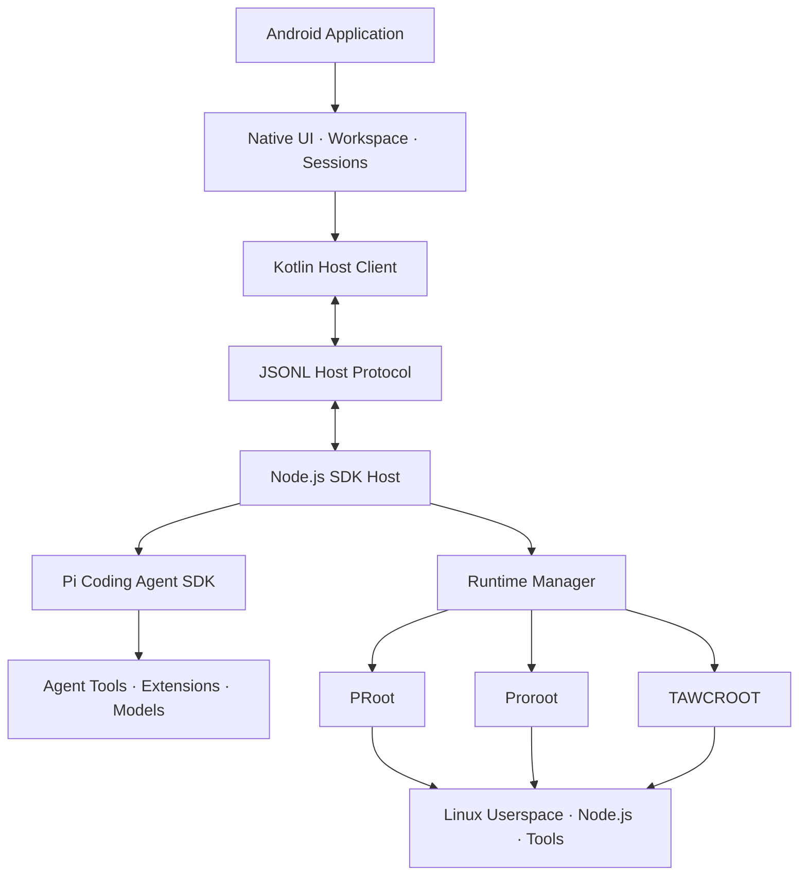

**English** · [简体中文](README.zh-CN.md)

<p align="center">
  <b>A real coding agent. Running locally on your Android device.</b>
</p>

<p align="center">
  <a href="https://github.com/heikeyangle-code/pi-android/releases">Latest Release</a> ·
  <a href="https://github.com/heikeyangle-code/pi-android/actions/workflows/ci.yml">Build Status</a> ·
  Android 8.0+ · ARM64
</p>

Pi for Android brings the Pi Coding Agent to your phone.

A native Android application with local project access, a bundled Linux environment, and three switchable runtime backends — giving you different ways to run the same coding agent directly on your device.

No root required. No separate Termux installation. No remote development machine required.

Your phone becomes the workspace.

---

## Why Pi for Android?

Pi for Android is not just another AI chat interface. It is a mobile environment for working with an actual coding agent.

The agent can explore projects, read and edit files, execute shell commands, use extensions, and continue development directly on your Android device.

- **Native Android experience** — a purpose-built interface for agent-driven development.
- **Local execution** — the agent and its tools run on your device.
- **Three switchable runtimes** — choose between PRoot, Proroot, and TAWCROOT.
- **Real project access** — work with directories and files available on your phone.
- **Upstream Pi engine** — built around the Pi Coding Agent ecosystem rather than an independently reinvented agent engine.

## Features

### Three runtime backends. One coding environment.

Different Android runtime approaches have different trade-offs in execution speed, compatibility, and stability.

Pi for Android supports three runtime choices:

| Runtime | Role |
| :--- | :--- |
| **PRoot** | Traditional user-space Linux execution, serving as the compatibility-oriented baseline. |
| **Proroot** | An alternative runtime designed to reduce the overhead associated with traditional PRoot execution. |
| **TAWCROOT** | A third runtime option offering another execution path. Its stability is still being improved. |

The two alternative runtimes can offer better performance than traditional PRoot in supported workloads.

Runtime performance depends on the device, workload, and compatibility requirements. No single backend is guaranteed to be the fastest or most suitable in every situation.

Choose the runtime that works best for your device and workload.

### A coding agent, not just a chatbot

Work with an agent that can:

- Inspect project files.
- Search through source code.
- Execute shell commands.
- Create and edit files.
- Use tools and extensions.
- Explain and report its changes.

Tool activity and results are presented as structured conversation elements, making it easier to understand what the agent is doing.

### A Linux environment on your phone

No root access or separate Termux installation is required.

The app provisions a local Linux userspace and Node.js environment. The pinned runtime artifacts include:

- Ubuntu 24.04 ARM64 userspace.
- Node.js 24.22.1.
- Git.
- ripgrep.
- fd.
- Runtime-specific components for the supported execution backends.

### Work with real projects

Choose a directory on your device and use it as a project workspace.

Browse files, inspect changes, edit code, and let the agent work with the same local project.

### Understand every change

Tool calls and their outputs are presented in dedicated UI components.

- Inspect tool execution results.
- Review code changes through diff-oriented views.
- Follow the agent's progress in the conversation.
- Expand or collapse detailed reasoning and tool output where supported.

### Sessions that preserve context

Continue previous work, navigate conversation history, and use branching workflows supported by the Pi engine.

### Extend the agent

Bring the Pi ecosystem into a mobile environment.

The project supports Pi-oriented customization through extensions, skills, prompts, and themes, with the goal of preserving compatibility with the upstream agent architecture.

### Configure your own models

Use supported provider presets or configure a custom OpenAI-compatible endpoint.

The application follows the upstream Pi configuration model rather than maintaining an unrelated model backend.

---

## Installation

### Requirements

| Requirement | Support |
| :--- | :--- |
| Android | 8.0 (API 26) or later |
| CPU architecture | ARM64 / arm64-v8a |
| Root access | Not required |
| Termux | Not required |
| Internet | Required for model-provider requests |

### Download

1. Open the [Releases](https://github.com/heikeyangle-code/pi-android/releases) page.
2. Download the APK.
3. Install it on your Android device.
4. Launch the app and allow the runtime to initialize.
5. Select a runtime and configure your model provider.
6. Open a project and start a session.

The first launch may take longer while runtime components are provisioned.

> **Note:** The bundled runtime currently targets ARM64 Android devices. Other CPU architectures are not supported.

---

## Architecture

Pi for Android combines a native Android application with a local Node.js agent host and switchable runtime backends.

The Android application provides the user interface, workspace access, runtime management, and lifecycle integration.

The Node.js host runs the Pi agent integration and communicates with the Android application through a structured protocol.



### Why the SDK Host?

The SDK Host provides a dedicated Node.js process that owns the agent integration and exposes a structured interface to the Android application.

This separates the Android presentation layer from the agent's internal implementation and provides a cleaner foundation for future capabilities.

The host protocol uses JSON Lines, with typed commands, events, state updates, and UI interaction requests.

The SDK Host integration has been merged into the main branch. The broader migration and integration work continues to evolve; not every remaining service should be assumed to have completed the transition.

See [`docs/sdk-host/`](docs/sdk-host/README.md) for implementation details and migration notes.

---

## Technology Stack

| Layer | Technology |
| :--- | :--- |
| Application | Native Android |
| UI | Kotlin · Jetpack Compose |
| Agent engine | [Pi Coding Agent](https://github.com/earendil-works/pi) |
| Agent integration | Pi SDK · Node.js Host |
| Runtime backends | PRoot · Proroot · TAWCROOT |
| Linux userspace | Ubuntu 24.04 ARM64 |
| JavaScript runtime | Node.js 24.22.1 |
| Host protocol | JSONL |
| Build system | Gradle · Android Gradle Plugin |

### Upstream engine

The project pins:

- `@earendil-works/pi-coding-agent`: **1.5.0**

The engine version is managed through the repository's dependency and runtime tooling.

The goal is to keep the upstream Pi agent engine intact and build the Android experience around its public capabilities.

---

## Development

### Clone the repository

```bash
git clone https://github.com/heikeyangle-code/pi-android.git
cd pi-android
```

### Build the APK

```bash
./gradlew :app:assembleRelease
```

### Run checks

```bash
./gradlew :rpc:test

node tools/pi-contract.mjs

node tools/sdk-host/contract.mjs
node tools/sdk-host/test.mjs

bash tools/run-app-pure-checks.sh
```

For SDK Host implementation details, see:

- [`docs/sdk-host/README.md`](docs/sdk-host/README.md)
- [`docs/sdk-host/architecture.md`](docs/sdk-host/architecture.md)
- [`docs/sdk-host/protocol.md`](docs/sdk-host/protocol.md)
- [`docs/sdk-host/migration.md`](docs/sdk-host/migration.md)

---

## Project Status

Pi for Android is actively developed.

The project includes a native Android application, local agent execution, three runtime options, project-oriented workflows, and SDK Host integration.

Current development priorities include:

- Improving runtime compatibility and stability.
- Refining runtime selection and switching workflows.
- Improving TAWCROOT stability.
- Continuing SDK Host integration.
- Improving extension UI support.
- Strengthening session and workspace workflows.
- Expanding device-level testing across supported Android versions and runtime backends.

For current work and known issues, visit [GitHub Issues](https://github.com/heikeyangle-code/pi-android/issues).

---

## Contributing

Contributions, bug reports, ideas, and technical discussions are welcome.

- Found a bug? [Open an issue](https://github.com/heikeyangle-code/pi-android/issues).
- Want to contribute code? Fork the repository and submit a pull request.

Please include relevant tests when modifying runtime, protocol, or agent integration code.

---

## Support the Project

If you find Pi for Android useful, consider giving the project a Star.

Stars help other developers discover the project and encourage continued development.

**A real coding agent. Three runtime choices. Your Android device.**

---

## Acknowledgements

Pi for Android builds on the work of several upstream projects:

- [Pi Coding Agent](https://github.com/earendil-works/pi) — the agent engine.
- [Node.js](https://nodejs.org/) — the JavaScript runtime.
- [Ubuntu](https://ubuntu.com/) — the Linux userspace.
- [PRoot](https://proot-me.github.io/) — user-space Linux execution.
- [ripgrep](https://github.com/BurntSushi/ripgrep) — fast code search.
- [fd](https://github.com/sharkdp/fd) — convenient file discovery.
- [Android](https://developer.android.com/) — the native application platform.

PRoot, Proroot, and TAWCROOT retain their respective upstream licenses and notices. Each third-party component retains its own license and copyright.

## License

The application source code is distributed under the MIT License.

Third-party components bundled with the application retain their respective licenses. See [`app/src/main/assets/licenses/`](app/src/main/assets/licenses/) for license texts and component notices.
