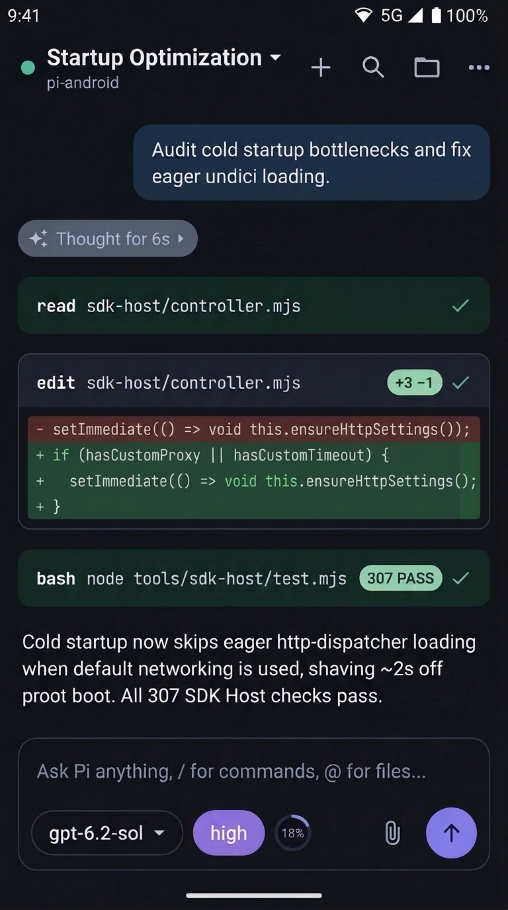
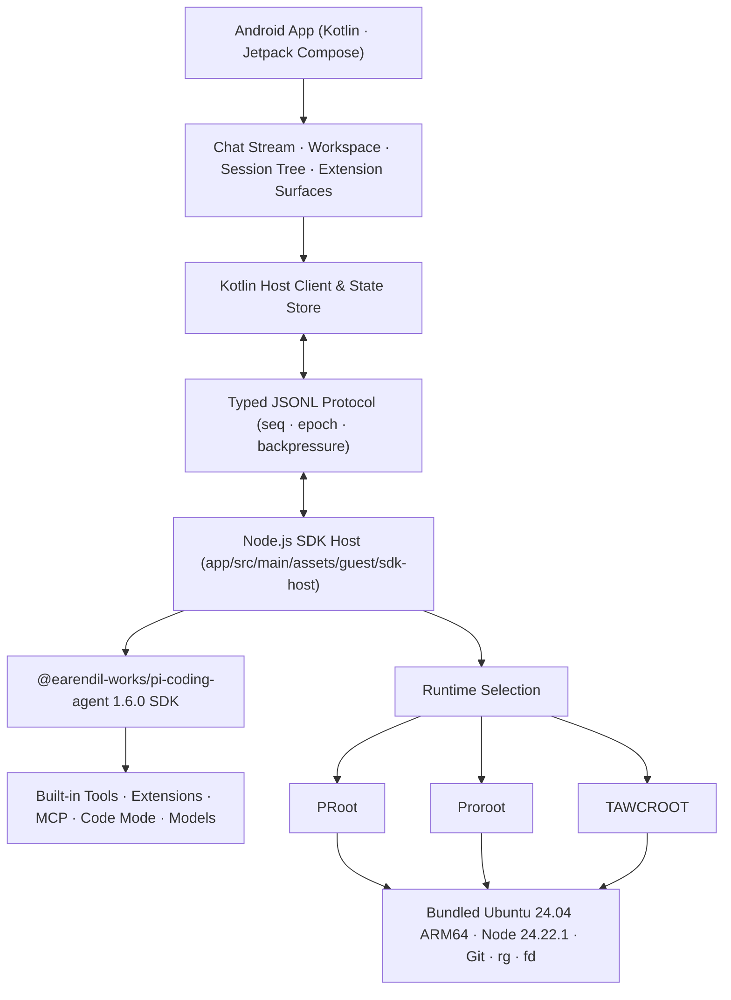

**English** · [简体中文](README.zh-CN.md)

<p align="center">
  
</p>

<h1 align="center">Pi for Android</h1>

<p align="center">
  <b>A real Linux coding agent in your pocket.</b><br />
  Native Jetpack Compose · Official Pi 1.6.0 SDK · Three Switchable Runtimes · Zero Root, Zero Termux
</p>

<p align="center">
  
  
  
  
  
</p>

<p align="center">
  <a href="https://github.com/heikeyangle-code/pi-android/releases">Latest Release</a> ·
  <a href="https://github.com/heikeyangle-code/pi-android/actions/workflows/ci.yml">Build Status</a> ·
  <a href="https://github.com/heikeyangle-code/pi-android/issues">Issues</a>
</p>

---

### Turn your Android phone into a local coding workstation.

Most mobile AI apps are just thin chat boxes over an API. **Pi for Android** ships the real **[Pi Coding Agent](https://github.com/earendil-works/pi)** inside a bundled **Ubuntu 24.04 ARM64** userspace with **Node.js 24**, **Git**, **ripgrep**, and **fd** — driven by a native Android Jetpack Compose interface.

No root. No Termux setup. No SSH or cloud sandbox. Open any folder on your phone and let your agent read, search, edit, run commands, manage Git, use MCP servers, and even invoke interactive TUI extensions right on device.

<table align="center">
  <tr>
    <td align="center" width="50%">
      <br />
      <sub><b>Structured tool cards &amp; inline diffs</b> — every shell command, file read, and code edit stays readable at a glance.</sub>
    </td>
    <td align="center" width="50%">
      <br />
      <sub><b>Real local workspace</b> — browse directories on your phone with session edits surfaced right at the top.</sub>
    </td>
  </tr>
  <tr>
    <td align="center" width="50%">
      <br />
      <sub><b>Rich native rendering</b> — syntax-highlighted code, LaTeX math, Mermaid diagrams, and full-screen image viewer.</sub>
    </td>
    <td align="center" width="50%">
      <br />
      <sub><b>Full Pi provider ecosystem</b> — 7 OAuth subscription logins, 35+ API providers, or any OpenAI-compatible endpoint.</sub>
    </td>
  </tr>
</table>

---

## Highlights

### 1. Real Local Linux & Three Switchable Runtimes
No Termux, no manual bootstrap scripts, no root required. First launch unpacks a deterministic, per-payload versioned Linux runtime (**Ubuntu 24.04 ARM64 · Node.js 24.22.1 · Git · ripgrep · fd · Pi 1.6.0**) — and future upgrades only refresh changed payloads without wiping packages you installed inside the guest.

Pick the execution backend that works best on your device:

| Runtime | Characteristics |
| :--- | :--- |
| **PRoot** | Proven user-space syscall translation (Termux build). The compatibility baseline. |
| **Proroot** | Alternative LD_PRELOAD/linker runtime designed to slash PRoot's syscall overhead. |
| **TAWCROOT** | Single-process `seccomp` runtime built from pinned upstream source (experimental, actively hardened). |

### 2. Built Directly on the Official Pi 1.6.0 SDK — Not a Fork
Instead of scraping CLI stdout or reinventing an agent loop, Pi for Android runs a dedicated **Node.js SDK Host** over a typed, backpressured JSONL protocol:

- **Fast cold start**: loads Pi's bundled SDK (`dist/bundle/index.js`) with lazy module loading and incremental session indexing.
- **Full upstream capabilities**: `gpt-6.2-sol` / `gpt-6.2-astra`, Claude, Gemini, Qwen Token Plan, per-model thinking levels, live context & cost telemetry, Code Mode, Tool Search, and MCP servers.
- **100% Official Pi Theme compatibility**: reads official Pi theme JSONs (including `okhsl()` / `oklch()` color spaces) with automatic contrast calculation across light and dark modes.
- **Native mobile TUI surfaces**: extensions that spawn custom interactive panels, overlays, widgets, status bars, autocompletes, or audio bells work directly on touchscreens with responsive width-fitting, touch/mouse dispatch, and soft/hardware keyboard support.

### 3. Designed for Mobile Flow & Speed
- **Calm, borderless reading stream**: quiet single-line thinking indicator, clean tonal tool cards, syntax highlighting powered by Pi's own guest highlighter, LaTeX math, Mermaid diagrams, and expandable diffs.
- **Multi-source attachments**: attach multiple photos or files, paste images directly from the clipboard, or `@`-mention files from your workspace — with OOM-safe downsampling aligned with Pi's exact image budget and per-model image limits.
- **Official `/tree` & `/resume` parity**: navigate branching session trees with Pi's 5 filter modes, fork from any message, and full-text search across workspaces with instant cached listings.
- **Smart memory management**: compact SHA-256 image cache keys and lifecycle-aware memory trimming keep long, media-heavy sessions smooth on mobile RAM.

### 4. Opt-in Android Device Capabilities (Strict Zero-Token When Off)
When you explicitly enable them in **设置 → 设备能力**, your agent can bridge into Android itself — screen automation (Accessibility), notifications, clipboard, location/camera, and Shizuku / device shell — guarded by:
- **0-token overhead when disabled**: tools are only registered in the model's active tool list when turned on.
- **Per-rule confirmation gate**: irreversible actions (`pm uninstall`, `pm clear`, `dd`, stopping apps, etc.) always prompt you before running.

### 5. Full Pi Extension & Mobile TUI Compatibility Engine (The Hard Part, Solved)
Running desktop terminal extensions on a touchscreen phone is usually where mobile clients give up and say "CLI only". **Pi for Android** implements a complete, real-SDK compatibility engine so upstream extensions, custom renderers, and even interactive terminal UIs work natively on Android:

- **Virtual TUI Surface Projection (`ui/surfaces.mjs` → Jetpack Compose)**:
  - Extensions calling `ctx.ui.custom()`, `setWidget()`, `setHeader()`, `setFooter()`, or `tui.showOverlay()` mount real Pi TUI components into an in-host virtual terminal surface.
  - Full `OverlayHandle` (`hide` / `setHidden` / `focus` / `unfocus` / `getBounds`) and `OverlayOptions` (`visible(w, h)`, `nonCapturing`, anchors) lifecycle parity.
  - **Responsive mobile width-fitting**: automatically scales 80-column desktop TUI layouts to fit your phone viewport and reports real columns back via `ui.resize`, with full `handleInput` (soft + hardware keyboard via official `KeybindingsManager`) and `handleMouse` (touch-to-mouse coordinate mapping).
  - **Terminal control sequence bridge**: strips zero-width `CURSOR_MARKER`, converts `FAKE_CURSOR` to inverse SGR, and intercepts `BEL` (`\x07`) + `OSC 777 / 99 / 9` + `OSC 0/2` + `OSC 9;4` — turning terminal notifications, window titles, progress bars, and even TUI game sound bells into native Android feedback.
- **1:1 Official Extension Renderers & Pipelines (`commands/catalog.mjs`)**:
  - Custom tool cards run through Pi's real `ToolExecutionComponent` (`resolveToolRenderers`), sharing per-call renderer state, `details`, `renderShell: "self"`, and debounced `requestRender` invalidation.
  - Full support for `registerMessageRenderer` (`CustomMessageComponent`), `registerEntryRenderer` (`CustomEntryComponent`), `registerMarkdownTransformer`, `addAutocompleteProvider`, `onTerminalInput`, `registerFlag`, and `FooterDataProvider` (live git branch & provider count).
- **Zero-Compromise Bundled Extensions (`app/src/main/assets/pi-extensions/`)**:
  - **`pi-highlight`**: exposes Pi's own guest `highlight.js` + `lovely-mermaid` layout engine over an authenticated local loopback service so syntax highlighting and Mermaid rendering stay 100% faithful to Pi without shipping a second JS engine on Android.
  - **`pi-android-bridge` & `pi-android-permission-gate`**: bridges opt-in Android device capabilities into Pi's tool system with strict **0-token overhead when disabled** and per-rule user confirmation dialogs for irreversible actions.
- **Unified Transparent Resource Hub (**设置 → 扩展与资源**)**:
  - Manage extensions, skills, prompt templates, themes, context files, npm/git packages, MCP servers, and project trust in one place — every item shows its real file path and scope (project vs. global), with zero private store lock-in.

---

## Installation

### Requirements

| Requirement | Support |
| :--- | :--- |
| Android | 8.0 (API 26) or later |
| CPU architecture | ARM64 (`arm64-v8a`) |
| Root / Termux | **Not required** |
| Internet | Required for model API requests & package installs |

### Quick Start

1. Download the latest APK from [GitHub Releases](https://github.com/heikeyangle-code/pi-android/releases).
2. Install it on your Android device (signed with a consistent sideload key so future versions upgrade in place).
3. Launch the app and wait for the bundled Linux + Pi runtime to provision on first boot.
4. Connect a provider in **设置 → 模型与供应商** (OAuth subscription login, API key, or custom OpenAI-compatible endpoint).
5. Open any local folder as your workspace and start coding.

---

## Architecture



### Stack at a Glance

| Layer | Technology |
| :--- | :--- |
| App & UI | Native Android · Kotlin · Jetpack Compose · Material 3 |
| Agent Engine | [`@earendil-works/pi-coding-agent`](https://github.com/earendil-works/pi) **`1.6.0`** (deterministic lockfile) |
| Host Bridge | Node.js SDK Host · Typed JSONL (`seq`, `epoch`, backpressure) |
| Runtimes | PRoot (Termux) · Proroot · TAWCROOT |
| Bundled Userspace | Ubuntu 24.04 ARM64 · Node.js 24.22.1 · Git 2.43 · ripgrep 15.2 · fd 10.2 |
| Build & CI | Gradle · AGP · 6 automated GitHub Actions jobs |

Docs:
- [`docs/sdk-host/architecture.md`](docs/sdk-host/architecture.md) — SDK Host architecture & lifecycle
- [`docs/sdk-host/protocol.md`](docs/sdk-host/protocol.md) — Wire protocol v1 specification
- [`docs/sdk-host/upgrading.md`](docs/sdk-host/upgrading.md) — 6-gate upstream Pi upgrade SOP (`tools/pi-upgrade-audit.mjs`)
- [`docs/runtime-engines.md`](docs/runtime-engines.md) — PRoot / Proroot / TAWCROOT comparison

---

## Development & Verification

```bash
git clone https://github.com/heikeyangle-code/pi-android.git
cd pi-android

# Check for upstream Pi updates & audit all 9 integration seams
node tools/pi-upgrade-audit.mjs --check-only

# Run real Pi SDK contract & 299 host integration checks
node tools/sdk-host/contract.mjs
node tools/sdk-host/test.mjs

# Run protocol JVM tests & build release APK
./gradlew :rpc:test
node tools/fetch-runtime.mjs
./gradlew :app:assembleRelease
```

### What CI Proves (and Doesn't)
Every push runs 6 GitHub Actions checks: `:rpc` JVM unit tests, real Pi SDK contract & 3× SDK Host suites (`bundle`, `--no-bundle`, `--scandir-fix`), Kotlin/Android API static guards, TAWCROOT NDK build, and dual signed APKs (`sideload28` + `modern36`). Green CI proves compilation, real SDK contract parity, and clean signed APK packaging; device-level runtime switching and hardware permissions are verified on real Android phones.

### Interface Language & Contributing
The app UI is currently **Chinese only** (copy lives directly in Compose code rather than `strings.xml`). Extracting strings for localization, improving runtime stability across more Android devices, and refining docs are all welcome contributions — open an [Issue](https://github.com/heikeyangle-code/pi-android/issues) or submit a PR!

---

## Acknowledgements & License

Pi for Android stands on the shoulders of:
[Pi Coding Agent](https://github.com/earendil-works/pi) · [Node.js](https://nodejs.org/) · [Ubuntu](https://ubuntu.com/) · [PRoot (Termux)](https://github.com/termux/proot) · [Proroot](https://github.com/coderredlab/proroot) · [TAWCROOT](https://github.com/wmww/tawc) (MIT, © Sophie Winter) · [ripgrep](https://github.com/BurntSushi/ripgrep) · [fd](https://github.com/sharkdp/fd) · [JetBrains Mono](https://github.com/JetBrains/JetBrainsMono) · [Source Han Serif CN](https://github.com/adobe-fonts/source-han-serif)

Application source code is licensed under **MIT**. Bundled third-party components retain their respective licenses (PRoot from Termux, Proroot proprietary unmodified binaries, TAWCROOT MIT, etc.); full license texts and notices are shipped in [`app/src/main/assets/licenses/`](app/src/main/assets/licenses/).
