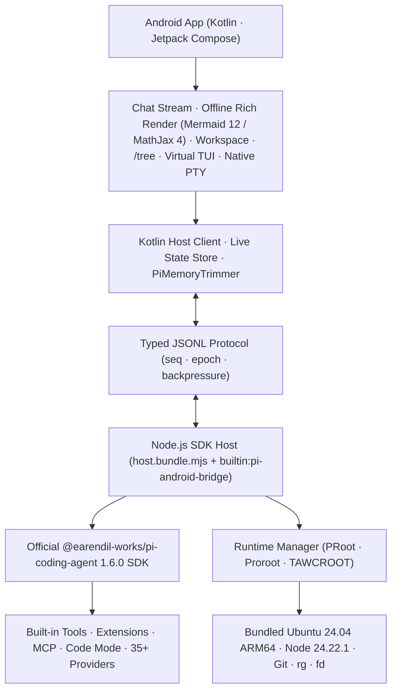

**English** · [简体中文](README.zh-CN.md)

<p align="center">
  
</p>

<h1 align="center">Pi for Android</h1>

<p align="center">
  <b>The Full-Power Native AI Coding Agent Workstation on Android.</b><br />
  Not a toy chat wrapper. Not a fragile SSH client. Zero Root. Zero Termux.<br />
  Install one APK and turn your phone into a real local Linux + Pi 1.6.0 engineering workstation.
</p>

<p align="center">
  
  
  
  
  
  
  
</p>

<p align="center">
  <a href="https://github.com/heikeyangle-code/pi-android/releases"><b>⬇ Download Latest APK</b></a> ·
  <a href="#see-it-in-action">Showcase</a> ·
  <a href="#30-second-quick-start">Quick Start</a> ·
  <a href="#under-the-hood-hardcore-engineering">Architecture</a> ·
  <a href="https://github.com/heikeyangle-code/pi-android/actions/workflows/ci.yml">CI Status</a>
</p>

---

## See It in Action

<table align="center">
  <tr>
    <td align="center" width="50%">
      <br />
      <sub><b>Pocket Code Review &amp; Agentic Editing</b> — real <code>read</code> / <code>edit</code> / <code>bash</code> tool cards, reverse-video intra-line word diffs, thinking summaries, and a floating composer dock.</sub>
    </td>
    <td align="center" width="50%">
      <br />
      <sub><b>Desktop-Grade Offline Rich Rendering</b> — native <b>Mermaid 12.2</b> diagrams, <b>MathJax 4.1</b> inline &amp; display TeX SVG, and <code>&lt;1 ms</code> syntax highlighting for 35+ languages.</sub>
    </td>
  </tr>
  <tr>
    <td align="center" width="50%">
      <br />
      <sub><b>Desktop Pi Extensions &amp; Mobile Virtual TUI</b> — real <code>ctx.ui.custom()</code> cell-grid surfaces, MCP &amp; Code Mode orchestration, clickable OSC 8 links, finger scroll, and quick-key controls.</sub>
    </td>
    <td align="center" width="50%">
      <br />
      <sub><b>Studio Light Theme &amp; Native GFM Markdown</b> — crisp light/dark &amp; custom Pi JSON themes with native GFM alerts, tables, task checklists, blockquotes, and zero-flash cached AST rendering.</sub>
    </td>
  </tr>
</table>

---

## Why Developers Switch to Pi for Android

Most mobile AI coding apps are cloud chat wrappers that can't touch a real repository, run a test suite, or make a commit. SSH and Termux force you to fight tiny fonts, broken IMEs, and dropped sessions the moment your connection blips.

**Pi for Android puts the real workstation directly on your phone:** a complete local Linux development environment, the **100% official Pi 1.6.0 Coding Agent SDK**, a desktop-grade offline rendering engine, a native multi-tab PTY terminal, and a Jetpack Compose UI engineered for one-handed mobile workflows.

- **Real On-Device Engineering — Zero Root, Zero Termux**: Built-in **Ubuntu 24.04 ARM64 · Node.js 24.22.1 · Git · `rg` · `fd`** + **60fps native multi-tab PTY Terminal** (`Termux terminal-emulator`). Open any local folder on your phone, search code in milliseconds, inspect word-level diffs, run tests, and `git commit` — even offline.
- **100% Official Pi 1.6.0 Ecosystem**: Direct SDK execution with zero forked semantics — run desktop Pi extensions, **MCP servers**, **Code Mode** multi-tool orchestration, `/tree` session branching, `/export` & `/import`, and drop in your desktop `~/.pi` configs and themes with 100% parity.
- **Total Model Freedom — Zero Lock-in, Zero Markup**: Sign in with **7 OAuth subscription providers**, pick from **35+ presets (1,698+ models)**, or connect any OpenAI-compatible / local endpoint. Full reasoning control (`off` → `max`), scoped models, and manual/auto context compaction.
- **Desktop-Class Mobile Reading & Copy Studio**: Offline **Mermaid 12.2** (20+ diagram families with pinch-to-zoom & fullscreen), **MathJax 4.1** inline & display LaTeX, `<1 ms` syntax highlighting for 35+ languages, intra-line word diffs, interactive SVG / HTML / JSON / YAML / CSV cards, and a full-screen **Free-Select + 1-Tap Block-Pick Copy Studio**.
- **Industry-First Mobile Virtual TUI Engine**: Desktop Pi extensions using `ctx.ui.custom()`, floating HUDs, widgets, progress bars, clickable OSC 8 links, and ringer-aware terminal bells project natively onto your touchscreen with natural finger scrolling and adaptive quick-key controls.
- **Optional Android Device Copilot & In-App Updater**: Opt in to Accessibility automation, Notifications, Clipboard, Location, Camera, App Control, or Shizuku Shell (**strictly 0 prompt tokens when disabled**), plus 1-tap verified in-app APK upgrades directly from GitHub Releases.

---

## How Pi for Android Compares

| Capability | Mobile AI Chat Apps | Termux / SSH | **Pi for Android** |
| :--- | :---: | :---: | :---: |
| **Local Linux + Node 24 + Git + `rg` + `fd` + PTY** | ❌ Cloud chat only | ⚠️ Hours of manual setup | ✅ **Built-in · Multi-tab 60fps PTY · Zero Root** |
| **Mobile-native diffs, Mermaid 12 & MathJax 4** | ⚠️ Plain bubbles | ❌ Wall of raw ANSI | ✅ **Word diffs · 20+ diagrams · Offline LaTeX** |
| **Desktop Pi extensions & interactive TUIs** | ❌ Unsupported | ⚠️ Painful soft keyboard | ✅ **Native Virtual TUI + touch scroll + OSC 8** |
| **Models, MCP & Code Mode ecosystem** | ❌ Closed / locked | ✅ CLI only | ✅ **100% Official Pi 1.6.0 · 7 OAuth · 35+ providers** |
| **Optional Android device automation** | ❌ Impossible | ⚠️ Fragile scripts | ✅ **Opt-in `builtin:pi-android-bridge` · 0 tokens off** |

---

## 30-Second Quick Start

| Requirement | Support |
| :--- | :--- |
| **Android** | Android 8.0 (API 26) or later |
| **ABI** | ARM64 (`arm64-v8a`) |
| **Root / Termux** | **Not required** |
| **Upgrades** | Stable sideload signature + built-in **Settings → App Update** — install over older versions with zero data loss |

1. Download the latest `pi-android-*-sideload28-arm64.apk` from **[GitHub Releases](https://github.com/heikeyangle-code/pi-android/releases)** (use `modern36` if testing Android 15/16 targetSdk 36).
2. Install and open — first launch automatically unpacks the digest-verified local Linux & Node.js runtime.
3. Connect any model in **Settings → Models & Providers** (OAuth subscription login, API key, or any custom endpoint).
4. Pick any folder on your phone and start shipping.

---

## Under the Hood: Hardcore Engineering

### 1. 100% Official Pi 1.6.0 SDK + Native Virtual TUI Surface Engine
- **Single-file SDK Host (`host.bundle.mjs`)**: Drives `@earendil-works/pi-coding-agent` directly over a typed, epoch-isolated JSONL protocol with explicit backpressure — 100% compatible with desktop `~/.pi/agent/` & `.pi/` layouts.
- **Complete Slash Command & SDK Parity**: Native mobile closures for `/model`, `/thinking`, `/tree`, `/fork`, `/clone`, `/export` (`exportToHtml` / `exportToJsonl`), `/import [path]`, `/compact`, `/reload`, `/trust` (`ProjectTrustHost`), `/login`, `/logout`, `/changelog`, and all extension commands & shortcuts.
- **Virtual TUI Projection (`ui/surfaces.mjs` → Jetpack Compose)**: Extensions calling `ctx.ui.custom()`, `setWidget()`, `setHeader()`, `setFooter()`, or `tui.showOverlay()` mount natively with `OverlayHandle`, `Focusable`, responsive column fit, clickable **OSC 8 hyperlinks**, natural touch scrolling (`TuiMouseEvent` + `↑/↓` fallback), `KeybindingsManager`, and ringer-aware terminal bells (`BEL` / `OSC 9;4` / `OSC 777`).
- **1:1 Official Extension Renderers**: Extension and MCP tool cards render via Pi's own `ToolExecutionComponent` (`resolveToolRenderers`) with live theme palette + `theme.name` sync and hot reload.

### 2. Three Switchable Linux Runtimes & Native Termux PTY Terminal
First boot unpacks a deterministic, digest-verified environment (**Ubuntu 24.04 ARM64 · Node.js 24.22.1 · Git 2.43 · ripgrep 15.2 · fd 10.2 · Pi 1.6.0**). APK upgrades diff per-payload digests and **only refresh changed payloads**, preserving every package you installed inside the guest.

| Runtime | Engineering Characteristics |
| :--- | :--- |
| **PRoot** | Battle-tested user-space syscall translation (Termux build) — maximum ROM compatibility. |
| **Proroot** | Custom dynamic linker + in-process hook runtime cutting PRoot syscall overhead. |
| **TAWCROOT** | Single-process `seccomp` backend compiled from pinned NDK source for near-native speed. |

- **Native Multi-Tab PTY Terminal**: Built on real kernel `forkpty` / `TIOCSWINSZ` / `SIGWINCH` via `libtermux.so` + 60fps Canvas `TerminalView`, persistent background tabs, pinch-to-zoom font sizing, full CJK IME support, and a customizable 2×8 extra-keys bar.

### 3. Native Offline Rich-Rendering & Zero-Jitter Streaming Pipeline
- **Mermaid 12.2.0 Chromium/Skia High-DPI Engine**: Renders 20+ Mermaid 12 diagram families with viewport-locked DPR scaling, pixel auto-trim, automatic software-layer retry, pinch-to-zoom, and 1-tap fullscreen viewer.
- **MathJax 4.1.3 Inline & Display LaTeX**: Bundled 16 core dynamic SVG font chunks + graceful unbundled fallback for `$...$`, `\(...\)`, `\[...\]`, `$$...$$`, `math` fences, and standalone `\begin{aligned/equation/align/gather/cases/matrix}` environments — with CJK adjacency & currency protection.
- **Zero-Jitter Streaming & Tail-Follow**: Dual-path JetBrains GFM AST parser (`Channel.CONFLATED` off-main-thread + frame-0 sync for cached/short blocks), `<1 ms` 35+ language highlighter, rock-solid `TailFollow` (preserved even when expanding/collapsing tool or thinking cards), `RowHeightCache`, and bounded LRU caches wired into `PiMemoryTrimmer`.
- **100% Official Pi Theme Parity**: Full `okhsl()` / `oklch()` parsing with automatic WCAG contrast floors, live Appearance preview, JSON import, and zero-restart EN/中文 switching.

### 4. Sub-Second Cold Start & 12 Automated Performance Invariants
Enforced on every commit by `tools/check-startup-perf.mjs` and runtime `import-audit`: single-file `host.bundle.mjs`, zero cold-start `jiti` / `Babel` / `undici` / `WebView` initialization, zero-RTT `host.ready` + `session.open` snapshots, `planDirect` Node spawn (no `/bin/bash -c`), parallel pre-spawn I/O, and APK stamp fast-paths.

### 5. Opt-in Android Device Bridge (`builtin:pi-android-bridge`)
Registered via Pi SDK's native `builtin: true, replaceable: true` extension mechanism (**Settings → Device Capabilities**):
- **3 Focused Capability Groups**: Screen Automation (Accessibility), System & Hardware (Notifications, Clipboard, Location, Camera, App Control), and Device Shell (Shizuku).
- **Zero-Token & Fail-Safe**: Disabled tools are never injected into the model context (**0 tokens**); irreversible actions enforce a native 3-choice confirmation dialog.

---

## System Architecture & CI Verification



Every commit is gated by **6 automated GitHub Actions CI jobs** (`tawcroot` NDK build, **339 real-SDK host checks** across bundle / unbundled / `--scandir-fix` + cold-start `import-audit`, static guards for Android APIs / i18n / 12 cold-start invariants, JVM unit tests, and both `sideload28` + `modern36` signed APKs):

```bash
git clone https://github.com/heikeyangle-code/pi-android.git
cd pi-android
node tools/sdk-host/contract.mjs
node tools/sdk-host/test.mjs
node tools/check-startup-perf.mjs
./gradlew :protocol:test :app:testDebugUnitTest
node tools/fetch-runtime.mjs
./gradlew :app:assembleRelease
```

**Technical Docs**: [`architecture.md`](docs/sdk-host/architecture.md) · [`protocol.md`](docs/sdk-host/protocol.md) · [`upgrading.md`](docs/sdk-host/upgrading.md) · [`runtime-engines.md`](docs/runtime-engines.md) · [`AGENTS.md`](AGENTS.md)
