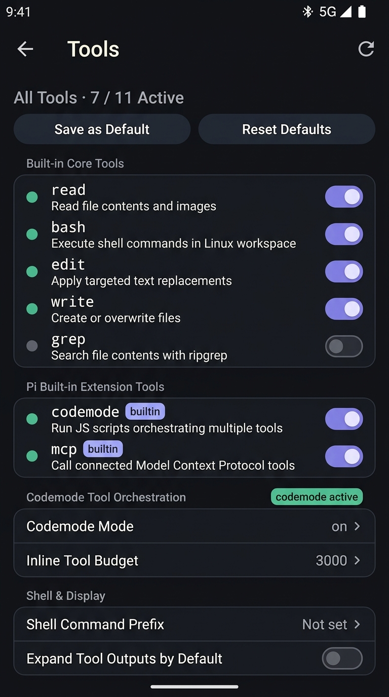
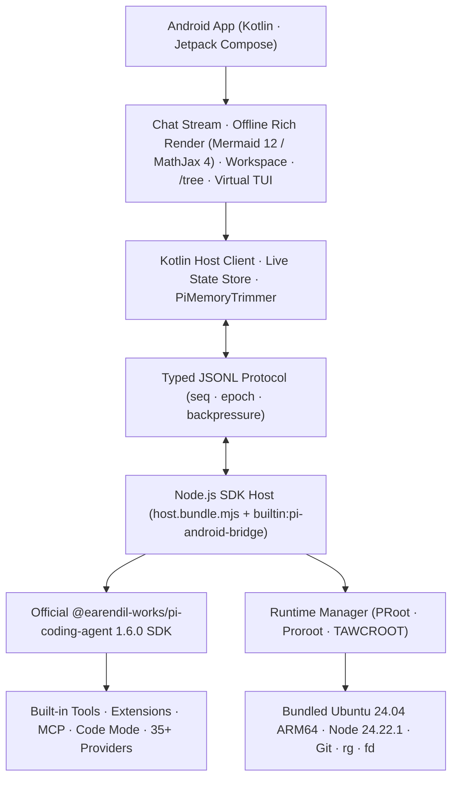

**English** · [简体中文](README.zh-CN.md)

<p align="center">
  
</p>

<h1 align="center">Pi for Android</h1>

<p align="center">
  <b>The First True Full-Power AI Coding Agent on Android.</b><br />
  Not a toy chat wrapper. Not a fragile SSH terminal. Zero Root. Zero Termux.<br />
  Install one APK and turn your phone into a pocket AI software engineering workstation.
</p>

<p align="center">
  
  
  
  
  
  
  
</p>

<p align="center">
  <a href="https://github.com/heikeyangle-code/pi-android/releases"><b>⬇ Download Latest APK</b></a> ·
  <a href="#30-second-quick-start">Quick Start</a> ·
  <a href="#under-the-hood-hardcore-engineering">Hardcore Architecture</a> ·
  <a href="https://github.com/heikeyangle-code/pi-android/actions/workflows/ci.yml">CI Status</a> ·
  <a href="https://github.com/heikeyangle-code/pi-android/issues">Issues &amp; Ideas</a>
</p>

---

## Why Developers Switch to Pi for Android

Most "mobile AI coding apps" are just cloud chat boxes that can't touch a real file, run a single test, or commit code. SSH and Termux force you to fight tiny terminal fonts, broken soft keyboards, and dead connections the moment you step onto a train.

**Pi for Android puts the real thing directly on your phone:** a complete local Linux development environment, the **100% official Pi 1.6.0 Coding Agent SDK**, a desktop-grade offline rendering engine, and a native Jetpack Compose interface crafted for one-handed mobile engineering.

- **Real On-Device Engineering — Zero Root, Zero Termux**: Built-in **Ubuntu 24.04 ARM64 + Node.js 24 + Git + `rg` + `fd`**. Open any local repository on your phone, search code in milliseconds, edit files with word-level diffs, run test suites, and `git commit` — even completely offline.
- **100% Official Pi 1.6.0 Ecosystem**: Not a stripped-down clone. Run real desktop Pi extensions, **MCP servers**, **Code Mode** multi-tool orchestration, `/tree` session branching, `/export` & `/import`, and drop in your existing desktop `~/.pi` configs and themes with 100% compatibility.
- **Total Model Freedom — Zero Lock-in, Zero Markup**: Sign in with **7 OAuth subscription providers**, pick from **35+ presets (1,698+ chat models)**, or connect any OpenAI-compatible / local endpoint. Control reasoning depth (`off` to `max`), scoped models, and context compaction at will.
- **Desktop-Class Mobile Reading & Rich Rendering**: Offline **Mermaid 12** (20+ diagram types with pinch-to-zoom & fullscreen), **MathJax 4** LaTeX formulas, instant `<1 ms` syntax highlighting for 35+ languages, intra-line word diffs, and interactive SVG / HTML / JSON / CSV viewers.
- **Industry-First Mobile Virtual TUI Engine**: Desktop Pi extensions that render full interactive terminal UIs, floating HUDs, progress bars, clickable OSC 8 links, and sound cues project natively onto your touchscreen — with natural finger scrolling, direct touch control, and an optional compact gamepad bar.
- **Optional Android Device Copilot**: Opt in to Accessibility screen automation, Notifications, Clipboard, Location, Camera, App Control, or Shizuku Shell — and turn them all off in one tap (**strictly 0 prompt tokens when disabled**).

---

## See It in Action

<table align="center">
  <tr>
    <td align="center" width="50%">
      <br />
      <sub><b>Code review in your pocket</b> — shell commands, file reads, and intra-line word diffs fold cleanly and expand in place.</sub>
    </td>
    <td align="center" width="50%">
      <br />
      <sub><b>Total agent control</b> — toggle built-in, extension, and MCP tools live, save defaults, and configure Pi 1.6.0 Code Mode.</sub>
    </td>
  </tr>
  <tr>
    <td align="center" width="50%">
      <br />
      <sub><b>Full prompt &amp; context pipeline</b> — inspect and edit global &amp; project <code>SYSTEM.md</code>, <code>APPEND_SYSTEM.md</code>, and <code>AGENTS.md</code> with 1-tap reload.</sub>
    </td>
    <td align="center" width="50%">
      <br />
      <sub><b>Every major model, your keys</b> — 7 OAuth subscriptions, 35+ provider presets (1,698+ models), or any custom endpoint.</sub>
    </td>
  </tr>
</table>

---

## How Pi for Android Compares

| Capability | Mobile AI Chat Apps | Termux / SSH | **Pi for Android** |
| :--- | :---: | :---: | :---: |
| **Local Linux + Node 24 + Git + `rg` + `fd`** | ❌ Cloud chat only | ⚠️ Hours of manual setup | ✅ **Built-in · Zero Root · Zero Termux** |
| **Mobile-native diffs, Mermaid 12 & MathJax 4** | ⚠️ Plain bubbles | ❌ Wall of raw ANSI | ✅ **Word diffs · 20+ diagrams · Offline LaTeX** |
| **Desktop Pi extensions & interactive TUIs** | ❌ Unsupported | ⚠️ Painful soft keyboard | ✅ **Native Virtual TUI + touch scroll + OSC 8** |
| **Models, MCP & Code Mode ecosystem** | ❌ Closed / locked | ✅ CLI only | ✅ **100% Official Pi 1.6.0 · 7 OAuth · 35+ providers** |
| **Optional Android device automation** | ❌ Impossible | ⚠️ Fragile scripts | ✅ **Opt-in `builtin:pi-android-bridge` · 0 tokens off** |

---

## 30-Second Quick Start

| Requirement | Support |
| :--- | :--- |
| **Android** | Android 8.0 (API 26) or later |
| **ABI** | ARM64 (`arm64-v8a`) |
| **Root / Termux** | **Not required** |
| **Upgrades** | Stable sideload signature — install newer APKs directly over older builds without losing data |

1. Download the latest `pi-android-*-sideload28-arm64.apk` from **[GitHub Releases](https://github.com/heikeyangle-code/pi-android/releases)**.
2. Install and open — first launch automatically unpacks the bundled Linux & Node.js runtime.
3. Connect any model in **Settings → Models & Providers** (OAuth subscription login, API key, or any OpenAI-compatible URL).
4. Pick any folder on your phone and start shipping.

---

## Under the Hood: Hardcore Engineering

Everything above is backed by zero shortcuts under the hood. If you care about systems architecture, runtime performance, and strict upstream compatibility, here is how Pi for Android is engineered.

### 1. 100% Official Pi 1.6.0 SDK + Native Virtual TUI Surface Engine
- **Direct SDK execution (`host.bundle.mjs`)**: Runs `@earendil-works/pi-coding-agent` directly through a typed, epoch-isolated JSONL host with explicit backpressure — zero parallel re-implementations, full desktop `~/.pi/agent/` & `.pi/` compatibility, and immediate upstream feature adoption.
- **Full Slash Command & SDK Parity**: Native mobile closures for `/model`, `/thinking`, `/tree`, `/fork`, `/clone`, `/export` (official `exportToHtml` & `exportToJsonl`), `/import [path]`, `/compact`, `/reload`, `/trust` (in-place `ProjectTrustHost`), `/login`, `/logout`, `/changelog` (bundled official `CHANGELOG.md`), and all extension commands & shortcuts.
- **Virtual TUI Surface Projection (`ui/surfaces.mjs` → Jetpack Compose)**: Extensions calling `ctx.ui.custom()`, `setWidget()`, `setHeader()`, `setFooter()`, or `tui.showOverlay()` mount real Pi TUI components natively — supporting `OverlayHandle`, `Focusable`, responsive column fit, clickable **OSC 8 hyperlinks**, natural touch scrolling with `TuiMouseEvent` + `↑/↓` fallback, official `KeybindingsManager`, and ringer-aware terminal bells (`BEL` / `OSC 9;4` / `OSC 777`).
- **1:1 Official Extension Renderers**: Extension and MCP tool cards render through Pi's own `ToolExecutionComponent` (`resolveToolRenderers`) with per-call state, live theme palette + `theme.name` sync, and hot reload.

### 2. Three Switchable Local Linux Runtimes & Incremental Upgrades
First boot unpacks a deterministic, digest-verified environment (**Ubuntu 24.04 ARM64 · Node.js 24.22.1 · Git 2.43 · ripgrep 15.2 · fd 10.2 · Pi 1.6.0**). APK upgrades diff per-payload digests and **only refresh changed payloads**, preserving every package and tool you installed inside the guest.

| Runtime | Engineering Characteristics |
| :--- | :--- |
| **PRoot** | Battle-tested user-space syscall translation (Termux build) — maximum compatibility across Android ROMs. |
| **Proroot** | Custom dynamic linker + in-process hook runtime dramatically cutting PRoot syscall overhead. |
| **TAWCROOT** | Single-process `seccomp` backend compiled from pinned upstream NDK source for near-native speed. |

### 3. Native Offline Rich-Rendering Pipeline
- **Mermaid 12.2.0 Chromium/Skia High-DPI Engine**: Renders 20+ Mermaid 12 diagram families (flowcharts, sequence, class, state, ER, Gantt, mindmap, timeline, gitGraph, quadrant, pie, xychart, sankey, kanban, architecture, C4, packet, block) with true CSS-viewport & DPR scaling, double-rAF layout flush, automatic GPU-cull software retry, pinch-to-zoom, and 1-tap fullscreen viewer.
- **MathJax 4 Inline & Display LaTeX**: Crisp SVG math for `$...$`, `\(...\)`, `\[...\]`, single/multi-line `$$...$$`, `math` fences, and standalone `\begin{aligned/equation/align/gather/cases/matrix}` environments — with CJK adjacency support and currency-safe parsing.
- **Zero-Jitter Streaming & Instant Scroll-Back**: Dual-path GFM AST parser (`Channel.CONFLATED` off-main-thread for long streams + frame-0 sync for short/cached replies), `<1 ms` native syntax highlighting for 35+ languages, `TailFollow` bottom lock, `RowHeightCache`, and bounded cross-scroll LRU caches (`PiMarkdownDocCache` & `PiCodeHighlightCache`) wired into `PiMemoryTrimmer`.
- **100% Official Pi Theme Parity**: Full `okhsl()` / `oklch()` theme parsing with automatic WCAG contrast calculation, live theme preview & JSON import, plus zero-restart EN/中文 switching.

### 4. Sub-Second Cold Start & 12 Automated Performance Invariants
Enforced on every commit by `tools/check-startup-perf.mjs`: single-file `host.bundle.mjs`, zero cold-start `jiti` / `Babel` / `undici` / `WebView` initialization, `readyHello` embedded in `host.ready`, initial `state` embedded in `session.open`, `planDirect` Node launch (no `/bin/bash -c`), parallel pre-spawn I/O, APK version-stamp fast-paths, and staggered background work.

### 5. Opt-in Android Device Bridge (`builtin:pi-android-bridge`)
Registered via Pi SDK's native `builtin: true, replaceable: true` extension mechanism (**Settings → Device Capabilities**):
- **3 Focused Capability Groups**: Screen Automation (Accessibility), System & Hardware (Notifications, Clipboard, Location, Camera, App Control), and Device Shell (Shizuku).
- **Zero-Token & Fail-Safe**: Disabled tools are never injected into the model context (**0 tokens**); irreversible actions enforce a native 3-choice confirmation dialog.

---

## System Architecture & CI Verification



Every commit is gated by **6 automated GitHub Actions CI jobs** (`tawcroot` NDK build, **339 real-SDK host checks** across bundled / unbundled / `--scandir-fix` modes + cold-start `import-audit`, static guards for Android APIs / i18n / 12 cold-start invariants, JVM unit tests, and both `modern36` + `sideload28` signed APKs):

```bash
git clone https://github.com/heikeyangle-code/pi-android.git
cd pi-android
node tools/sdk-host/contract.mjs
node tools/sdk-host/test.mjs
node tools/check-startup-perf.mjs
./gradlew :protocol:test
node tools/fetch-runtime.mjs
./gradlew :app:assembleRelease
```

**Technical Docs**: [`architecture.md`](docs/sdk-host/architecture.md) · [`protocol.md`](docs/sdk-host/protocol.md) · [`upgrading.md`](docs/sdk-host/upgrading.md) · [`runtime-engines.md`](docs/runtime-engines.md) · [`AGENTS.md`](AGENTS.md)
