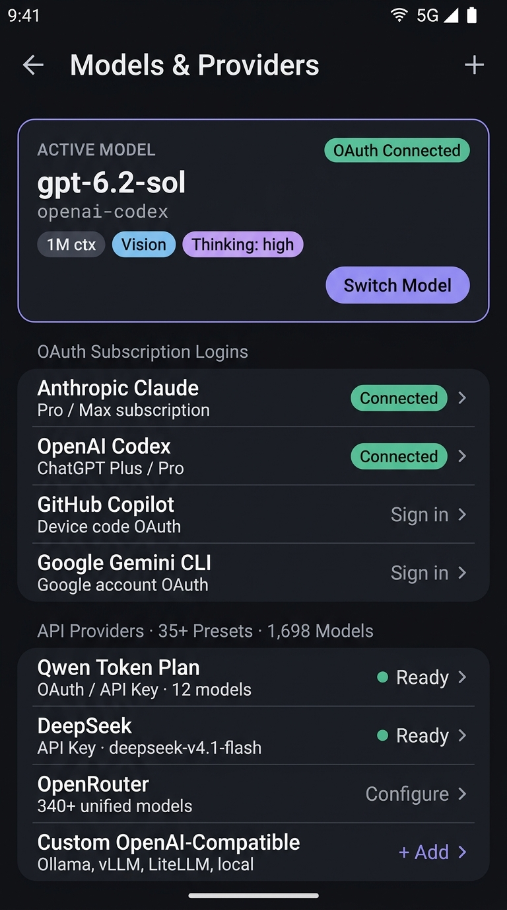
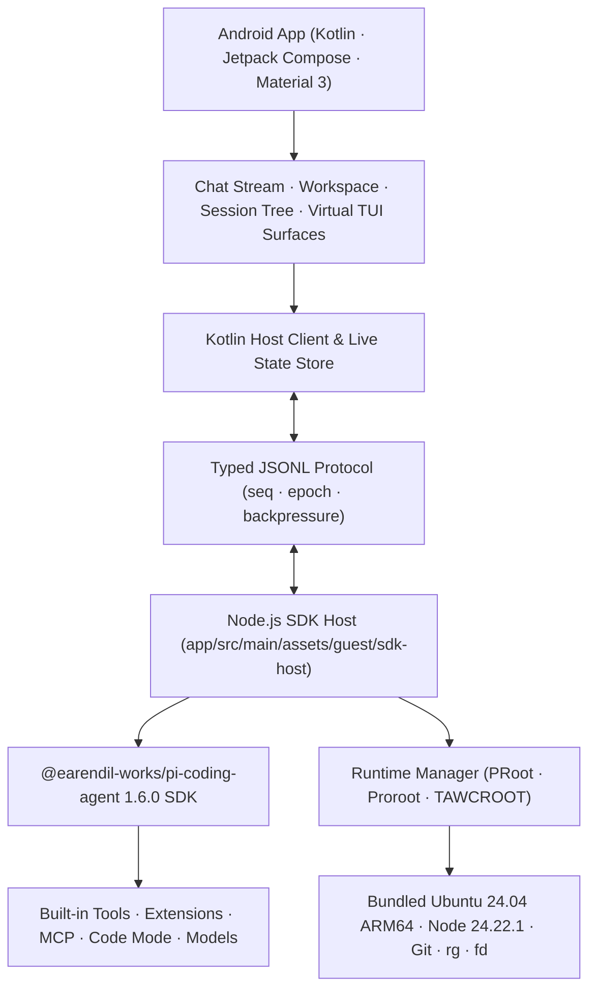

**English** · [简体中文](README.zh-CN.md)

<p align="center">
  
</p>

<h1 align="center">Pi for Android</h1>

<p align="center">
  <b>Stop using your phone as a tiny remote for a distant server.<br />Put a real Linux + official Pi Coding Agent workstation straight in your pocket.</b>
</p>

<p align="center">
  Native Jetpack Compose · Official Pi 1.6.0 SDK · Three Linux Runtimes · Full Extension &amp; TUI Parity · Zero Root, Zero Termux
</p>

<p align="center">
  
  
  
  
  
  
</p>

<p align="center">
  <a href="https://github.com/heikeyangle-code/pi-android/releases"><b>⬇ Download Latest APK</b></a> ·
  <a href="https://github.com/heikeyangle-code/pi-android/actions/workflows/ci.yml">Build Status</a> ·
  <a href="https://github.com/heikeyangle-code/pi-android/issues">Issues &amp; Ideas</a>
</p>

---

## Why Most "Mobile AI Coding Apps" Fall Flat

When you're away from your desk and want an agent to actually get work done, you usually face three frustrating compromises:
1. **Chat-box wrappers**: fine for copy-pasting snippets, useless for reading a real repository, running `git diff`, executing tests, or loading MCP servers and extensions.
2. **SSH into a remote box**: breaks on spotty transit networks and turns reading diffs into squinting at microscopic scrolling terminal text.
3. **Hand-rolled Termux setups**: hours of bootstrapping packages, wrestling with permissions, and fighting tiny virtual keyboards before you write a single line of code.

**Pi for Android throws all three compromises away.**

It bundles a complete **Ubuntu 24.04 ARM64 userspace + Node.js 24.22.1 + Git + ripgrep + fd + the official [Pi Coding Agent](https://github.com/earendil-works/pi) 1.6.0 SDK** inside a single native Jetpack Compose APK. **No root. No Termux. No cloud sandbox. Zero setup scripts.** Install the APK, open any real folder on your phone, and start working with a real local coding agent.

| Capability | Typical AI Chat Apps | Termux / SSH | **Pi for Android** |
| :--- | :---: | :---: | :---: |
| **Real local Linux + Node + Git + rg + fd** | ❌ Chat only | ⚠️ Manual setup | ✅ **Built-in, zero root, zero Termux** |
| **Mobile-native diffs &amp; reading stream** | ⚠️ Chat bubbles | ❌ Tiny scrolling TTY | ✅ **Tonal tool cards, intra-line diffs, LaTeX, Mermaid** |
| **Desktop Pi extensions &amp; interactive TUI** | ❌ Unsupported | ⚠️ Painful keyboard UX | ✅ **Virtual TUI surface projection + touch/mouse + auto-fit** |
| **Full Pi model, MCP &amp; Code Mode ecosystem** | ❌ Closed / limited | ✅ CLI only | ✅ **Real Pi 1.6.0 SDK · 7 OAuth logins + 35+ providers** |
| **Opt-in Android device automation** | ❌ Impossible | ⚠️ Fragile scripts | ✅ **Zero-token device bridge + native confirmation gate** |

<table align="center">
  <tr>
    <td align="center" width="50%">
      <br />
      <sub><b>Calm tool cards &amp; intra-line diffs</b> — every shell command, file read, and edit stays structured and effortless to review.</sub>
    </td>
    <td align="center" width="50%">
      <br />
      <sub><b>Real local workspace</b> — browse any folder on your phone with files edited in this session pinned right at the top.</sub>
    </td>
  </tr>
  <tr>
    <td align="center" width="50%">
      <br />
      <sub><b>Native rich rendering</b> — guest-powered syntax highlighting, LaTeX math, Mermaid diagrams, and full-screen image viewer.</sub>
    </td>
    <td align="center" width="50%">
      <br />
      <sub><b>Full provider freedom</b> — 7 OAuth subscription logins, 35+ presets (1,698 chat models), or any OpenAI-compatible endpoint.</sub>
    </td>
  </tr>
</table>

---

## Six Engineering Pillars You Actually Feel

### 1. Full Pi Extension & Mobile TUI Compatibility Engine (The Hard Part, Solved)
> Most mobile agent clients hit "desktop terminal extensions & custom TUIs" and give up. **Pi for Android built a real virtual TUI projection & official renderer pipeline** so upstream Pi extensions feel right at home on a touchscreen:

- **Virtual TUI Surface Projection (`ui/surfaces.mjs` → Jetpack Compose)**:
  - Extensions calling `ctx.ui.custom()`, `setWidget()`, `setHeader()`, `setFooter()`, or `tui.showOverlay()` mount real Pi TUI components into an in-host virtual surface — **minimizable to a dock, collapsible, and reopenable at any time**.
  - Full `OverlayHandle` (`hide` / `setHidden` / `focus` / `unfocus` / `getBounds`), `Focusable.focused`, and `OverlayOptions` (`visible(w, h)`, `nonCapturing`, anchors) parity.
  - **Responsive 80-col width-fitting + touch & keyboard dispatch**: scales 80-column desktop TUI layouts cleanly into your phone viewport, reports real columns back via `ui.resize`, wires official `KeybindingsManager`, and translates touchscreen taps into `TuiMouseEvent` for `handleMouse()`.
  - **Terminal control sequence bridge**: strips zero-width `CURSOR_MARKER`, turns `FAKE_CURSOR` into inverse SGR, and intercepts `BEL` (`\x07`) sound bells, `OSC 777 / 99 / 9` notifications, `OSC 0/2` window titles, and `OSC 9;4` progress indicators — even interactive TUI games with terminal bells come alive on Android.
- **1:1 Official Extension Renderers & Hooks (`commands/catalog.mjs`)**:
  - Extension & MCP tool cards run through Pi's own `ToolExecutionComponent` (`resolveToolRenderers`), preserving per-call `state`, `details`, `renderShell: "self"`, and debounced `render.invalidate`.
  - Complete plumbing for `registerMessageRenderer` (`CustomMessageComponent`), `registerEntryRenderer` (`CustomEntryComponent`), `registerMarkdownTransformer`, `addAutocompleteProvider`, `onTerminalInput`, `registerFlag`, `FooterDataProvider` (live git branch & provider count), plus official `resetExtensionUI` and 1-tap reload (`catalog.changed`).
- **Bundled Native-Enhancement Extensions (`app/src/main/assets/pi-extensions/`)**:
  - **`pi-highlight`**: exposes Pi's own guest `highlight.js` + `lovely-mermaid` over an authenticated local loopback service — instant syntax highlighting and Mermaid rendering with zero second JS runtime on Android and 100% official theme parity.
  - **`pi-android-bridge` & `pi-android-permission-gate`**: bridges opt-in Android device automation into Pi as a standard extension — **0 tokens when off**, native 3-choice confirmation dialogs for irreversible actions.
- **Unified Transparent Resource Hub (**设置 → 扩展与资源**)**:
  - Extensions, skills, prompt templates, themes, context files, npm/git packages, MCP servers, and project trust in one place — every row names its real path and scope (project vs. global), 100% compatible with desktop `~/.pi/agent/` and `.pi/` layouts.

---

### 2. Real Local Linux & Three Switchable Runtimes (Incremental Updates, Zero Wipes)
First launch unpacks a deterministic, per-payload versioned Linux environment (**Ubuntu 24.04 ARM64 · Node.js 24.22.1 · Git 2.43 · ripgrep 15.2 · fd 10.2 · Pi 1.6.0**). Future APK upgrades diff per-payload digests and **only refresh what changed**, keeping packages and tools you installed inside the guest intact.

| Runtime | Role |
| :--- | :--- |
| **PRoot** | Battle-tested user-space syscall translation (Termux build) — the compatibility baseline. |
| **Proroot** | Linker + in-process hook runtime built to slash PRoot's syscall overhead. |
| **TAWCROOT** | Single-process `seccomp` backend compiled from pinned upstream source (actively hardened). |

---

### 3. Powered Directly by Official Pi 1.6.0 SDK — Automatic Upstream Evolution
Running the real Pi SDK via a typed, backpressured, epoch-isolated **Node.js SDK Host** means ~85% of every upstream Pi release lands automatically:
- **Pi `1.6.0` ready**: GPT-6.2 Sol & Astra (default on OpenAI / Azure / Codex, auto-hiding unsupported `off` thinking), Qwen Token Plan new gateways & models, 1,698 chat models, `undici 8.12.4` (6 GHSA security fixes), Codex WebSocket & prompt-cache fixes.
- **Deep 1.6.0 host integration**: `AgentSessionRuntime.takeUnreportedDiagnostics()` (reports model fallbacks and extension errors once per occurrence on startup & session switches), `commandOutput: "capture"` (prevents git/npm subprocesses from corrupting protocol stdout or hanging on password prompts), OpenAI & Anthropic dropped-reasoning notices (`showCacheMissNotices`), and collapsed-state `imageUnsupportedByModel` warnings on `read` cards.
- **Fast cold start & live telemetry**: loads `dist/bundle/index.js` first, lazy-loads heavy modules, and streams live context usage, token counts, and costs directly from `stateStore`.

---

### 4. Calm Mobile Aesthetics, 100% Official Pi Theme Parity & Memory Slimming
- **Borderless tonal stream**: clean tonal tool cards (subtle accent border only while running), quiet single-line thinking pill, intra-line word diffs, LaTeX math, Mermaid diagrams, and full-screen image viewer.
- **100% Official Pi Theme compatibility**: full `okhsl()` / `oklch()` support with automatic foreground contrast computation — zero hardcoded white text, drop in any desktop Pi theme JSON and it looks sharp in both light and dark modes.
- **Multi-source attachments & OOM-safe downsampling**: gallery multi-pick, documents multi-pick, clipboard image paste, and `@` workspace mentions — with `computeSafeSampleSize()` preventing 108MP camera OOMs and enforcing per-model `inputLimits.images.maxPerMessage`.
- **Lean RAM & buttery scrolling**: SHA-256 compact image cache keys (99.999% key RAM reduction, 5–10× effective capacity), centralized `PiMemoryTrimmer` wired to `onTrimMemory()`, zero 60–120fps idle composer recompositions, and GPU-layer animations.

---

### 5. Official `/tree` Branching & Instant Cross-Workspace `/resume` Search
- **Rule-by-rule `/tree` port**: all 5 official filter modes, collapsible subtrees, in-tree search, active-branch-first layout, and clean forking from any entry.
- **Incremental-indexed `/resume`**: persistent `.session-list-index.json`, workspace grouping, instant startup display, and seamless full-text relevance search across all projects.

---

### 6. Opt-in Android Device Capabilities (Strict 0-Token When Disabled)
Turn your phone into an agent peripheral only when you want to (**设置 → 设备能力**):
- **3 clean groups**: Screen Automation (Accessibility), System & Hardware (Notifications, Clipboard, Location, Camera, App control), and Device Shell (Shizuku).
- **2×2 live permission readiness tiles** + one-tap "Disable All".
- **Zero-token & fail-safe**: disabled tools are never exposed to the model (**0 tokens**); irreversible actions (`pm uninstall`, `pm clear`, `dd`, force-stopping apps) always trigger a native 3-choice confirmation dialog.

---

## Quick Start

| Requirement | Support |
| :--- | :--- |
| **Android** | 8.0 (API 26) or later |
| **ABI** | ARM64 (`arm64-v8a`) |
| **Root / Termux** | **Not required** |
| **In-place upgrades** | Consistent sideload signature — install newer APKs right over older versions |

1. Download the latest `pi-android-*-sideload28-arm64.apk` from **[GitHub Releases](https://github.com/heikeyangle-code/pi-android/releases)**.
2. Install & launch; wait for first-boot runtime provisioning.
3. Connect a provider in **设置 → 模型与供应商** (OAuth subscription login, API key, or custom OpenAI-compatible endpoint).
4. Pick any folder on your phone and start coding with your agent.

---

## Architecture & Engineering Discipline



- **299 real-SDK host checks + 6/6 CI**: every push verifies `:rpc` JVM tests, real Pi SDK contract (`contract.mjs`), 3× SDK Host suites (`bundle`, `--no-bundle`, `--scandir-fix`), Android API static guards, TAWCROOT NDK build, and both signed APKs (`sideload28` + `modern36`).
- **Automated upstream upgrade auditing**: run `node tools/pi-upgrade-audit.mjs` to scan all 9 host & app integration seams whenever upstream Pi publishes a release (full SOP in [`docs/sdk-host/upgrading.md`](docs/sdk-host/upgrading.md)).

```bash
git clone https://github.com/heikeyangle-code/pi-android.git
cd pi-android

node tools/pi-upgrade-audit.mjs --check-only
node tools/sdk-host/contract.mjs
node tools/sdk-host/test.mjs
./gradlew :rpc:test
node tools/fetch-runtime.mjs
./gradlew :app:assembleRelease
```

Docs: [`architecture.md`](docs/sdk-host/architecture.md) · [`protocol.md`](docs/sdk-host/protocol.md) · [`upgrading.md`](docs/sdk-host/upgrading.md) · [`runtime-engines.md`](docs/runtime-engines.md)

---

## Honest Notes & Contributing

- **What green CI proves**: compilation, real Pi 1.6.0 SDK contract & behavior parity, and clean signed APK assembly; hardware-level runtime switching and Android permissions are verified on real devices.
- **Interface language**: currently Simplified Chinese; full Chinese/English bilingual i18n (`strings.xml` extraction + instant in-app switching) is actively planned next.
- **Star & Contribute**: if you've ever wanted a real Linux coding agent in your pocket, drop a **Star** — issues, device reports, and PRs are all welcome!

---

## Acknowledgements & License

Built on [Pi Coding Agent](https://github.com/earendil-works/pi) · [Node.js](https://nodejs.org/) · [Ubuntu](https://ubuntu.com/) · [PRoot (Termux)](https://github.com/termux/proot) · [Proroot](https://github.com/coderredlab/proroot) · [TAWCROOT](https://github.com/wmww/tawc) (MIT, © Sophie Winter) · [ripgrep](https://github.com/BurntSushi/ripgrep) · [fd](https://github.com/sharkdp/fd) · [JetBrains Mono](https://github.com/JetBrains/JetBrainsMono) · [Source Han Serif CN](https://github.com/adobe-fonts/source-han-serif).

App source code is **MIT** licensed. Bundled third-party components retain their respective upstream licenses; full texts and notices ship in [`app/src/main/assets/licenses/`](app/src/main/assets/licenses/).
