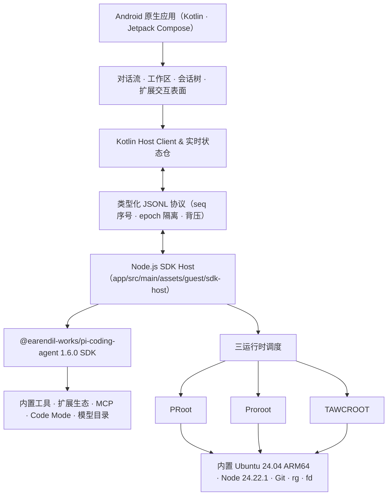

[English](README.md) · **简体中文**

<p align="center">
  
</p>

<h1 align="center">Pi for Android</h1>

<p align="center">
  <b>装进口袋的真 Linux Coding Agent。</b><br />
  原生 Jetpack Compose · 官方 Pi 1.6.0 SDK · 三引擎运行时 · 免 Root · 免 Termux
</p>

<p align="center">
  
  
  
  
  
</p>

<p align="center">
  <a href="https://github.com/heikeyangle-code/pi-android/releases">下载最新版本</a> ·
  <a href="https://github.com/heikeyangle-code/pi-android/actions/workflows/ci.yml">构建状态</a> ·
  <a href="https://github.com/heikeyangle-code/pi-android/issues">问题反馈</a>
</p>

---

### 把整套 Coding Agent 工作站，原生塞进 Android 手机

市面上大多数手机 AI 客户端只是套壳聊天框。**Pi for Android** 直接把官方 **[Pi Coding Agent](https://github.com/earendil-works/pi)** 连同完整的 **Ubuntu 24.04 ARM64** 用户态、**Node.js 24**、**Git**、**ripgrep**、**fd** 一起打进 APK，用原生 **Jetpack Compose** 重塑移动端交互。

**不需要 Root，不需要折腾 Termux，不需要连远程服务器。** 装上 APK，打开手机里的任意真实项目目录，Agent 就能就地读代码、搜全库、跑测试、改文件、玩 MCP 与 Code Mode，甚至在手机上打开交互式扩展 TUI 面板。

<table align="center">
  <tr>
    <td align="center" width="50%">
      <br />
      <sub><b>克制的工具卡与行内 Diff</b> —— 每次命令、读文件、改代码都结构化呈现，一眼看清改动。</sub>
    </td>
    <td align="center" width="50%">
      <br />
      <sub><b>手机本地真工作区</b> —— 直接浏览设备目录，本次会话改过的文件自动汇总置顶。</sub>
    </td>
  </tr>
  <tr>
    <td align="center" width="50%">
      <br />
      <sub><b>原生富文本渲染</b> —— 语法高亮、LaTeX 公式、Mermaid 图表与全屏看图一气呵成。</sub>
    </td>
    <td align="center" width="50%">
      <br />
      <sub><b>完整模型生态</b> —— 7 家订阅账号 OAuth 登录 + 35+ 供应商预设，或任意 OpenAI 兼容接口。</sub>
    </td>
  </tr>
</table>

---

## 为什么会爱上它

### 1. 开箱即用的本地 Linux，三套运行时随心切
内置确定性打包的完整工具链（**Ubuntu 24.04 ARM64 · Node.js 24.22.1 · Git · ripgrep · fd · Pi 1.6.0**），并且支持**按载荷增量更新** —— 升级新版本只会替换变动的组件，不会清空你在容器里装好的工具和配置。

三种容器运行时按机型和负载自由切换：

| 运行时 | 定位与特点 |
| :--- | :--- |
| **PRoot** | Termux 构建的经典用户态系统调用翻译层，兼容性最稳的默认基线。 |
| **Proroot** | 基于链接器与进程内 hook 的轻量替代运行时，大幅降低传统 PRoot 的系统调用开销。 |
| **TAWCROOT** | 基于单进程 `seccomp` 的高速方案（从固定上游源码编译，持续打磨稳定性）。 |

### 2. 原汁原味的官方 Pi 1.6.0 SDK，而不是山寨套壳
拒绝粗糙的终端文本抓取，采用独立 **Node.js SDK Host** 通过带背压的类型化 JSONL 协议直接驱动官方 SDK：

- **极速启动与同步**：优先加载官方打包入口 `dist/bundle/index.js`，配合增量会话索引与实时状态推送，上下文用量、Token、费用实时同步无延迟。
- **第一时间跟进上游能力**：完整支持 Pi 1.6.0（GPT-6.2 Sol / Astra、Claude、Gemini、通义 Token Plan、逐模型思考深度、Code Mode、Tool Search、MCP 服务器、运行时诊断与推理丢弃提示）。
- **100% 兼容官方 Pi 主题**：直接读取官方主题 JSON（完整支持 `okhsl()` / `oklch()` 色彩空间），前景对比度自动计算，深浅色无缝切换。
- **移动端也能跑扩展 TUI**：支持扩展的自定义交互表面、浮层、Widget、状态栏、参数补全、终端响铃与触控/键鼠事件，小屏自动适配宽度。

### 3. 为手机手感打磨的极简阅读与交互体验
- **克制、通透的对话流**：去描边色块工具卡、不扎眼的单行思考胶囊、宿主级原生语法高亮、LaTeX 数学公式、Mermaid 流程图与内联代码 Diff。
- **全来源附件与防 OOM 压缩**：相册多选、系统文件多选、剪贴板图片一键粘贴、`@` 工作区文件引用一应俱全；自动按 Pi 官方缩放档位与模型图片上限安全采样，亿像素照片也不爆内存。
- **官方级 `/tree` 分支与 `/resume` 搜索**：完整对齐官方 5 档过滤的会话树导航与任意节点分叉；跨工作区毫秒级增量索引 + 全文相关性检索。
- **移动端内存精简**：SHA-256 紧凑图片缓存键 + 跟随系统 `onTrimMemory` 的统一内存回收器，长会话与多图对话依然丝滑跟手。

### 4. 可选的 Android 设备能力（关闭时严格 0 Token）
在 **设置 → 设备能力** 中按需开启后，Agent 可通过本地桥接安全调用手机能力 —— 屏幕自动化（无障碍）、通知读取、剪贴板、定位/相机与 Shizuku / 设备 Shell：
- **关闭即零消耗**：未启用的能力不会注册进模型工具集，严格 **0 Token** 占用。
- **高危操作逐规则确认**：`pm uninstall`、`pm clear`、`dd`、停止应用等不可逆调用强制弹出原生确认框，绝不静默执行。

### 5. 硬核级 Pi 扩展与移动端 TUI 兼容引擎（把桌面终端生态搬上触屏）
大多数移动端 Agent 客户端一遇到「终端扩展、自定义 TUI 界面、扩展渲染器」就会直接摆烂。**Pi for Android** 在宿主层与原生 UI 之间完整重建了一套贴合官方 SDK 的扩展与 TUI 兼容引擎，让社区的 Pi 扩展在手机上几乎开箱即用：

- **虚拟 TUI 表面实时投影（`ui/surfaces.mjs` → 原生 Compose 交互面板）**：
  - 扩展调用 `ctx.ui.custom()`、`setWidget()`、`setHeader()`、`setFooter()`、`tui.showOverlay()` 时，宿主实时挂载真实 TUI 组件并按帧去重推送给原生 UI，完整支持最小化、收起与重开。
  - 完整实现 `OverlayHandle`（`hide` / `setHidden` / `focus` / `unfocus` / `getBounds`）、`Focusable.focused` 焦点流转与 `OverlayOptions`（`visible(w, h)`、`nonCapturing` 等）。
  - **小屏自适应 + 触控键鼠双支持**：默认「适配宽度」将 80 列桌面 TUI 优雅缩进手机视口并按实际列数回传 `ui.resize`；接入官方 `KeybindingsManager` 匹配快捷键，同时把触屏点击实时映射为 `TuiMouseEvent` 交给 `handleMouse()`。
  - **终端控制序列桥接**：自动剥离 `CURSOR_MARKER`、将 `FAKE_CURSOR` 转为反显 SGR，并拦截 `tui.terminal.write()` 发出的 `BEL`（`\x07`）、`OSC 777 / 99 / 9` 通知、`OSC 0/2` 标题与 `OSC 9;4` 进度条 —— 连终端游戏里的响铃提示音都能在手机上响起来。
- **1:1 复刻官方扩展渲染链路（`commands/catalog.mjs`）**：
  - 扩展/MCP 工具直接交由官方 `ToolExecutionComponent`（经 `resolveToolRenderers`）渲染，完整保留 `details`、跨帧渲染状态、`renderShell: "self"` 自绘框架与防抖异步重绘（`render.invalidate`）。
  - 全面接通 `registerMessageRenderer`（`CustomMessageComponent`）、`registerEntryRenderer`（`CustomEntryComponent`）、`registerMarkdownTransformer`、`addAutocompleteProvider`（输入框扩展补全）、`onTerminalInput`、`registerFlag` 与真实 `FooterDataProvider`（Git 分支与供应商计数）。
- **随包内置的自研原生增强扩展（`app/src/main/assets/pi-extensions/`）**：
  - **`pi-highlight`**：通过本地认证回环服务直接复用 guest 里 Pi 自带的 `highlight.js` 与 `lovely-mermaid`，零额外 JS 引擎开销实现毫秒级代码高亮与 Mermaid 渲染，且 100% 跟随官方主题色盘。
  - **`pi-android-bridge` + `pi-android-permission-gate`**：将手机设备能力以原生 Pi 扩展形态接入，关闭时严格 0 Token 占用，高危操作按规则弹出原生三选一确认框。
- **透明统一的扩展与资源中心（设置 → 扩展与资源）**：
  - 扩展、技能（Skills）、提示模板、主题、上下文文件、npm/git 包、MCP 服务器与项目信任一站管理；每一项都展示真实路径与项目/全局作用域，**一键重载即刻刷新命令与工具**，与桌面端 Pi 配置 100% 互通。

---

## 快速上手

### 运行要求

| 项目 | 要求 |
| :--- | :--- |
| Android 版本 | Android 8.0（API 26）及以上 |
| CPU 架构 | ARM64（`arm64-v8a`） |
| Root / Termux | **均不需要** |
| 网络 | 请求模型接口或安装扩展包时需要 |

### 安装步骤

1. 前往 [GitHub Releases](https://github.com/heikeyangle-code/pi-android/releases) 下载最新 APK。
2. 安装到 Android 手机（采用固定侧载签名，后续版本可直接覆盖升级，不丢数据）。
3. 首次打开等待内置 Linux 与 Pi 引擎自动解包初始化。
4. 在 **设置 → 模型与供应商** 中完成登录（支持 OAuth 订阅登录、API Key 或自定义 OpenAI 兼容接口）。
5. 选择手机上的任意目录作为工作区，立刻开始与你的 Agent 协作。

---

## 技术架构



### 技术栈一览

| 层级 | 技术选型 |
| :--- | :--- |
| 应用与界面 | 原生 Android · Kotlin · Jetpack Compose · Material 3 |
| Agent 引擎 | [`@earendil-works/pi-coding-agent`](https://github.com/earendil-works/pi) **`1.6.0`**（确定性锁文件） |
| 宿主集成 | Node.js SDK Host · 类型化 JSONL（`seq` / `epoch` / 背压） |
| 容器运行时 | PRoot（Termux）· Proroot · TAWCROOT |
| 内置用户态 | Ubuntu 24.04 ARM64 · Node.js 24.22.1 · Git 2.43 · ripgrep 15.2 · fd 10.2 |
| 工程与 CI | Gradle · AGP · 6 项 GitHub Actions 自动验收 |

架构与开发文档：
- [`docs/sdk-host/architecture.md`](docs/sdk-host/architecture.md) — SDK Host 架构与生命周期
- [`docs/sdk-host/protocol.md`](docs/sdk-host/protocol.md) — 线协议 v1 规范
- [`docs/sdk-host/upgrading.md`](docs/sdk-host/upgrading.md) — 上游 Pi 发包六步升级标准流程（配合 `tools/pi-upgrade-audit.mjs`）
- [`docs/runtime-engines.md`](docs/runtime-engines.md) — PRoot / Proroot / TAWCROOT 对比说明

---

## 开发、验证与上游升级

```bash
git clone https://github.com/heikeyangle-code/pi-android.git
cd pi-android

# 检查上游 Pi 是否有新版本，并自动审计全部 9 条集成接缝
node tools/pi-upgrade-audit.mjs --check-only

# 运行真实 Pi SDK 契约检查与 299 项宿主集成测试
node tools/sdk-host/contract.mjs
node tools/sdk-host/test.mjs

# 运行协议单测并构建发布版 APK
./gradlew :rpc:test
node tools/fetch-runtime.mjs
./gradlew :app:assembleRelease
```

### CI 全绿能证明什么、不能证明什么
每次推送都会自动执行 6 项 GitHub Actions 检查：`:rpc` JVM 单测、真实 Pi SDK 契约与 3 套 SDK Host 测试（`bundle` / `--no-bundle` / `--scandir-fix`）、Kotlin/Android API 静态守卫、TAWCROOT NDK 编译，以及双变体签名 APK 构建（`sideload28` + `modern36`）。绿灯证明代码可编译、与锁定版本 Pi SDK 契约一致、签名包装配完整；具体机型的三运行时切换与硬件权限体验需在真机复测。

### 界面语言与参与贡献
应用界面目前为**简体中文**（文案尚未抽离至 `strings.xml`）。非常欢迎提 PR 参与文案抽离与多语言支持、扩展机型运行时适配或改进文档 —— 欢迎提交 [Issue](https://github.com/heikeyangle-code/pi-android/issues) 或 Pull Request！

---

## 致谢与许可证

本项目构建于以下优秀项目之上：
[Pi Coding Agent](https://github.com/earendil-works/pi) · [Node.js](https://nodejs.org/) · [Ubuntu](https://ubuntu.com/) · [PRoot (Termux)](https://github.com/termux/proot) · [Proroot](https://github.com/coderredlab/proroot) · [TAWCROOT](https://github.com/wmww/tawc)（MIT, © Sophie Winter）· [ripgrep](https://github.com/BurntSushi/ripgrep) · [fd](https://github.com/sharkdp/fd) · [JetBrains Mono](https://github.com/JetBrains/JetBrainsMono) · [思源宋体 CN](https://github.com/adobe-fonts/source-han-serif)

应用源代码采用 **MIT License** 开源。随包分发的第三方组件保留各自上游许可证（PRoot 取自 Termux 构建、Proroot 为未修改专有二进制、TAWCROOT 为 MIT 等），完整许可文本与声明见 [`app/src/main/assets/licenses/`](app/src/main/assets/licenses/)。
