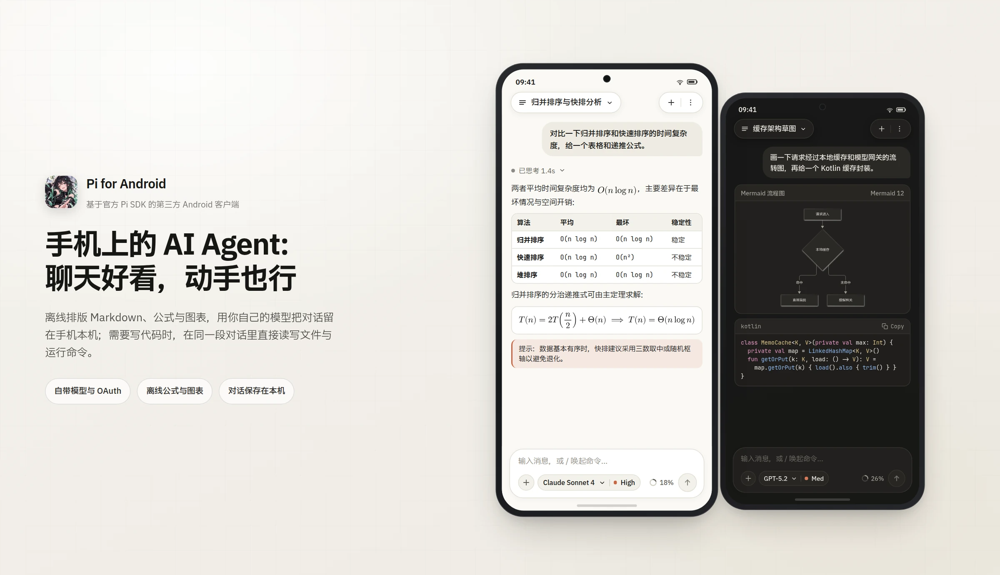
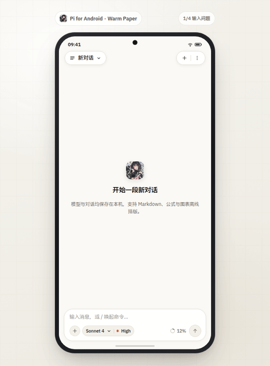
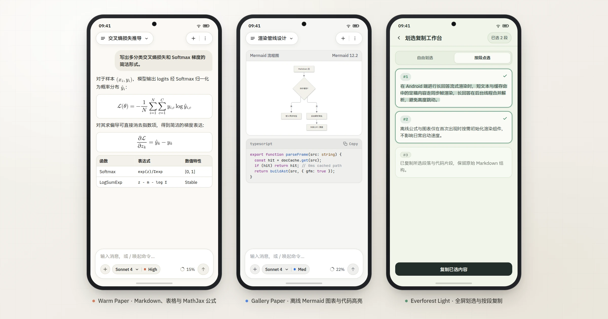
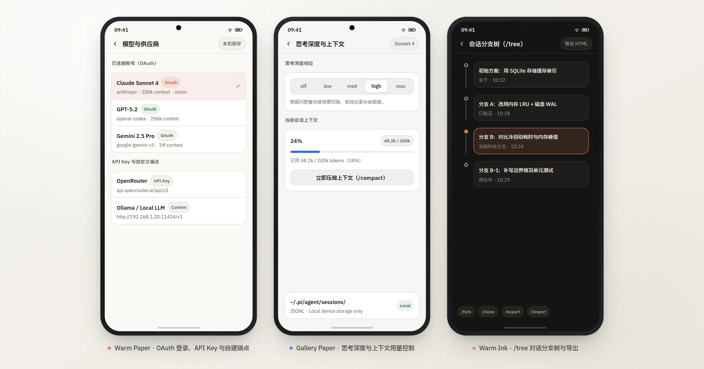
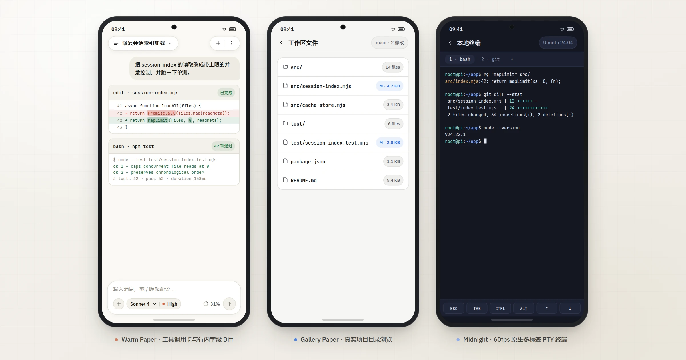
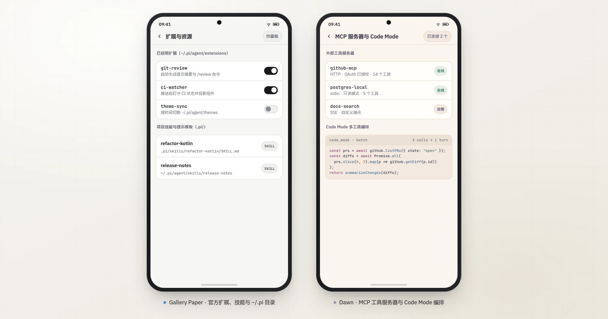
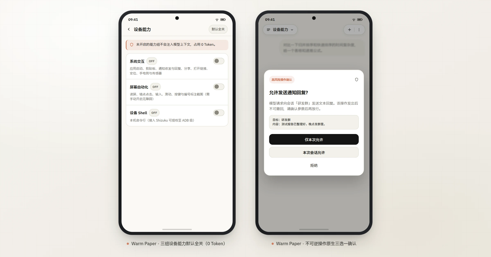
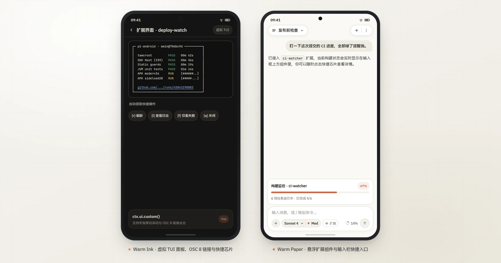
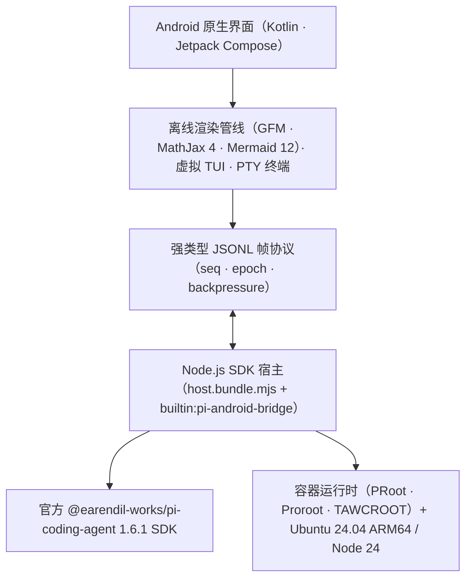

<p align="right"><strong>简体中文</strong> · <a href="README.md">English</a></p>

<div align="center">
<h1>Pi for Android</h1>
<p>手机上的 AI Agent：聊天好看，动手也行</p>
<p><sub>基于官方 Pi SDK（<code>@earendil-works/pi-coding-agent</code>）构建的第三方 Android 客户端，非官方出品。</sub></p>
<p>
<a href="https://github.com/heikeyangle-code/pi-android/releases/latest"></a>
<a href="https://github.com/heikeyangle-code/pi-android/releases"></a>
<a href="https://github.com/heikeyangle-code/pi-android/actions/workflows/ci.yml"></a>
<a href="https://github.com/heikeyangle-code/pi-android/stargazers"></a>
<a href="LICENSE"></a>

</p>
<p><a href="https://github.com/heikeyangle-code/pi-android/releases/latest"><strong>下载最新 APK</strong></a> · <a href="#安装">安装步骤</a> · <a href="#常见问题">常见问题</a></p>
</div>

<picture><source media="(prefers-color-scheme: dark)" srcset="docs/assets/hero-zh-dark.webp" /><source media="(prefers-color-scheme: light)" srcset="docs/assets/hero-zh-light.webp" /></picture>

<p align="center"><br /><sub>16 秒实录演示：流式排版、离线公式与消息排队（<a href="docs/assets/demo-chat-zh.mp4">高清 MP4 版本</a>）。</sub></p>

<p align="center"><a href="#好看好读的聊天">我只想聊天</a> · <a href="#需要时让它动手">我想让它动手</a> · <a href="#给开发者">我想看实现</a></p>

## 定位与适用人群

- **只想好好聊天**：你可以把它当成一款排版干净、不绑定厂商的聊天 App，自带模型账号或密钥，对话只存在自己手机里。
- **需要它动手干活**：在同一段对话里，你可以让它读取手机上的项目文件夹、查看修改差异、运行测试或在终端里执行命令。
- **喜欢折腾与扩展**：你可以安装 Pi 扩展、接入外部工具服务器、切换本地运行引擎，或者直接阅读源码参与改进。

## 好看、好读的聊天

你可以离线渲染 Markdown、表格、数学公式、流程图表和语法高亮代码，回复逐字输出时页面稳定不跳动。遇到长回答，可以切进独立选字界面自由划选或按段落勾选复制。

<picture><source media="(prefers-color-scheme: dark)" srcset="docs/assets/f1-reading-zh-dark.webp" /><source media="(prefers-color-scheme: light)" srcset="docs/assets/f1-reading-zh-light.webp" /></picture>

## 你的模型，你的对话

你可以用订阅账号 OAuth 直接登录、填写各家 API Key，或者接入自建的兼容接口。输入栏里随时调节思考深度与上下文用量，历史对话以文件形式保存在本机，支持分支回溯与导出。

<picture><source media="(prefers-color-scheme: dark)" srcset="docs/assets/f2-models-zh-dark.webp" /><source media="(prefers-color-scheme: light)" srcset="docs/assets/f2-models-zh-light.webp" /></picture>

## 需要时，让它动手

应用内置了免配置的本地 Linux 环境（包含常用开发工具），选中手机里的项目目录后，模型可以直接读文件、改代码、展示逐词对比的修改记录，你也能随时打开内置多标签终端亲自操作。

<picture><source media="(prefers-color-scheme: dark)" srcset="docs/assets/f3-coding-zh-dark.webp" /><source media="(prefers-color-scheme: light)" srcset="docs/assets/f3-coding-zh-light.webp" /></picture>

## 完整的 Pi 生态

由于底层直接运行官方 Pi SDK，桌面端的扩展、技能、提示模板与配置目录可以沿用到手机上。你也可以配置 MCP（模型上下文协议，用于连接外部数据源和工具的服务标准）服务器，或用 Code Mode 在单次调用里编排多个工具。

<picture><source media="(prefers-color-scheme: dark)" srcset="docs/assets/f4-ecosystem-zh-dark.webp" /><source media="(prefers-color-scheme: light)" srcset="docs/assets/f4-ecosystem-zh-light.webp" /></picture>

## 可选的设备副驾

三组手机设备能力（系统交互、屏幕自动化、设备 Shell）默认全部关闭，关闭时不占用任何上下文额度。按需开启后，发送回复等不可逆操作会弹出原生三选一确认框，由你逐项放行。

<picture><source media="(prefers-color-scheme: dark)" srcset="docs/assets/f5-copilot-zh-dark.webp" /><source media="(prefers-color-scheme: light)" srcset="docs/assets/f5-copilot-zh-light.webp" /></picture>

## 把桌面终端扩展带到手机

桌面端 Pi 扩展常常会绘制字符界面的面板、进度条或状态栏。应用通过虚拟 TUI（把终端字符画实时映射为可触控界面的渲染层）将它们直接搬到手机屏幕上，支持手指滑动、点击链接和快捷按键。

<picture><source media="(prefers-color-scheme: dark)" srcset="docs/assets/f6-virtual-tui-zh-dark.webp" /><source media="(prefers-color-scheme: light)" srcset="docs/assets/f6-virtual-tui-zh-light.webp" /></picture>

## 方案对比

| 维度 | 云端聊天套壳 App | Termux + 命令行 pi | Pi for Android |
| :--- | :--- | :--- | :--- |
| 日常聊天与排版 | 原生界面，渲染能力视厂商而定 | 纯终端文字输出，依赖小字滚动 | 原生界面，离线渲染公式、图表与代码 |
| 本地文件与命令行 | 通常仅支持上传附件，无本机执行环境 | 完整本地环境，需自行安装配置 | 内置 Linux 运行时与终端，安装即用 |
| 对话与模型自主权 | 账号与历史多托管于服务商云端 | 本机保存，模型自由配置 | 本机保存，支持 OAuth、API Key 与自建端点 |
| 桌面 Pi 扩展界面 | 不兼容 Pi 扩展生态 | 原生终端显示，触屏按键操作不便 | 虚拟 TUI 映射，支持触控滑动与快捷芯片 |
| 手机设备能力联动 | 仅限系统分享等基础入口 | 需自行编写 Termux API 或 ADB 脚本 | 内置可选桥接，默认全关，高危操作需确认 |

## 安装

系统要求：Android 8.0（API 26）及以上、64 位 ARM（`arm64-v8a`）设备，不需要 Root，也不需要先装 Termux。

1. 前往 [GitHub Releases](https://github.com/heikeyangle-code/pi-android/releases/latest) 下载 `pi-android-*-sideload28-arm64.apk` 并安装。
2. 打开应用，首次启动会自动解包内置环境，稍等片刻即可进入聊天页。
3. 打开 **设置 → 模型与供应商**，使用 OAuth 登录或填写 API Key，返回对话页即可开始聊天（需要写代码时，再在顶栏菜单里选择项目文件夹）。

版本选择说明：日常侧载安装直接选 **`sideload28`**（固定兼容安卓 10 及以上执行内置工具的策略，稳定性最好）；`modern36` 面向想实测较新系统目标版本行为的用户。后续可在设置页的「应用更新」里原地覆盖升级，不会清空历史对话和环境。

## 常见问题

<details>
<summary>1. 需要 Root 或懂 Linux 吗？</summary>

都不需要。日常当聊天软件使用时，完全不会接触命令行或 Linux 概念；只有在你想让它改代码、跑测试时，才需要选一个项目目录。

</details>

<details>
<summary>2. 能当普通聊天 App 用吗，能发图片吗？</summary>

可以。默认打开就是干净的聊天界面，支持从相册或文件选择器添加图片附件（按当前模型支持的图片上限自动缩放发送），非图片文件则会自动放进当前工作区供模型读取。

</details>

<details>
<summary>3. 能联网搜索吗？</summary>

应用本身不内置独立的搜索引擎代理。若你需要联网检索，可以通过模型供应商自带的搜索能力、在内置终端里调用命令行工具，或在设置中接入外部搜索类 MCP 服务器与社区扩展。

</details>

<details>
<summary>4. 对话存在哪里，会不会上传到作者服务器？</summary>

对话历史（JSONL 格式）、设置与凭据只保存在你手机的应用数据目录（对应 `~/.pi/agent/`）中，没有作者托管的后端服务器。消息只在你发送提问时直接发往你自己配置的模型接口或 MCP 服务器。

</details>

<details>
<summary>5. 安装和运行需要多少存储空间？</summary>

单个 APK 安装包约 149 MB（内含 Ubuntu 24.04 ARM64 基础系统、Node.js、Git、ripgrep、fd 与离线公式图表资源）。首次启动解包后，建议手机预留约 1 GB 可用空间以容纳运行时及后续依赖缓存。

</details>

<details>
<summary>6. 怎么升级才不会丢数据？</summary>

直接在应用内 **设置 → 应用更新** 检查并安装新版，或从 GitHub Releases 下载同变体（如 `sideload28`）的新版 APK 覆盖安装即可。发布包使用固定侧载签名，升级时仅按校验和更新变化的运行组件，不会删除你的对话、设置、工作区或容器里自己装的工具。

</details>

<details>
<summary>7. 和桌面版 Pi 配置互通吗？</summary>

互通。应用直接调用官方 `@earendil-works/pi-coding-agent` SDK，配置目录结构（`~/.pi/agent/` 与项目级 `.pi/`）、主题 JSON、会话 JSONL、技能与扩展格式与桌面端保持一致。

</details>

<details>
<summary>8. 三种运行时（PRoot、Proroot、TAWCROOT）怎么选？</summary>

默认使用 **PRoot**，机型与系统兼容性最稳，大多数人无需改动。Proroot（闭源二进制）与 TAWCROOT（开源单进程 seccomp 方案，随 CI 从源码编译）属于实验性选项，用于探索更低的系统调用开销；切换前应用会自动跑探针检测，不通过时自动回退到 PRoot。详情见 [docs/runtime-engines.md](docs/runtime-engines.md)。

</details>

<details>
<summary>9. 设备能力安全吗？</summary>

应用内置的三组设备能力默认全部关闭。未开启的能力不会把工具说明塞给模型，也不申请对应敏感权限；开启后，发消息、删文件、执行高危指令等不可逆动作会弹出原生三选一确认框，你可以随时在设置里关闭。

</details>

<details>
<summary>10. 和官方 Pi 是什么关系？</summary>

本项目是由社区开发者独立维护的第三方 Android 客户端，通过官方发布的 `@earendil-works/pi-coding-agent` SDK 驱动核心能力，与官方 Pi 团队无隶属或背书关系。

</details>

<details>
<summary>11. 为什么不在 Google Play 上架？</summary>

默认推荐的 `sideload28` 版本为了在 Android 10 及以上稳定执行解包后的本地 Linux 运行时，将 `targetSdk` 固定为 28，这不符合 Google Play 的上架要求；同时仓库使用公开的固定侧载签名以便无缝覆盖升级。`modern36` 分支正在持续探索 `targetSdk 36` 下的兼容路径。

</details>

## 数据、权限与风险提示

- **数据流向**：应用不含遥测统计与第三方广告 SDK。除你主动配置的模型供应商、MCP 服务器及手动触发的 GitHub 更新检查外，不向其他地址发送数据。
- **核心权限说明**：`INTERNET` 用于访问模型接口；前台服务与唤醒锁用于熄屏后保持长回合运行不中断；`MANAGE_EXTERNAL_STORAGE`（所有文件访问）仅在你主动选择手机真实目录作为代码工作区时申请，因为容器需要绑定真实文件系统路径；`usesCleartextTraffic` 为全局放行明文 HTTP，以便加载 Markdown 中的 `http://` 图片资源。
- **可选设备能力风险提示**：系统交互（含通知监听、定位、手电筒等）、屏幕自动化（无障碍服务）与设备 Shell（可选对接 Shizuku 获取 ADB 级权限）默认全部关闭。开启无障碍或 Shizuku 后，若模型误操作或遭遇提示词注入，可能读到屏幕隐私或执行意外操作，请仅在明确需要时开启并仔细核对确认弹窗中的参数。

## 给开发者

<details>
<summary>展开架构图、技术文档、CI 门禁、源码构建与素材生成命令</summary>

### 架构概览



- **核心文档**：[架构设计](docs/sdk-host/architecture.md) · [通信协议](docs/sdk-host/protocol.md) · [SDK 升级指南](docs/sdk-host/upgrading.md) · [运行时引擎说明](docs/runtime-engines.md) · [工程规范 AGENTS.md](AGENTS.md)
- **自动化验证与冷启动守卫**：GitHub Actions 每次推送运行 6 项流水线（`tawcroot` NDK 构建、`SDK Host` 契约与运行态测试含冷启动 `import-audit`、`Static safety guards` 含 12 项冷启动守卫与双语校验、`JVM unit tests`、`APK modern36`、`APK sideload28`）。

### 从源码构建

```bash
git clone https://github.com/heikeyangle-code/pi-android.git
cd pi-android

# 1. 运行 SDK 宿主契约、运行态测试与静态守卫
node tools/sdk-host/contract.mjs
node tools/sdk-host/test.mjs
node tools/check-startup-perf.mjs
./gradlew :protocol:test :app:testDebugUnitTest

# 2. 拉取内置运行时分包并编译 Release APK
node tools/fetch-runtime.mjs
./gradlew :app:assembleRelease
```

### README 图片与演示视频重新生成

本仓库 README 中的全部静态图（WebP）、演示动图（GIF）和视频（MP4）均由代码驱动生成，使用仓库内置字体与离线 MathJax 4 / Mermaid 12 引擎：

```bash
# 需要本机已安装 Python 3、Playwright、Chromium、ffmpeg 与 cwebp
python3 tools/readme-assets/render.py
```

脚本源码位于 [tools/readme-assets/](tools/readme-assets/)，输出目录为 [docs/assets/](docs/assets/)。

</details>

## 社区与反馈

- 遇到问题或提交功能建议，请前往 [GitHub Issues](https://github.com/heikeyangle-code/pi-android/issues)。
- 获取最新安装包与更新日志，请关注 [GitHub Releases](https://github.com/heikeyangle-code/pi-android/releases)。

## 参与贡献

欢迎提交 Issue 与 Pull Request。改动代码前请先阅读 [AGENTS.md](AGENTS.md) 了解冷启动性能守卫、渲染约束与双语规范；若修改了 `app/src/main/assets/guest/sdk-host/` 下的文件，提交前请运行 `node tools/sdk-host/build-bundle.mjs` 重新打包，并确保静态守卫与测试通过。

## 许可证与致谢

本项目采用 [MIT 许可证](LICENSE) 开源。安装包内随附的第三方组件按各自上游许可证分发，完整清单与许可证全文可在应用内 **设置 → 开源许可** 或仓库目录 [app/src/main/assets/licenses/](app/src/main/assets/licenses/) 中查阅。

致谢以下开源与上游项目：

- **[@earendil-works/pi-coding-agent](https://www.npmjs.com/package/@earendil-works/pi-coding-agent)**：提供核心 Agent 会话、工具、扩展与 MCP 运行时能力。
- **[Termux](https://github.com/termux)**：提供 `terminal-emulator`、`terminal-view`、`proot` 与 `libandroid-shmem`。
- **[proroot](https://github.com/coderredlab/proroot)**：提供可选的实验性容器运行时（专有组件，未修改原样分发，条款见 `proroot-license.txt`）。
- **[wmww/tawc](https://github.com/wmww/tawc)**：提供实验性单进程 `seccomp` 容器后端 `tawcroot`（MIT）。
- **离线富渲染引擎**：[Mermaid](https://github.com/mermaid-js/mermaid) 与 [MathJax](https://github.com/mathjax/MathJax) 提供图表与数学公式矢量渲染。
- **Android 渲染与系统库**：[JetBrains Markdown](https://github.com/JetBrains/markdown)、[AndroidSVG](https://bigbadaboom.github.io/androidsvg/)、[jsoup](https://jsoup.org/)、[SnakeYAML](https://bitbucket.org/snakeyaml/snakeyaml) 与 [Shizuku API](https://github.com/RikkaApps/Shizuku-API)。
- **随包字体**：IBM Plex Sans SC、JetBrains Mono、Geist Mono、Source Han Serif CN、LXGW WenKai。
