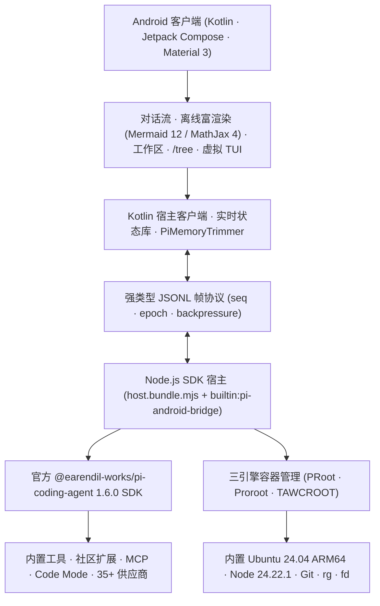

[English](README.md) · **简体中文**

<p align="center">
  
</p>

<h1 align="center">Pi for Android</h1>

<p align="center">
  <b>别再拿手机当远程终端的遥控器了。<br />把一整套真 Linux + 官方 Pi Coding Agent，直接装进口袋。</b>
</p>

<p align="center">
  原生 Jetpack Compose · 官方 Pi 1.6.0 SDK · 离线 Mermaid 12 &amp; MathJax 4 · 三引擎 Linux 容器 · 完整扩展与 TUI 兼容 · 免 Root · 免 Termux
</p>

<p align="center">
  
  
  
  
  
  
  
</p>

<p align="center">
  <a href="https://github.com/heikeyangle-code/pi-android/releases"><b>⬇ 立即下载最新 APK</b></a> ·
  <a href="https://github.com/heikeyangle-code/pi-android/actions/workflows/ci.yml">构建状态</a> ·
  <a href="https://github.com/heikeyangle-code/pi-android/issues">问题与建议</a>
</p>

---

## 为什么绝大多数「手机 AI 编程工具」都用不下去？

想在地铁上、沙发上、出门没带电脑时真正让 AI 帮你干活，过去只有三个糟糕的选项：
1. **套壳聊天 App**：只能贴代码干聊，读不了本地仓库、跑不了 `git diff`、没有扩展和 MCP。
2. **手机 SSH 终端**：断网就废，在 6 寸竖屏里看满屏滚动的 ANSI 字符和 diff 极度折磨眼睛。
3. **手搓 Termux**：装环境、配 Node/Git、调权限、忍受反人类虚拟键盘，环境还没搭完就已经不想写了。

**Pi for Android 把完整本地 Linux 用户态（Ubuntu 24.04 ARM64 + Node.js 24.22.1 + Git + ripgrep + fd）与官方 [Pi Coding Agent](https://github.com/earendil-works/pi) 1.6.0 SDK 直接装进一个原生 Android APK。** 免 Root、免 Termux、免云服务器、免初始化命令——装完打开，选一个手机里的真实目录，立刻开干。

| 维度 | 普通手机 AI 聊天 App | Termux / SSH 终端 | **Pi for Android** |
| :--- | :---: | :---: | :---: |
| **真本地 Linux + Node 24 + Git + `rg` + `fd`** | ❌ 只能文字聊天 | ⚠️ 手动折腾半天 | ✅ **开箱即用，免 Root 免 Termux** |
| **移动端原生阅读、Diff 与富渲染体验** | ⚠️ 只有气泡框 | ❌ 竖屏小字滚动地狱 | ✅ **工具卡、行内字级 Diff、Mermaid 12、MathJax 4** |
| **桌面端 Pi 扩展与全屏交互式 TUI** | ❌ 完全不支持 | ⚠️ 虚拟键盘反人类 | ✅ **虚拟 TUI 表面投影 + 触控/键鼠 + 80 列自适应** |
| **模型、MCP 与 Code Mode 完整生态** | ❌ 封闭或阉割 | ✅ 仅纯命令行 | ✅ **100% 官方 Pi 1.6.0 SDK · 7 家 OAuth · 35+ 供应商** |
| **手机原生自动化能力（无障碍/通知/Shizuku）** | ❌ 做不到 | ⚠️ 折腾脚本 | ✅ **可选内置设备桥 · 关闭时严格 0 Token** |

<table align="center">
  <tr>
    <td align="center" width="50%">
      <br />
      <sub><b>克制通透的工具卡与行内字级 Diff</b> —— 每次命令、读文件、改代码都清晰折叠、就地展开，像看代码评审一样舒服。</sub>
    </td>
    <td align="center" width="50%">
      <br />
      <sub><b>全部工具实时总控与 Codemode</b> —— 内置/扩展/MCP 工具一键启停、设为默认，完整对齐 Pi 1.6.0 Codemode 与 Shell 前缀。</sub>
    </td>
  </tr>
  <tr>
    <td align="center" width="50%">
      <br />
      <sub><b>统一系统提示词与上下文管线</b> —— 全局与项目级 <code>SYSTEM.md</code> / <code>APPEND_SYSTEM.md</code> / <code>AGENTS.md</code> 一站编辑与即时重载。</sub>
    </td>
    <td align="center" width="50%">
      <br />
      <sub><b>全生态模型自由</b> —— 7 家订阅账号 OAuth 直登 + 35+ 供应商预设（1,698 个模型），或任意 OpenAI 兼容端点。</sub>
    </td>
  </tr>
</table>

---

## 在手机上真正能干的事

- **通勤路上修 Bug / 审 PR**：在本地项目里直接跑 `rg` / `fd` 定位代码、看红绿行内字级 Diff、跑单测并 `git commit`。
- **随手甩截图与多文件上下文**：支持相册多选、文档多选、剪贴板粘贴图片与 `@文件名` 补全，内置大像素防 OOM 下采样与模型图片上限保护。
- **把桌面端 Pi 扩展与 MCP 搬上手机**：用 Pi 1.6.0 **Code Mode** 编排多工具脚本、接 MCP 查文档/数据库，甚至在手机上直接畅玩带全屏交互式 TUI 与音效提示的扩展。
- **按需唤醒手机自动化副驾**：按需开启无障碍屏幕操作、通知监听、剪贴板、位置、相机或 Shizuku Shell；不用时一键全关，**严格 0 Token 占用**。

---

## 五大核心工程能力

### 1. 100% 官方 Pi 1.6.0 SDK + 移动端真实 TUI 投影引擎
- **直跑官方 SDK（单文件 `host.bundle.mjs`）**：通过强类型、带背压与 Epoch 隔离的 JSONL 宿主直接驱动 `@earendil-works/pi-coding-agent`——不魔改核心语义，100% 兼容桌面端 `~/.pi/agent/` 与 `.pi/` 目录，上游新版本特性自然跟进。
- **虚拟 TUI 表面投影（`ui/surfaces.mjs` → Jetpack Compose）**：扩展调用 `ctx.ui.custom()`、`setWidget()`、`setHeader()`、`setFooter()`、`tui.showOverlay()` 时自动投影为可折叠/最小化停靠的原生浮层，完整支持 `OverlayHandle`、`Focusable`、80 列自适应排版、可点击 **OSC 8 超链接**、触屏 `TuiMouseEvent`、官方 `KeybindingsManager` 与终端响铃/进度序列（`BEL` / `OSC 9;4` / `OSC 777`）。
- **1:1 官方扩展工具渲染**：扩展与 MCP 工具卡片直走官方 `ToolExecutionComponent`（`resolveToolRenderers`），保留逐调用状态与热重载。

### 2. 桌面级离线富渲染管线（专为移动端打磨）
- **离线 Mermaid 12.2.0 高清 Chromium/Skia 引擎**：支持 20+ 种 Mermaid 12 全系图表（流程图、时序图、类图、状态图、ER、甘特图、思维导图、时间线、Git 图、象限图、饼图、XYChart、桑基图、看板、架构图、C4 等），锁定真实 CSS 视口与 DPR 缩放、双 `rAF` 同步抓取、自动软件层重试防 ROM 离屏白图、双指缩放与一键全屏看图。
- **离线 MathJax 4 全语法数学公式**：精准渲染行内 `$...$` / `\(...\)` / `\[...\]`、单/多行 `$$...$$`、` ```math ` 代码块以及独立 `egin{aligned/equation/align/gather/cases/matrix}` 环境，完美支持中文紧邻排版并自动避开 `$5 and $10` 货币误判。
- **原生 `<1 ms` 代码高亮与全能富卡片**：35+ 编程语言本地零延迟同步着色，内置静态/动态 SVG、安全 HTML 预览、CSV/TSV 表格、JSON/YAML/XML 可折叠树、堆栈追踪与行内字级 Diff 卡片。
- **流式零抖动与回滚瞬开**：自研双路径 GFM AST 解析（长流式走 `Channel.CONFLATED` 后台并发 + 短内容/缓存命中帧 0 同步）、`TailFollow` 精准锁底、`RowHeightCache` 防跳高，配合跨滚动 LRU 缓存（`PiMarkdownDocCache` & `PiCodeHighlightCache`）与 `PiMemoryTrimmer` 统一内存回收。

### 3. 真本地 Linux 与三引擎可切换运行时
首次启动按摘要校验自动解压完整本地环境（**Ubuntu 24.04 ARM64 · Node.js 24.22.1 · Git 2.43 · ripgrep 15.2 · fd 10.2 · Pi 1.6.0**）。后续升级 APK 仅增量更新变化的分包，**绝不清空你在容器里装好的包与工具**。

| 运行时引擎 | 定位与特点 |
| :--- | :--- |
| **PRoot** | 久经考验的用户态系统调用翻译（Termux 构建），兼容性基线。 |
| **Proroot** | 自定义动态链接器 + 进程内 Hook，大幅削减 PRoot 系统调用开销。 |
| **TAWCROOT** | 基于上游源码编译的单进程 `seccomp` 后端，低开销原生体验。 |

### 4. 极速冷启动、官方 `/tree` 分支与全工作区 `/resume`
- **12 项冷启动自动化防回退守卫（`tools/check-startup-perf.mjs`）**：单文件 `host.bundle.mjs`、冷启动零 `jiti` / `Babel` / `undici` / `WebView` 初始化、`host.ready` 内嵌握手载荷、`session.open` 直出初始状态快照、`planDirect` 直拉 Node（无 `/bin/bash -c`）、并行 I/O 预处理、APK 版本戳 O(1) 跳过重复校验与后台错峰拉取。
- **原汁原味 `/tree` 与增量索引 `/resume`**：完整移植官方 5 种过滤模式、子树折叠、树内搜索与任意节点分叉；持久 `.session-list-index.json` 实现跨项目秒搜秒切。
- **100% 官方 Pi 主题兼容 + 中英双语零重启切换**：完整支持 `okhsl()` / `oklch()` 与自动前景对比度计算，克制中性的现代 Material 3 视觉层级，直接丢进桌面端 Pi 主题 JSON 即可明暗通透。

### 5. 可选 Android 设备能力桥（`builtin:pi-android-bridge`）
以官方 Pi SDK 原生 `builtin: true, replaceable: true` 机制内建（**设置 → 设备能力**）：
- **三大分组**：屏幕自动化（无障碍）、系统与硬件（通知、剪贴板、位置、相机、应用控制）、设备 Shell（Shizuku）。
- **零占用 + 防误操作**：关闭的工具完全不注入模型上下文（**严格 0 Token**）；不可逆高危操作强制弹出原生三选一确认框。

---

## 快速开始

| 运行要求 | 说明 |
| :--- | :--- |
| **Android 版本** | Android 8.0 (API 26) 及以上 |
| **CPU 架构** | ARM64 (`arm64-v8a`) |
| **Root / Termux** | **均不需要** |
| **覆盖升级** | 固定 sideload 签名，新版本 APK 直接覆盖安装不丢数据 |

1. 前往 **[GitHub Releases](https://github.com/heikeyangle-code/pi-android/releases)** 下载最新版 `pi-android-*-sideload28-arm64.apk`。
2. 安装并打开，等待首次自动解压内置 Linux 与 Node 运行时。
3. 在 **设置 → 模型与供应商** 中登录订阅 OAuth 账号、填写 API Key 或自定义 OpenAI 兼容端点。
4. 选中手机里的任意项目目录，即可开始编码。

---

## 架构与工程质量



每次推送均通过 **6 项完整 GitHub Actions CI**（TAWCROOT NDK 编译、**326 项真实 SDK 宿主测试**覆盖 bundle / unbundled / `--scandir-fix` 与冷启动 `import-audit`、Android API / 双语 / 12 项冷启动静态守卫、JVM 单元测试以及 `modern36` + `sideload28` 双签名 APK 构建）：

```bash
git clone https://github.com/heikeyangle-code/pi-android.git
cd pi-android
node tools/sdk-host/contract.mjs
node tools/sdk-host/test.mjs
node tools/check-startup-perf.mjs
./gradlew :protocol:test
node tools/fetch-runtime.mjs
./gradlew :app:assembleRelease
```

**相关文档**：[`架构设计`](docs/sdk-host/architecture.md) · [`通信协议`](docs/sdk-host/protocol.md) · [`升级指南`](docs/sdk-host/upgrading.md) · [`运行时引擎`](docs/runtime-engines.md) · [`AGENTS.md`](AGENTS.md)
