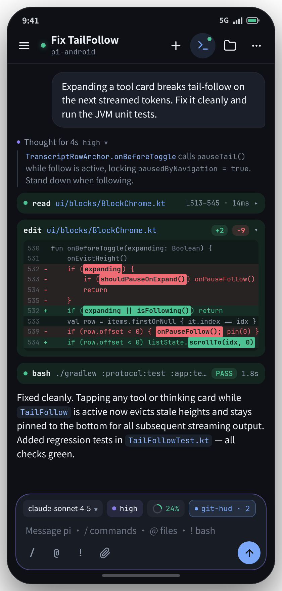
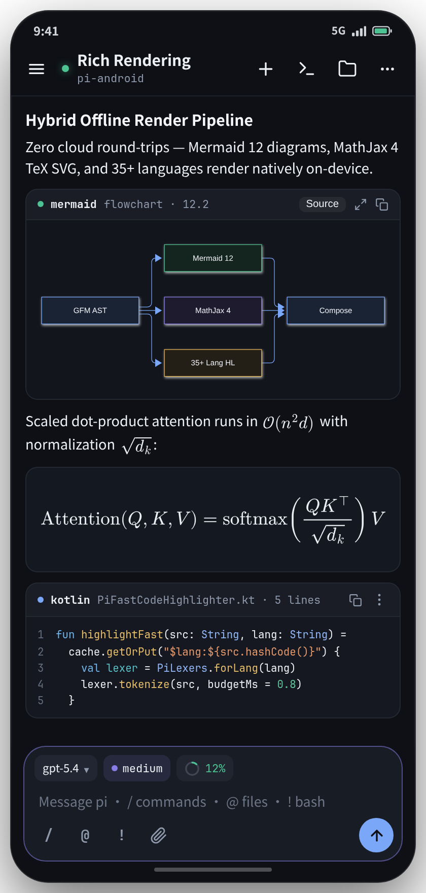
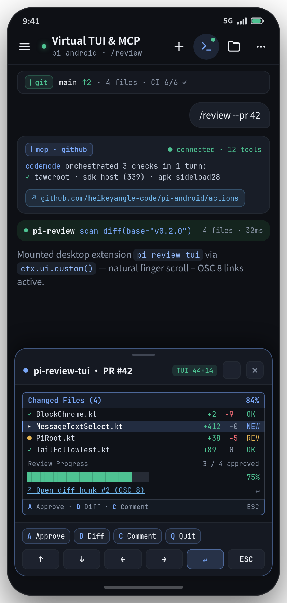
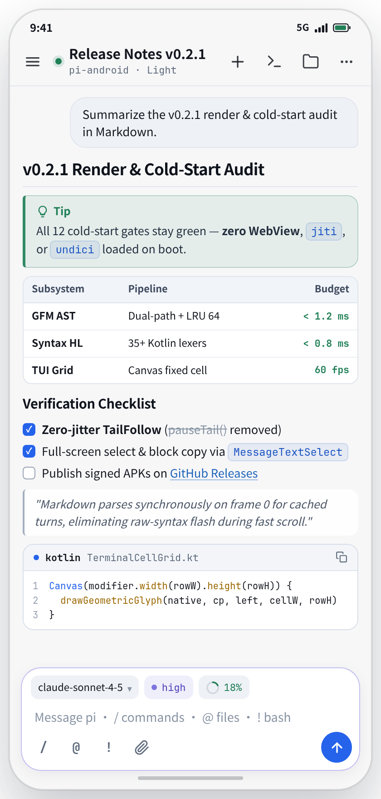
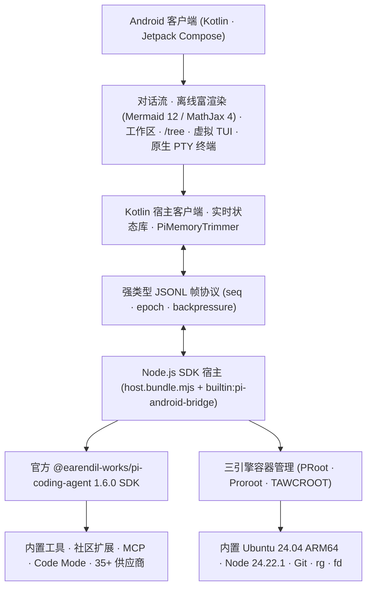

[English](README.md) · **简体中文**

<p align="center">
  
</p>

<h1 align="center">Pi for Android</h1>

<p align="center">
  <b>手机上真正满血的原生 AI Coding Agent 工作站。</b><br />
  不是套壳聊天框，不是脆弱 SSH，更不用折腾 Root 和 Termux。<br />
  装上一个 APK，你的 Android 手机就是一台真本地 Linux + 官方 Pi 1.6.0 全栈研发工作站。
</p>

<p align="center">
  
  
  
  
  
  
  
</p>

<p align="center">
  <a href="https://github.com/heikeyangle-code/pi-android/releases"><b>⬇ 立即下载最新 APK</b></a> ·
  <a href="#界面与能力一览">实机画廊</a> ·
  <a href="#30-秒极速上手">30 秒上手</a> ·
  <a href="#硬核工程与底层架构">硬核架构</a> ·
  <a href="https://github.com/heikeyangle-code/pi-android/actions/workflows/ci.yml">CI 状态</a>
</p>

---

## 界面与能力一览

<table align="center">
  <tr>
    <td align="center" width="50%">
      <br />
      <sub><b>口袋里的 Code Review 与自主编码</b> —— 原生 <code>read</code> / <code>edit</code> / <code>bash</code> 工具卡、反显行内字级 Diff、思考轨迹与悬浮输入工作台。</sub>
    </td>
    <td align="center" width="50%">
      <br />
      <sub><b>桌面级离线富渲染管线</b> —— 离线 <b>Mermaid 12.2</b> 高清图表、<b>MathJax 4.1</b> 行内/块级矢量数学公式与 <code>&lt;1 ms</code> 35+ 语言原生高亮。</sub>
    </td>
  </tr>
  <tr>
    <td align="center" width="50%">
      <br />
      <sub><b>官方 Pi 扩展与移动端虚拟 TUI 引擎</b> —— 原生投影 <code>ctx.ui.custom()</code> 终端字符格、MCP 与 Code Mode 编排、可点 OSC 8 超链接与触屏快捷控制。</sub>
    </td>
    <td align="center" width="50%">
      <br />
      <sub><b>浅色主题与原生 GFM Markdown 排版</b> —— 亮/暗及自定义 Pi 主题 JSON 无缝切换，原生渲染 GFM 提示卡、表格、任务清单、引用块与零闪烁缓存 AST。</sub>
    </td>
  </tr>
</table>

---

## 为什么它是手机上真正能干活的 AI Coding Agent？

市面上绝大多数「手机 AI 编程软件」，要么是碰不到真实文件、跑不了测试的云端聊天套壳，要么逼你在 6 寸屏幕上硬扛 SSH 和 Termux，进地铁一断网、弹键盘一遮屏就彻底抓瞎。

**Pi for Android 把整套真实研发工作站直接装进手机里：** 开箱内置真 Linux 运行时、**100% 官方 Pi 1.6.0 SDK**、桌面级离线富渲染引擎、原生 60fps 多标签 PTY 终端，以及为单手触控彻底重构的原生 Jetpack Compose 交互体验。

- **真·本地满血开发环境（免 Root · 免 Termux）**：内置完整 **Ubuntu 24.04 ARM64 · Node.js 24.22.1 · Git · `rg` · `fd`** + **60fps 原生多标签 PTY 终端**（Termux `terminal-emulator`）。直接打开手机里任意代码目录，毫秒级搜代码、看字级 Diff、跑单测、做 `git commit`——彻底离线也能干活。
- **100% 官方 Pi 1.6.0 全生态，绝非阉割魔改**：直跑官方 SDK 内核，桌面端怎么玩手机上就怎么玩——社区扩展、**MCP 工具生态**、**Code Mode** 多工具编排、`/tree` 会话分支树、`/export` & `/import` 全打通，桌面端 `~/.pi` 配置与主题 JSON 直接拖进来就能用。
- **顶级全模型自由，不锁厂商不收抽成**：支持 **7 家订阅账号 OAuth 一键直登** + **35+ 主流供应商预设（1,698+ 模型）** + 任意 OpenAI 兼容或本地自建接口；支持 `off` 到 `max` 全档位思考深度、作用域模型切换与手动/自动上下文压缩。
- **桌面级离线富渲染 + 全屏选字复制工作台**：离线 **Mermaid 12.2**（20+ 种图表高清渲染、双指缩放、一键全屏）、**MathJax 4.1** 行内/块级矢量公式、`<1 ms` 35+ 语言高亮、行内字级 Diff、SVG / HTML / JSON / YAML / CSV 交互卡片，以及全屏 **自由划选 + 按段点选** 复制工作台。
- **业界独创移动端虚拟 TUI 引擎**：桌面端带全屏交互界面、悬浮 HUD、进度条、可点击 OSC 8 超链接与终端音效的 Pi 扩展，在手机上直接原生投影成高质感交互面板，支持自然手指滑动、触屏直控与自动提取的一键快捷芯片。
- **可选 Android 设备副驾 & 应用内原地升级**：按需开启无障碍控屏、通知监听、剪贴板、位置、相机、应用控制或 Shizuku Shell（**关即严格 0 Token 占用**），并内置 GitHub Releases 原生应用内校验与原地覆盖升级。

---

## 与传统方案对比

| 核心能力 | 普通手机 AI 聊天套壳 | Termux / SSH 远程终端 | **Pi for Android** |
| :--- | :---: | :---: | :---: |
| **本地 Linux + Node 24 + Git + `rg` + `fd` + PTY** | ❌ 只能纯文本聊天 | ⚠️ 手动配置耗时折腾 | ✅ **内置开箱即用 · 多标签 60fps PTY · 免 Root** |
| **移动端代码 Diff、Mermaid 12 与 MathJax 4** | ⚠️ 简陋聊天气泡 | ❌ 满屏滚动 ANSI 字符 | ✅ **字级 Diff · 20+ 图表 · 离线矢量公式** |
| **桌面端 Pi 扩展与全屏交互式 TUI** | ❌ 完全不支持 | ⚠️ 手机软键盘极难操控 | ✅ **原生虚拟 TUI 投影 + 手指自然滑动 + OSC 8** |
| **模型、MCP 与 Code Mode 全生态** | ❌ 封闭锁厂商 | ✅ 仅命令行 | ✅ **100% 官方 Pi 1.6.0 · 7 家 OAuth · 35+ 供应商** |
| **可选 Android 设备自动化** | ❌ 不可能 | ⚠️ 脆弱手工脚本 | ✅ **内建 `builtin:pi-android-bridge` · 关即 0 Token** |

---

## 30 秒极速上手

| 运行要求 | 说明 |
| :--- | :--- |
| **Android 版本** | Android 8.0 (API 26) 及以上 |
| **CPU 架构** | ARM64 (`arm64-v8a`) |
| **Root / Termux** | **均不需要** |
| **无损覆盖升级** | 固定 sideload 签名 + 内置 **设置 → 应用更新**，新版本直接原地覆盖升级不丢会话与环境 |

1. 前往 **[GitHub Releases](https://github.com/heikeyangle-code/pi-android/releases)** 下载最新版 `pi-android-*-sideload28-arm64.apk`（若测试 Android 15/16 targetSdk 36 可选 `modern36`）。
2. 安装并打开，首次启动自动按摘要校验解压内置 Linux 与 Node.js 运行时。
3. 进入 **设置 → 模型与供应商**，一键 OAuth 登录订阅账号、填写 API Key 或接入任意自定义端点。
4. 选中手机里的任意项目文件夹，立刻开始写代码。

---

## 硬核工程与底层架构

### 1. 100% 官方 Pi 1.6.0 SDK + 移动端真实虚拟 TUI 投影引擎
- **直跑官方 SDK（单文件 `host.bundle.mjs`）**：通过强类型、带背压与 Epoch 隔离的 JSONL 宿主直接驱动 `@earendil-works/pi-coding-agent`——不魔改核心语义，100% 兼容桌面端 `~/.pi/agent/` 与 `.pi/` 目录。
- **官方斜杠命令全闭环**：`/model`、`/thinking`（带实时档位校验）、`/tree`、`/fork`、`/clone`、`/export`（直调 `exportToHtml` / `exportToJsonl`）、`/import [path]`、`/compact`、`/reload`、`/trust`（就地弹出 `ProjectTrustHost`）、`/login`、`/logout`、`/changelog` 及全部扩展命令与快捷键全接入。
- **虚拟 TUI 表面引擎（`ui/surfaces.mjs` → Jetpack Compose）**：扩展调用 `ctx.ui.custom()`、`setWidget()`、`setHeader()`、`setFooter()`、`tui.showOverlay()` 时自动投影为原生交互表面，完整支持 `OverlayHandle`、`Focusable`、自适应列宽、可点击 **OSC 8 超链接**、自然手指滑动（`TuiMouseEvent` + `↑/↓` 兼容回退）、官方 `KeybindingsManager` 与遵循系统静音/震动模式的终端音效和进度序列（`BEL` / `OSC 9;4` / `OSC 777`）。
- **1:1 官方扩展工具渲染**：扩展与 MCP 工具卡片直走官方 `ToolExecutionComponent`（`resolveToolRenderers`），保留逐调用状态、动态同步应用色板与真实 `theme.name`，并支持热重载。

### 2. 三引擎可切换本地 Linux 运行时 & 原生多标签 PTY 终端
首次启动按摘要校验自动解压确定性本地环境（**Ubuntu 24.04 ARM64 · Node.js 24.22.1 · Git 2.43 · ripgrep 15.2 · fd 10.2 · Pi 1.6.0**）。后续升级 APK 仅比对各分包摘要并增量更新变化部分，**绝不清空你在容器里装好的包与工具**。

| 运行时引擎 | 工程定位与特点 |
| :--- | :--- |
| **PRoot** | 久经考验的用户态系统调用翻译（Termux 构建），跨机型与 ROM 兼容性基线。 |
| **Proroot** | 自定义动态链接器 + 进程内 Hook，大幅削减 PRoot 系统调用开销。 |
| **TAWCROOT** | 基于上游 NDK 源码编译的单进程 `seccomp` 后端，低开销接近原生执行效率。 |

- **原生多标签 PTY 终端**：基于真实内核 `forkpty` / `TIOCSWINSZ` / `SIGWINCH`（`libtermux.so`）+ 60fps 硬件加速 Canvas `TerminalView`，后台切出不杀进程、支持双指缩放字号、完整中文 IME 组合输入与可定制 2×8 辅助键条。

### 3. 桌面级离线富渲染与流式零抖动管线
- **离线 Mermaid 12.2.0 高清 Chromium/Skia 引擎**：支持 20+ 种 Mermaid 12 全系图表，锁定真实 CSS 视口与 DPR 缩放、像素级自动裁切白边、离屏软件层自动重试、双指缩放与一键全屏看图。
- **离线 MathJax 4.1.3 全语法数学公式**：内置 16 个核心动态 SVG 字形分片 + 冷僻符号优雅兜底，精准渲染 `$...$` / `\(...\)` / `\[...\]` / `$$...$$` / `math` 代码块与独立 `\begin{aligned/equation/align/gather/cases/matrix}` 环境，完美兼容中文紧邻排版并自动避开货币符号误判。
- **流式零抖动与精准触底跟随**：双路径 JetBrains GFM AST 解析（长流式走 `Channel.CONFLATED` 后台并发 + 短内容/缓存命中帧 0 同步）、`<1 ms` 35+ 语言原生高亮、`TailFollow` 精准锁底（展开/收起工具卡与思考块绝不中断跟随）、`RowHeightCache` 防跳高，配合有界跨滚动 LRU 缓存与 `PiMemoryTrimmer` 统一内存裁剪。
- **100% 官方 Pi 主题规范 + 中英双语零重启切换**：完整支持 `okhsl()` / `oklch()` 与自动 WCAG 前景对比度计算，外观页内置实时预览卡与无损主题 JSON 导入。

### 4. 亚秒级冷启动与 12 项自动化性能守卫
由 `tools/check-startup-perf.mjs` 与运行态 `import-audit` 在每次提交中强制校验：单文件 `host.bundle.mjs`、冷启动零 `jiti` / `Babel` / `undici` / `WebView` 初始化、`host.ready` 与 `session.open` 零 RTT 握手快照、`planDirect` 直拉 Node（无 `/bin/bash -c`）、并行 I/O 预处理与 APK 版本戳 O(1) 快路径。

### 5. 可选 Android 设备能力桥（`builtin:pi-android-bridge`）
以官方 Pi SDK 原生 `builtin: true, replaceable: true` 机制内建（**设置 → 设备能力**）：
- **三大能力分组**：屏幕自动化（无障碍）、系统与硬件（通知、剪贴板、位置、相机、应用控制）、设备 Shell（Shizuku）。
- **零占用 + 防误操作**：关闭的能力绝不注入模型上下文（**严格 0 Token**）；不可逆高危操作强制弹出原生三选一确认框。

---

## 系统架构与 CI 工程质量



每次推送均通过 **6 项完整 GitHub Actions CI 门禁**（TAWCROOT NDK 编译、**339 项真实 SDK 宿主测试**覆盖 bundle / unbundled / `--scandir-fix` 与冷启动 `import-audit`、Android API / 双语 / 12 项冷启动静态守卫、JVM 单元测试以及 `sideload28` + `modern36` 双签名 APK 构建）：

```bash
git clone https://github.com/heikeyangle-code/pi-android.git
cd pi-android
node tools/sdk-host/contract.mjs
node tools/sdk-host/test.mjs
node tools/check-startup-perf.mjs
./gradlew :protocol:test :app:testDebugUnitTest
node tools/fetch-runtime.mjs
./gradlew :app:assembleRelease
```

**技术文档**：[`架构设计`](docs/sdk-host/architecture.md) · [`通信协议`](docs/sdk-host/protocol.md) · [`升级指南`](docs/sdk-host/upgrading.md) · [`运行时引擎`](docs/runtime-engines.md) · [`AGENTS.md`](AGENTS.md)
