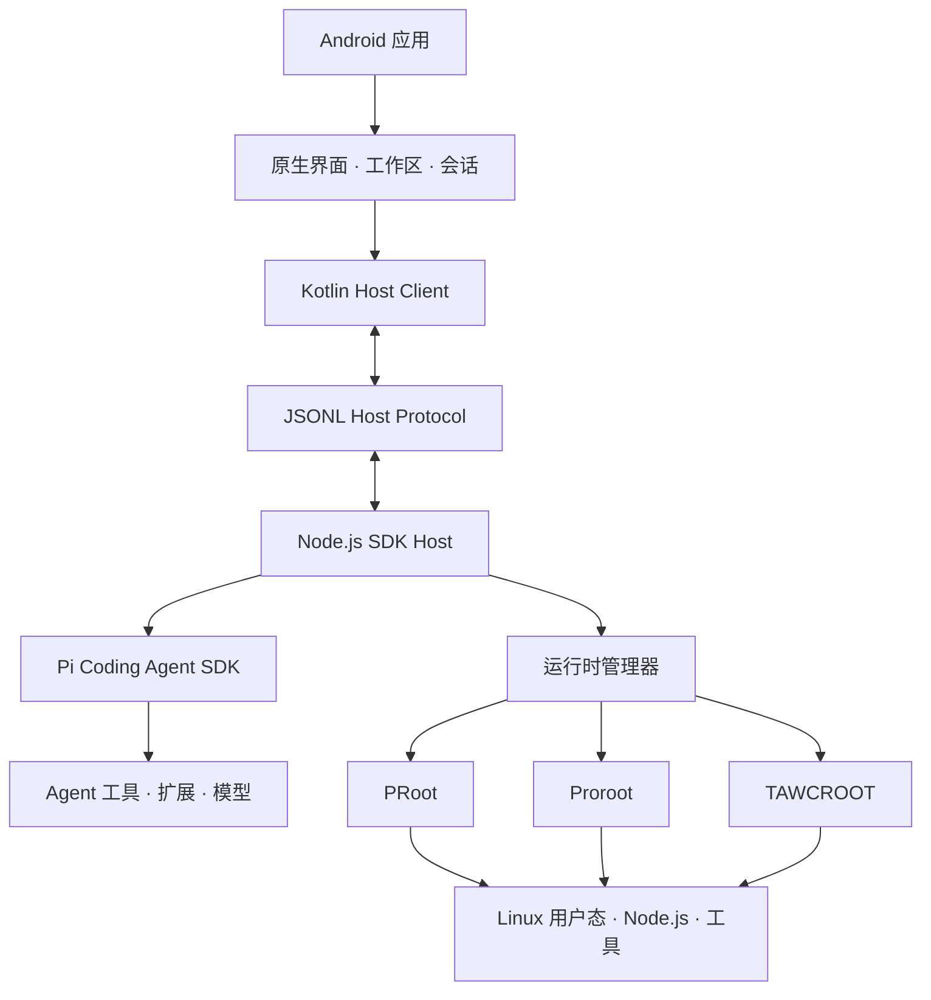

[English](README.md) · **简体中文**

<p align="center">
  
</p>

<p align="center">
  <b>真正的 Coding Agent，在你的 Android 手机上本地运行。</b>
</p>

<p align="center">
  <a href="https://github.com/heikeyangle-code/pi-android/releases">最新版本</a> ·
  <a href="https://github.com/heikeyangle-code/pi-android/actions/workflows/ci.yml">构建状态</a> ·
  Android 8.0+ · ARM64
</p>

Pi for Android 将 Pi Coding Agent 带到 Android 手机上。

它是一款原生 Android 应用，拥有本地项目访问能力、内置 Linux 环境，以及三种可以切换的运行时后端，让你直接在手机上运行真正的 Coding Agent。

无需 Root，无需单独安装 Termux，也不需要远程开发机器。

让手机成为你的开发工作区。

---

## 为什么选择 Pi for Android？

Pi for Android 不只是又一个 AI 聊天应用，而是一个真正可以在手机上工作的 Agent 开发环境。

Agent 可以探索项目、读取和修改文件、执行 Shell 命令、使用扩展，并直接在 Android 设备上继续开发工作。

- **原生 Android 体验**：专为 Agent 开发工作流设计的移动端界面。
- **本地执行**：Agent 和它使用的工具运行在你的设备上。
- **三种运行时切换**：支持 PRoot、Proroot 和 TAWCROOT。
- **真实项目访问**：直接操作手机上的项目目录和文件。
- **基于上游 Pi 引擎**：围绕 Pi Coding Agent 构建，而不是另起炉灶开发一套独立 Agent 引擎。

## 核心功能

### 三种运行时，一个开发环境

不同的 Android 运行时方案，在执行速度、兼容性和稳定性方面各有特点。

Pi for Android 支持三种运行时选择：

| 运行时 | 定位 |
| :--- | :--- |
| **PRoot** | 传统用户态 Linux 运行方案，作为兼容性基准。 |
| **Proroot** | 另一种运行方案，旨在降低传统 PRoot 执行方式带来的额外开销。 |
| **TAWCROOT** | 第三种运行方案，提供不同的执行路径，目前仍在持续完善稳定性。 |

在适合的工作负载下，另外两种运行时相比传统 PRoot 可以获得更好的执行性能。

实际表现会受到设备、任务类型和兼容性要求影响。没有任何一种运行时能够保证在所有设备和所有场景下始终最快、最稳定。

根据自己的设备和工作需求，选择合适的运行时。

### 真正的 Coding Agent，而不只是聊天机器人

Agent 可以：

- 浏览和检查项目文件。
- 搜索源代码。
- 执行 Shell 命令。
- 创建和修改文件。
- 使用工具和扩展。
- 汇报执行结果和代码变更。

工具调用及其输出会以结构化界面展示，让你清楚看到 Agent 正在做什么。

### 手机内置 Linux 环境

不需要 Root，也不需要另外安装 Termux。

应用会在本地配置 Linux 用户态环境和 Node.js 运行环境。锁定的运行时组件包括：

- Ubuntu 24.04 ARM64 用户态环境。
- Node.js 24.22.1。
- Git。
- ripgrep。
- fd。
- 各运行时所需的配套组件。

### 操作真实项目

选择手机上的任意项目目录，将它作为工作区。

浏览文件、检查代码变更、编辑源代码，让 Agent 直接操作同一个本地项目。

### 每一次修改都看得见

工具调用和执行结果会以独立的 UI 组件展示。

- 查看工具执行结果。
- 通过 Diff 界面检查代码修改。
- 在对话中跟踪 Agent 的工作进度。
- 按需展开或折叠详细的思考和工具输出。

### 保留上下文的会话管理

继续之前的工作，浏览对话历史，并使用 Pi 引擎支持的会话分支功能。

### 扩展 Agent 能力

将 Pi 的扩展生态带到 Android。

项目支持通过 Extensions、Skills、Prompts 和 Themes 对 Agent 进行定制，目标是在移动端保留上游 Agent 架构的灵活性。

### 自由配置模型

使用内置的模型供应商预设，也可以配置自定义 OpenAI 兼容接口。

应用遵循上游 Pi 的模型配置体系，而不是另外维护一套无关的模型后端。

---

## 安装

### 系统要求

| 项目 | 要求 |
| :--- | :--- |
| Android | 8.0（API 26）及以上 |
| CPU 架构 | ARM64 / arm64-v8a |
| Root 权限 | 不需要 |
| Termux | 不需要 |
| 网络 | 请求模型供应商接口时需要 |

### 下载与安装

1. 打开 [GitHub Releases](https://github.com/heikeyangle-code/pi-android/releases)。
2. 下载 APK。
3. 在 Android 手机上安装。
4. 启动应用，等待运行时初始化。
5. 选择运行时并配置模型供应商。
6. 打开项目，开始使用 Agent。

首次启动可能需要更长时间，因为应用需要初始化运行时组件。

> **注意：** 当前内置运行时面向 ARM64 Android 设备，暂不支持其他 CPU 架构。

---

## 技术架构

Pi for Android 由原生 Android 应用、本地 Node.js Agent Host，以及可切换的运行时后端组成。

Android 应用负责界面、工作区访问、运行时管理和生命周期集成。

Node.js Host 负责运行 Pi Agent 集成，并通过结构化协议与 Android 应用通信。



### 为什么采用 SDK Host？

SDK Host 使用独立的 Node.js 进程承载 Agent 集成，并向 Android 应用提供结构化接口。

这种方式将 Android 表现层与 Agent 内部实现分离，为后续功能扩展提供更加清晰的架构基础。

Host 协议采用 JSON Lines（JSONL），支持类型化命令、事件、状态更新和 UI 交互请求。

SDK Host 集成已经合并进入主开发分支，但更广泛的迁移和集成工作仍在持续推进，不能将尚未迁移完成的服务视为已经全部完成。

具体实现和迁移说明见 [`docs/sdk-host/`](docs/sdk-host/README.md)。

---

## 技术栈

| 层级 | 技术 |
| :--- | :--- |
| 应用 | 原生 Android |
| UI | Kotlin · Jetpack Compose |
| Agent 引擎 | [Pi Coding Agent](https://github.com/earendil-works/pi) |
| Agent 集成 | Pi SDK · Node.js Host |
| 运行时后端 | PRoot · Proroot · TAWCROOT |
| Linux 用户态 | Ubuntu 24.04 ARM64 |
| JavaScript 运行环境 | Node.js 24.22.1 |
| Host 通信协议 | JSONL |
| 构建系统 | Gradle · Android Gradle Plugin |

### 上游引擎版本

当前项目锁定的版本：

- `@earendil-works/pi-coding-agent`：**1.5.0**

引擎版本通过仓库中的依赖和运行时工具统一管理。

项目的目标是尽可能保持上游 Pi Agent 引擎本身的完整性，在其公开能力之上构建 Android 使用体验。

---

## 开发与构建

### 克隆仓库

```bash
git clone https://github.com/heikeyangle-code/pi-android.git
cd pi-android
```

### 构建 APK

```bash
./gradlew :app:assembleRelease
```

### 执行检查

```bash
./gradlew :rpc:test

node tools/pi-contract.mjs

node tools/sdk-host/contract.mjs
node tools/sdk-host/test.mjs

bash tools/run-app-pure-checks.sh
```

SDK Host 的实现文档：

- [`docs/sdk-host/README.md`](docs/sdk-host/README.md)
- [`docs/sdk-host/architecture.md`](docs/sdk-host/architecture.md)
- [`docs/sdk-host/protocol.md`](docs/sdk-host/protocol.md)
- [`docs/sdk-host/migration.md`](docs/sdk-host/migration.md)

---

## 项目状态

Pi for Android 正在持续开发。

项目已经具备原生 Android 应用、本地 Agent 执行环境、三种运行时选择、项目工作区工作流，以及 SDK Host 集成。

当前主要开发方向：

- 改进不同运行时的兼容性与稳定性。
- 优化运行时选择和切换流程。
- 持续改善 TAWCROOT 的稳定性。
- 继续完善 SDK Host 集成。
- 改进扩展 UI 支持。
- 强化会话和工作区工作流。
- 扩大不同 Android 版本和运行时方案的真机测试范围。

查看当前开发进度和已知问题，请访问 [GitHub Issues](https://github.com/heikeyangle-code/pi-android/issues)。

---

## 参与贡献

欢迎提交代码、问题反馈、功能建议和技术讨论。

- 发现问题？[提交 Issue](https://github.com/heikeyangle-code/pi-android/issues)。
- 希望参与开发？Fork 仓库并提交 Pull Request。

修改运行时、通信协议或 Agent 集成代码时，请尽可能附带对应测试。

---

## 支持项目

如果你觉得 Pi for Android 有用，欢迎给项目点一个 Star。

这能帮助更多开发者发现这个项目，也能鼓励项目继续发展。

**真正的 Coding Agent，三种运行时选择，你的 Android 开发工作站。**

---

## 致谢

Pi for Android 建立在多个优秀开源项目之上：

- [Pi Coding Agent](https://github.com/earendil-works/pi)：Agent 引擎。
- [Node.js](https://nodejs.org/)：JavaScript 运行环境。
- [Ubuntu](https://ubuntu.com/)：Linux 用户态环境。
- [PRoot](https://proot-me.github.io/)：用户态 Linux 执行环境。
- [ripgrep](https://github.com/BurntSushi/ripgrep)：高速代码搜索工具。
- [fd](https://github.com/sharkdp/fd)：文件查找工具。
- [Android](https://developer.android.com/)：原生应用平台。

PRoot、Proroot 和 TAWCROOT 各自保留其上游许可和声明。所有第三方组件均保留各自的许可证和版权。

## 许可证

应用源代码采用 MIT License。

随应用打包的第三方组件仍遵循各自的许可证。许可证文本和组件声明见 [`app/src/main/assets/licenses/`](app/src/main/assets/licenses/)。
