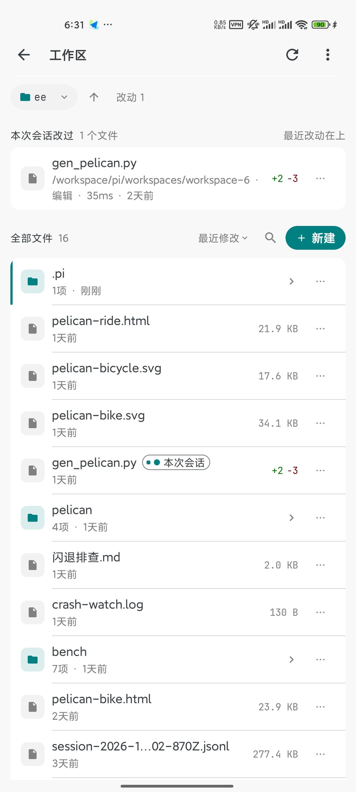
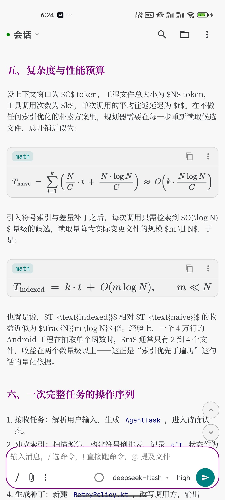
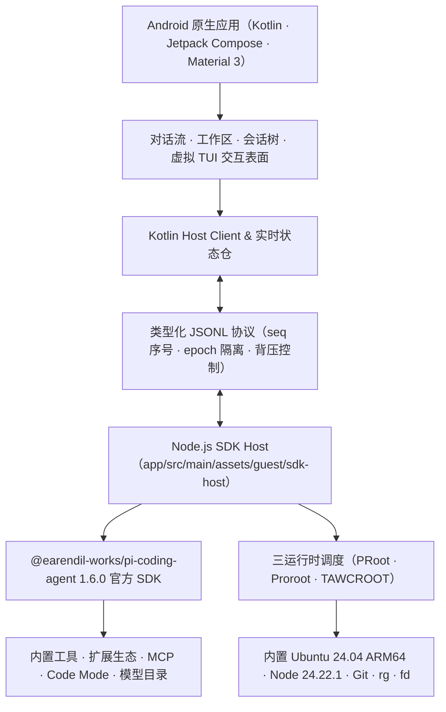

[English](README.md) · **简体中文**

<p align="center">
  
</p>

<h1 align="center">Pi for Android</h1>

<p align="center">
  <b>别再拿手机当远程终端的遥控器了。<br />把一整套真 Linux + 官方 Pi Coding Agent，直接装进口袋。</b>
</p>

<p align="center">
  原生 Jetpack Compose · 官方 Pi 1.6.0 SDK · 三引擎 Linux 容器 · 完整扩展与 TUI 兼容 · 免 Root · 免 Termux
</p>

<p align="center">
  
  
  
  
  
  
</p>

<p align="center">
  <a href="https://github.com/heikeyangle-code/pi-android/releases"><b>⬇ 立即下载最新 APK</b></a> ·
  <a href="https://github.com/heikeyangle-code/pi-android/actions/workflows/ci.yml">构建状态</a> ·
  <a href="https://github.com/heikeyangle-code/pi-android/issues">问题与建议</a>
</p>

---

## 为什么绝大多数「手机 AI 编程工具」都让人用不下去？

如果你想在地铁上、沙发上、出门没带电脑的时候，真正让 AI 帮你干点活，过去你只有三个糟糕的选择：
1. **套壳聊天 App**：只能贴几段代码干聊，不能读本地仓库、不能跑 `git diff`、不能执行命令、更没有扩展和 MCP。
2. **手机 SSH 连远程服务器**：没网就废，断线重连吐血，在 6 寸竖屏里看终端满屏滚动的 ANSI 字符和 diff 简直是折磨眼睛。
3. **手搓 Termux**：装环境、配 Node、配 Git、折腾权限、忍受反人类的虚拟键盘，光把环境搭起来就已经不想写代码了。

**Pi for Android 把这三条路的痛点一次性掀翻了。**

它把完整的 **Ubuntu 24.04 ARM64 用户态 + Node.js 24.22.1 + Git + ripgrep + fd + 官方 [Pi Coding Agent](https://github.com/earendil-works/pi) 1.6.0 SDK** 直接打包进一个原生 Android APK 里。**不用 Root，不用装 Termux，不用买云服务器，不用敲任何初始化命令。** 装完打开，选一个手机里的真实文件夹，你的手机立刻变成一台离线也能跑的本地 Coding Agent 工作站。

| 维度 | 普通手机 AI 聊天 App | Termux / SSH 终端 | **Pi for Android** |
| :--- | :---: | :---: | :---: |
| **真正本地 Linux + Node + Git + rg + fd** | ❌ 只能文字聊天 | ⚠️ 手动折腾半天 | ✅ **开箱即用，免 Root 免 Termux** |
| **移动端原生阅读与 Diff 体验** | ⚠️ 只有气泡框 | ❌ 竖屏小字滚动地狱 | ✅ **原生工具卡、行内字级 Diff、公式与 Mermaid** |
| **运行桌面端 Pi 扩展与交互式 TUI** | ❌ 完全不支持 | ⚠️ 虚拟键盘反人类 | ✅ **虚拟 TUI 表面投影 + 触控/键鼠 + 80 列自适应** |
| **完整模型与 MCP / Code Mode 生态** | ❌ 封闭或阉割 | ✅ 仅纯命令行 | ✅ **原汁原味 Pi 1.6.0 SDK，7 家 OAuth + 35+ 供应商** |
| **调用手机原生能力（无障碍/通知/Shizuku）** | ❌ 做不到 | ⚠️ 折腾脚本 | ✅ **内置 0-Token 设备桥 + 高危操作原生确认框** |

<table align="center">
  <tr>
    <td align="center" width="50%">
      <br />
      <sub><b>克制通透的工具卡与行内字级 Diff</b> —— 每次命令、读文件、改代码都清晰折叠、就地展开，像看代码评审一样舒服。</sub>
    </td>
    <td align="center" width="50%">
      <br />
      <sub><b>手机本地真工作区</b> —— 直接操作手机上的真实项目目录，本次会话改过的文件自动置顶归集。</sub>
    </td>
  </tr>
  <tr>
    <td align="center" width="50%">
      <br />
      <sub><b>旗舰级原生富文本渲染</b> —— 宿主毫秒级语法高亮、LaTeX 数学公式、Mermaid 流程图与全屏看图。</sub>
    </td>
    <td align="center" width="50%">
      <br />
      <sub><b>全生态模型自由</b> —— 7 家订阅账号 OAuth 直登 + 35+ 供应商预设（1,698 个模型），或任意 OpenAI 兼容端点。</sub>
    </td>
  </tr>
</table>

---

## 你在手机上真的可以这样用

- **通勤路上修 Bug / 审 PR**：在本地项目里直接让 Pi 跑 `rg` 定位代码、做 `edit`、看红绿行内 Diff、跑单测并 `git commit`。
- **随手拍张报错截图或粘贴剪贴板图片**：直接甩进对话，甚至混着 `@文件名` 和多份文档一起发给视觉模型定位问题。
- **装上社区 Pi 扩展与 MCP 服务器**：无论是 Code Mode 写脚本编排多工具调用、连 MCP 查文档/数据库，还是跑带交互式浮层的复杂扩展，在手机上照样跑得飞起。
- **把 Agent 变成手机自动化副驾**：按需开启无障碍屏幕操作、通知监听、剪贴板或 Shizuku Shell，让它帮你操作手机；不用的时候一键全关，**严格 0 Token 占用**。

---

## 六大硬核杀手锏

### 1. 硬核级 Pi 扩展与移动端 TUI 兼容引擎（把桌面终端生态搬上触屏）
> 移动端 Agent 客户端最容易「偷工减料」的地方就是扩展兼容。别人做不到的交互式终端组件、自定义工具卡片、扩展补全和终端控制符，**Pi for Android 全部啃了下来，而且做到了近乎 1:1 的官方还原。**

- **虚拟 TUI 表面实时投影（`ui/surfaces.mjs` → 原生 Compose 交互面板）**：
  - 扩展调用 `ctx.ui.custom()`、`setWidget()`、`setHeader()`、`setFooter()`、`tui.showOverlay()` 时，宿主把真实 Pi TUI 组件挂载到虚拟终端表面，按帧去重推送给 Android 原生界面，**支持最小化常驻停靠栏、随时收起与重开**。
  - 完整实现官方 `OverlayHandle`（`hide` / `setHidden` / `focus` / `unfocus` / `getBounds`）、`Focusable.focused` 焦点流转与 `OverlayOptions`（`visible(w, h)`、`nonCapturing` 等）。
  - **小屏自适应宽度 + 触控键鼠双打通**：默认「适配宽度」把 80 列桌面 TUI 自动缩放进手机屏幕，并按真实列数回传 `ui.resize`；视口高度按屏幕动态计算，不再死板截断；接入官方 `KeybindingsManager` 匹配快捷键，并把触屏点按实时翻译为 `TuiMouseEvent` 交给组件的 `handleMouse()`。
  - **终端控制序列原生桥接**：精准剥离零宽 `CURSOR_MARKER`、把 `FAKE_CURSOR` 转为反显 SGR，并实时拦截 `tui.terminal.write()` 发出的 **`BEL`（`\x07`）响铃**、**OSC 777 / 99 / 9 通知**、**OSC 0/2 窗口标题**与 **OSC 9;4 进度指示** —— 连社区写的终端小游戏音效和进度条，在手机上都能活起来！
- **1:1 官方扩展渲染与拦截管线（`commands/catalog.mjs`）**：
  - 第三方扩展与 MCP 工具直接交给官方 `ToolExecutionComponent`（经 `resolveToolRenderers`）渲染，完整保留 `details`、跨帧持久化 `state`、`renderShell: "self"` 自绘框架，以及防抖异步重绘（`render.invalidate`）。
  - 全面接通 `registerMessageRenderer`（`CustomMessageComponent`）、`registerEntryRenderer`（`CustomEntryComponent`）、`registerMarkdownTransformer`、`addAutocompleteProvider`（输入框实时补全扩展命令与参数）、`onTerminalInput`、`registerFlag` 与真实 `FooterDataProvider`（实时 Git 分支与可用供应商计数）。
  - 会话切换与 `/reload` 严格同步官方 `resetExtensionUI`（`ui.reset`）与 `catalog.changed` —— 装完新扩展包，**一键重载，命令面板、工具列表与模型目录秒级同步**。
- **随包内置的自研原生增强扩展（`app/src/main/assets/pi-extensions/`）**：
  - **`pi-highlight`**：通过认证本地回环服务直接复用 guest 里 Pi 自带的 `highlight.js` 与 `lovely-mermaid`，不在 Android 端塞第二套 JS 引擎，就能实现毫秒级语法高亮与 Mermaid 排版，且配色 100% 跟随官方主题。
  - **`pi-android-bridge` + `pi-android-permission-gate`**：把 Android 设备能力封装为标准 Pi 扩展，关闭即零消耗，高危操作按规则拦截弹窗。
- **透明统一的扩展与资源中心（设置 → 扩展与资源）**：
  - 扩展、技能（Skills）、提示模板、主题、上下文文件、npm/git 包、MCP 服务器与项目信任一站直达；每一条都标明真实磁盘路径与作用域（项目级 / 全局级），没有封闭私有商店，与桌面端 `~/.pi/agent/` 和 `.pi/` 配置 100% 互通。

---

### 2. 真 Linux 装进口袋，三套容器引擎随心切
不用 Root、不用 Termux，首次打开自动展开确定性打包的完整用户态：**Ubuntu 24.04 ARM64 · Node.js 24.22.1 · Git 2.43 · ripgrep 15.2 · fd 10.2 · Pi 1.6.0**。

更重要的是**按载荷增量更新机制**：每个组件独立校验摘要与文件清单，以后升级 App 只替换变动的 `pi-engine`，**你在容器里自己装的工具和环境全部原样保留，绝不白洗盘。**

三套运行时后端按机型自由切换：

| 运行时 | 定位与优势 |
| :--- | :--- |
| **PRoot** | Termux 构建的经典用户态系统调用翻译层，最稳的兼容性基线。 |
| **Proroot** | 基于链接器与进程内 hook 的轻量替代运行时，大幅削减 PRoot 系统调用开销。 |
| **TAWCROOT** | 基于单进程 `seccomp` 的高速方案（从固定上游源码编译），持续打磨稳定性。 |

---

### 3. 直接跑官方 Pi 1.6.0 SDK —— 上游一进化，你立刻白吃
Pi for Android 不是山寨重写，也不是脆弱的 CLI 文本解析器，而是由独立 **Node.js SDK Host** 通过带背压、带序号校验（`seq`）、带会话代际隔离（`epoch`）的 JSONL 协议直接驱动官方 SDK：

- **第一时间享受上游最新进化**：已升级至 **Pi `1.6.0`** —— 内置 **GPT-6.2 Sol / GPT-6.2 Astra**（OpenAI / Azure / Codex 默认切换，自动隐藏不支持的 `off` 思考档位）、通义 Token Plan 新网关与 `qwen4-max-preview` / `deepseek-v4.1-flash`、1,698 个官方 chat 模型、`undici 8.12.4`（6 项 GHSA 安全修复）、Codex 长思考断连续传与缓存命中优化。
- **深度吃透 1.6.0 宿主新特性**：接入 `takeUnreportedDiagnostics()`（启动与每次会话替换精准推送模型回退与扩展报错）、`commandOutput: "capture"`（彻底防止 `git`/`npm` 污染管道或卡死密码输入）、OpenAI & Anthropic 推理块被丢弃实时诊断通知、以及 `read` 非视觉模型读图折叠态警告。
- **秒级冷启动与实时状态推流**：优先加载 `dist/bundle/index.js` 打包入口、延迟加载重型模块；上下文用量、Token 计数与费用全部由宿主 `stateStore` 实时推送，告别卡顿轮询。

---

### 4. 为手机审美与流畅度重做的阅读体验 + 100% 官方主题兼容
- **克制、耐看的无描边色块美学**：对话流工具卡彻底告别刺眼重边框（仅运行中保留柔和呼吸微描边），思考过程收敛为不打扰阅读的单行胶囊（`思考中…` / `已思考 12s`），代码 Diff、LaTeX 公式、Mermaid 图表与全屏看图浑然一体。
- **100% 兼容官方 Pi 主题**：完整解析官方主题 JSON 与 `okhsl()` / `oklch()` 色彩空间，所有主题色块自动计算前景对比度，零硬编码白字，随便导入社区深浅主题都能保证高对比、高颜值。
- **全能多源附件 + 防亿像素 OOM**：相册多选、文档多选、剪贴板图片一键粘贴、`@` 工作区文件引用一站配齐；内置 `computeSafeSampleSize()` 安全下采样，完美对齐 Pi 图片压缩档位与每模型单条消息图片上限，亿像素原图也不爆内存。
- **移动端内存精简与丝滑滚动**：图片缓存采用 SHA-256 紧凑键（键内存直降 99.999%，有效容量暴涨 5–10×），统一 `PiMemoryTrimmer` 响应系统 `onTrimMemory()` 与会话切换回收；消除输入框静止态 60–120fps 无效重组，动画全部下沉 `graphicsLayer`。

---

### 5. 官方级 `/tree` 分支导航 + 毫秒级跨项目 `/resume` 搜索
- **1:1 复刻官方会话树（`/tree`）**：完整支持 5 档过滤（默认 / 无工具结果 / 仅用户消息 / 仅书签 / 全部）、分支折叠、树内搜索、当前分支优先与任意节点无损分叉。
- **增量索引会话列表（`/resume`）**：持久化 `.session-list-index.json` 增量索引 + 按工作区分组，打开即秒出；输入关键词自动无缝回源官方全文相关性搜索，跨几十个历史项目也能瞬间找回那段对话。

---

### 6. 按需开启的 Android 设备能力（关闭即严格 0 Token）
在 **设置 → 设备能力** 中，你可以把手机本身变成 Agent 的扩展外设：
- **三大清爽分组**：屏幕自动化（无障碍读取/点击/滑动/输入/截屏）、系统交互与硬件（通知监听、剪贴板、定位、相机、应用启停）、设备 Shell（Shizuku / ADB）。
- **2×2 实时就绪状态看板** + 一键「全部关闭」按钮，权限状态一目了然。
- **安全与省钱双底线**：未启用的工具**绝不注册给模型（严格 0 Token）**；一旦涉及 `pm uninstall`、`pm clear`、`dd`、强制停止应用等不可逆高危操作，权限闸门强制弹出原生三选一确认框，绝不替你自作主张。

---

## 30 秒极速上手

| 运行要求 | 说明 |
| :--- | :--- |
| **系统版本** | Android 8.0（API 26）及以上 |
| **CPU 架构** | ARM64（`arm64-v8a`） |
| **Root / Termux** | **都不需要** |
| **覆盖升级** | 固定侧载签名，新版直接覆盖安装，保留全部会话与容器环境 |

1. 前往 **[GitHub Releases](https://github.com/heikeyangle-code/pi-android/releases)** 下载最新 `pi-android-*-sideload28-arm64.apk`。
2. 安装并打开，等待首次内置 Linux + Pi 引擎自动解包完成。
3. 在 **设置 → 模型与供应商** 登录你的账号（支持 7 家 OAuth 订阅直登、API Key 或自定义 OpenAI 兼容接口）。
4. 选一个手机上的项目目录，开始你的口袋 Coding Agent 体验。

---

## 系统架构与工程严谨度



### 面向开发者的工程护城河
- **299 项真引擎集成测试 + 契约守卫**：每次提交都在真实 Pi SDK 上跑满 `contract.mjs`（覆盖公开导出 + 全部内部 `dist/` 路径）与 3 套 `test.mjs`（`bundle` / `--no-bundle` / `--scandir-fix`），再叠加 `:rpc` JVM 单测、Android API 静态守卫、TAWCROOT NDK 编译与双变体签名 APK 构建（6/6 GitHub Actions CI）。
- **自动化上游升级审计流**：内置 [tools/pi-upgrade-audit.mjs](tools/pi-upgrade-audit.mjs) 与 [docs/sdk-host/upgrading.md](docs/sdk-host/upgrading.md)，上游 Pi 一发新包，一条命令自动扫描 9 条集成接缝并精确列出宿主层与 App 层改动清单。

```bash
git clone https://github.com/heikeyangle-code/pi-android.git
cd pi-android

# 检查上游 Pi 更新并审计全部 9 条集成接缝
node tools/pi-upgrade-audit.mjs --check-only

# 运行真实 Pi SDK 契约检查与 299 项宿主测试
node tools/sdk-host/contract.mjs
node tools/sdk-host/test.mjs

# 运行协议单测并构建发布版 APK
./gradlew :rpc:test
node tools/fetch-runtime.mjs
./gradlew :app:assembleRelease
```

相关技术文档：
- [`docs/sdk-host/architecture.md`](docs/sdk-host/architecture.md) — SDK Host 架构与生命周期
- [`docs/sdk-host/protocol.md`](docs/sdk-host/protocol.md) — 线协议 v1 规范
- [`docs/sdk-host/upgrading.md`](docs/sdk-host/upgrading.md) — 上游 Pi 发包六步升级标准流程
- [`docs/runtime-engines.md`](docs/runtime-engines.md) — PRoot / Proroot / TAWCROOT 对比说明

---

## 坦诚说明与参与贡献

- **CI 绿灯能证明什么**：6/6 CI 全绿证明代码可编译、与锁定版本 Pi SDK 契约 100% 对齐、双签名 APK 装配完整；具体机型的三运行时切换与硬件权限体验需以真机实测为准。
- **界面语言**：当前界面为简体中文，中英双语（`strings.xml` 抽离 + App 内零重启切换）已进入规划与推进阶段。
- **欢迎 Star 与 PR**：如果你喜欢「把真正的 Coding Agent 塞进手机」这件事，欢迎点一颗 **Star** 支持！无论你是想提 Issue、补充更多机型实测反馈，还是参与多语言与扩展生态建设，都非常欢迎。

---

## 致谢与许可证

本项目建立在以下优秀项目之上：
[Pi Coding Agent](https://github.com/earendil-works/pi) · [Node.js](https://nodejs.org/) · [Ubuntu](https://ubuntu.com/) · [PRoot (Termux)](https://github.com/termux/proot) · [Proroot](https://github.com/coderredlab/proroot) · [TAWCROOT](https://github.com/wmww/tawc)（MIT, © Sophie Winter）· [ripgrep](https://github.com/BurntSushi/ripgrep) · [fd](https://github.com/sharkdp/fd) · [JetBrains Mono](https://github.com/JetBrains/JetBrainsMono) · [思源宋体 CN](https://github.com/adobe-fonts/source-han-serif)

应用源代码采用 **MIT License** 开源。随包分发的第三方组件保留各自上游许可证（PRoot 取自 Termux 构建、Proroot 为未修改专有二进制、TAWCROOT 为 MIT 等），完整许可文本与声明随包内置在 [`app/src/main/assets/licenses/`](app/src/main/assets/licenses/)。
