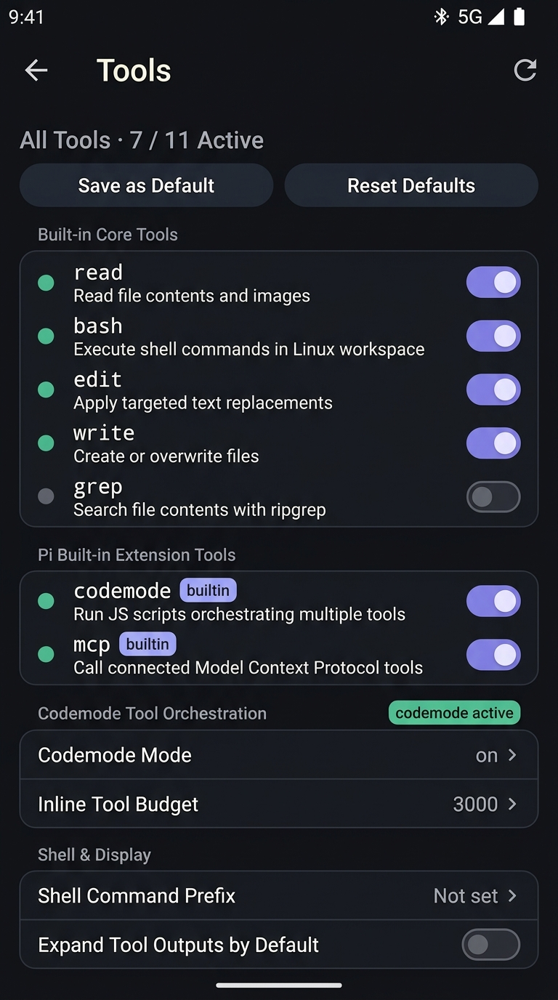
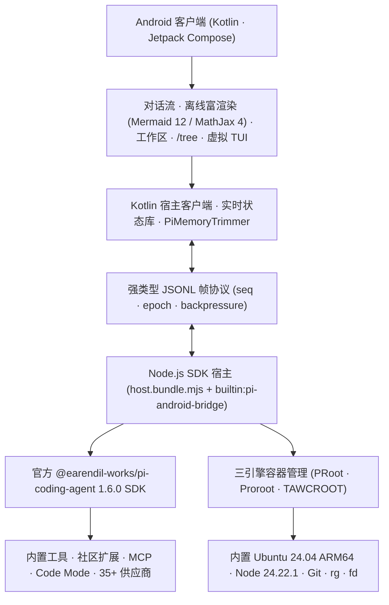

[English](README.md) · **简体中文**

<p align="center">
  
</p>

<h1 align="center">Pi for Android</h1>

<p align="center">
  <b>手机上真正满血的原生 AI Coding Agent。</b><br />
  不是套壳聊天框，不是脆弱 SSH，更不用折腾 Root 和 Termux。<br />
  装上一个 APK，你的 Android 手机就是一台随身全栈 AI 研发工作站。
</p>

<p align="center">
  
  
  
  
  
  
  
</p>

<p align="center">
  <a href="https://github.com/heikeyangle-code/pi-android/releases"><b>⬇ 立即下载最新 APK</b></a> ·
  <a href="#30-秒极速上手">30 秒上手</a> ·
  <a href="#硬核工程与底层架构">硬核架构</a> ·
  <a href="https://github.com/heikeyangle-code/pi-android/actions/workflows/ci.yml">CI 状态</a> ·
  <a href="https://github.com/heikeyangle-code/pi-android/issues">问题与建议</a>
</p>

---

## 为什么它是手机上真正能干活的 AI Coding Agent？

市面上绝大多数所谓「手机 AI 编程软件」，要么是只能空谈代码的套壳聊天框，碰不到真实文件、跑不了测试、提交不了 Git；要么逼你顶着 6 寸屏幕折腾 SSH 和 Termux，进了地铁一断网、键盘一遮屏就彻底抓瞎。

**Pi for Android 直接把整套真实开发环境和官方顶级 Coding Agent 装进了手机里：** 开箱内置真 Linux 运行时、**100% 官方 Pi 1.6.0 SDK**、移动端顶级离线富渲染引擎，以及专为单手触控重塑的原生 Jetpack Compose 交互体验。

- **真·本地满血开发环境（免 Root · 免 Termux）**：内置完整 **Ubuntu 24.04 ARM64 + Node.js 24 + Git + `rg` + `fd`**。直接打开手机里任何真实代码目录，毫秒级搜代码、看红绿字级 Diff、改文件、跑单测、做 `git commit`——就算彻底离线也能干活。
- **100% 官方 Pi 1.6.0 全生态，绝非阉割魔改**：直跑官方 SDK 内核，桌面端怎么玩手机上就怎么玩——社区扩展、**MCP 工具生态**、**Code Mode** 多工具编排、`/tree` 会话分支树、`/export` & `/import` 全打通，桌面端 `~/.pi` 配置与主题 JSON 直接拖进来就能用。
- **顶级全模型自由，不锁厂商不收抽成**：支持 **7 家订阅账号 OAuth 一键直登** + **35+ 主流供应商预设（1,698+ 模型）** + 任意 OpenAI 兼容或本地自建接口；支持从 `off` 到 `max` 全档位思考深度、作用域模型切换与手动/自动上下文压缩。
- **桌面级离线富渲染，手机看代码与图表同样惊艳**：内置离线 **Mermaid 12**（20+ 种图表高清渲染、双指缩放、一键全屏）、**MathJax 4** 全语法数学公式、`<1 ms` 35+ 语言原生高亮、红绿行内字级 Diff，以及 SVG / HTML / CSV / JSON / YAML 交互卡片，长流式输出零抖动。
- **业界独创移动端虚拟 TUI 引擎**：桌面端那些带全屏交互界面、悬浮 HUD、进度条、终端音效和可点击超链接的 Pi 扩展，在手机上直接原生投影成精美交互面板，支持自然手指滑动、触屏直控与紧凑虚拟按键条。
- **可选 Android 设备自动化副驾**：按需开启无障碍控屏、通知监听、剪贴板、位置、相机、应用控制或 Shizuku Shell，让 Agent 真正帮你操作手机；不用时一键全关，**严格 0 Token 占用**，高危操作强制三选一人工确认。

---

## 实机界面一览

<table align="center">
  <tr>
    <td align="center" width="50%">
      <br />
      <sub><b>口袋里的 Code Review 体验</b> —— Shell 执行、文件读取与红绿行内字级 Diff 优雅折叠，点按就地展开审阅。</sub>
    </td>
    <td align="center" width="50%">
      <br />
      <sub><b>Agent 能力实时掌控</b> —— 内置工具、扩展工具与 MCP 工具实时启停，一站配置 Pi 1.6.0 Code Mode。</sub>
    </td>
  </tr>
  <tr>
    <td align="center" width="50%">
      <br />
      <sub><b>提示词与上下文管线全透明</b> —— 全局与项目级 <code>SYSTEM.md</code> / <code>APPEND_SYSTEM.md</code> / <code>AGENTS.md</code> 随时查看、编辑与一键重载。</sub>
    </td>
    <td align="center" width="50%">
      <br />
      <sub><b>全生态模型自由接入</b> —— 7 家订阅 OAuth 直登、35+ 供应商预设（1,698+ 模型）或任意自定义端点。</sub>
    </td>
  </tr>
</table>

---

## 与传统方案对比

| 核心能力 | 普通手机 AI 聊天套壳 | Termux / SSH 远程终端 | **Pi for Android** |
| :--- | :---: | :---: | :---: |
| **本地 Linux + Node 24 + Git + `rg` + `fd`** | ❌ 只能纯文本聊天 | ⚠️ 手动配置耗时折腾 | ✅ **内置开箱即用 · 免 Root · 免 Termux** |
| **移动端代码 Diff、Mermaid 12 与 MathJax 4** | ⚠️ 简陋聊天气泡 | ❌ 满屏滚动 ANSI 字符 | ✅ **字级 Diff · 20+ 图表 · 离线公式** |
| **桌面端 Pi 扩展与全屏交互式 TUI** | ❌ 完全不支持 | ⚠️ 手机软键盘极难操控 | ✅ **原生虚拟 TUI 投影 + 手指自然滑动 + OSC 8** |
| **模型、MCP 与 Code Mode 全生态** | ❌ 封闭锁厂商 | ✅ 仅命令行 | ✅ **100% 官方 Pi 1.6.0 · 7 家 OAuth · 35+ 供应商** |
| **可选 Android 设备自动化** | ❌ 不可能 | ⚠️ 脆弱手工脚本 | ✅ **内建 `builtin:pi-android-bridge` · 关即 0 Token** |

---

## 30 秒极速上手

| 运行要求 | 说明 |
| :--- | :--- |
| **Android 版本** | Android 8.0 (API 26) 及以上 |
| **CPU 架构** | ARM64 (`arm64-v8a`) |
| **Root / Termux** | **均不需要** |
| **无损覆盖升级** | 固定 sideload 签名，新版本 APK 直接覆盖安装不丢环境与数据 |

1. 前往 **[GitHub Releases](https://github.com/heikeyangle-code/pi-android/releases)** 下载最新版 `pi-android-*-sideload28-arm64.apk`。
2. 安装并打开，首次启动自动解压内置 Linux 与 Node.js 运行时。
3. 进入 **设置 → 模型与供应商**，一键 OAuth 登录订阅账号、填写 API Key 或接入任意 OpenAI 兼容端点。
4. 选中手机里的任意项目文件夹，立刻开始写代码。

---

## 硬核工程与底层架构

上面每一项丝滑的商业级体验，底层都没有走任何捷径。如果你关心系统架构、运行时性能、协议设计与上游兼容性，以下是 Pi for Android 的硬核工程细节。

### 1. 100% 官方 Pi 1.6.0 SDK + 移动端真实虚拟 TUI 投影引擎
- **直跑官方 SDK（单文件 `host.bundle.mjs`）**：通过强类型、带背压与 Epoch 隔离的 JSONL 宿主直接驱动 `@earendil-works/pi-coding-agent`——不魔改核心语义，100% 兼容桌面端 `~/.pi/agent/` 与 `.pi/` 目录，上游新版本能力平滑同步。
- **官方斜杠命令全闭环**：`/model`、`/thinking`（带实时档位校验）、`/tree`、`/fork`、`/clone`、`/export`（直调官方 `exportToHtml` 与 `exportToJsonl`）、`/import [path]`、`/compact`、`/reload`、`/trust`（就地弹出官方 `ProjectTrustHost`）、`/login`、`/logout`（就地一键退出）、`/changelog`（直读内置 SDK `CHANGELOG.md`）以及全部扩展命令与快捷键全接入。
- **虚拟 TUI 表面引擎（`ui/surfaces.mjs` → Jetpack Compose）**：扩展调用 `ctx.ui.custom()`、`setWidget()`、`setHeader()`、`setFooter()`、`tui.showOverlay()` 时自动投影为可折叠/最小化停靠的原生面板，完整支持 `OverlayHandle`、`Focusable`、自适应列宽、可点击 **OSC 8 超链接**、手指自然滑动（`TuiMouseEvent` + 自动 `↑/↓` 兼容回退）、官方 `KeybindingsManager` 与遵循系统静音/震动模式的终端响铃和进度序列（`BEL` / `OSC 9;4` / `OSC 777`）。
- **1:1 官方扩展工具渲染**：扩展与 MCP 工具卡片直走官方 `ToolExecutionComponent`（`resolveToolRenderers`），保留逐调用状态、动态同步应用色板与真实 `theme.name`，并支持热重载。

### 2. 三引擎可切换本地 Linux 运行时与增量无损升级
首次启动按摘要校验自动解压确定性本地环境（**Ubuntu 24.04 ARM64 · Node.js 24.22.1 · Git 2.43 · ripgrep 15.2 · fd 10.2 · Pi 1.6.0**）。后续升级 APK 仅比对各分包摘要并增量更新变化部分，**绝不清空你在容器里装好的包与工具**。

| 运行时引擎 | 工程定位与特点 |
| :--- | :--- |
| **PRoot** | 久经考验的用户态系统调用翻译（Termux 构建），跨机型与 ROM 兼容性基线。 |
| **Proroot** | 自定义动态链接器 + 进程内 Hook，大幅削减 PRoot 系统调用开销。 |
| **TAWCROOT** | 基于上游 NDK 源码编译的单进程 `seccomp` 后端，低开销接近原生执行效率。 |

### 3. 桌面级离线富渲染管线
- **离线 Mermaid 12.2.0 高清 Chromium/Skia 引擎**：支持 20+ 种 Mermaid 12 全系图表（流程图、时序图、类图、状态图、ER、甘特图、思维导图、时间线、Git 图、象限图、饼图、XYChart、桑基图、看板、架构图、C4 等），锁定真实 CSS 视口与 DPR 缩放、双 `rAF` 同步抓取、自动软件层重试防离屏白图、双指缩放与一键全屏看图。
- **离线 MathJax 4 全语法数学公式**：精准渲染行内 `$...$` / `\(...\)` / `\[...\]`、单/多行 `$$...$$`、`math` 代码块以及独立 `\begin{aligned/equation/align/gather/cases/matrix}` 环境，完美支持中文紧邻排版并自动规避 `$5 and $10` 货币误判。
- **流式零抖动与回滚瞬开**：双路径 GFM AST 解析（长流式走 `Channel.CONFLATED` 后台并发 + 短内容/缓存命中帧 0 同步）、`<1 ms` 35+ 语言原生高亮、`TailFollow` 精准锁底、`RowHeightCache` 防跳高，配合跨滚动 LRU 缓存（`PiMarkdownDocCache` & `PiCodeHighlightCache`）与 `PiMemoryTrimmer` 统一内存回收。
- **100% 官方 Pi 主题规范 + 中英双语零重启切换**：完整支持 `okhsl()` / `oklch()` 与自动 WCAG 前景对比度计算，外观页内置实时预览卡与无损主题 JSON 导入。

### 4. 亚秒级冷启动与 12 项自动化性能守卫
由 `tools/check-startup-perf.mjs` 在每次提交中强制校验：单文件 `host.bundle.mjs`、冷启动零 `jiti` / `Babel` / `undici` / `WebView` 初始化、`host.ready` 内嵌握手载荷、`session.open` 直出初始状态快照、`planDirect` 直拉 Node（无 `/bin/bash -c`）、并行 I/O 预处理、APK 版本戳 O(1) 跳过重复校验与后台错峰任务。

### 5. 可选 Android 设备能力桥（`builtin:pi-android-bridge`）
以官方 Pi SDK 原生 `builtin: true, replaceable: true` 机制内建（**设置 → 设备能力**）：
- **三大能力分组**：屏幕自动化（无障碍）、系统与硬件（通知、剪贴板、位置、相机、应用控制）、设备 Shell（Shizuku）。
- **零占用 + 防误操作**：关闭的能力绝不注入模型上下文（**严格 0 Token**）；不可逆高危操作强制弹出原生三选一确认框。

---

## 系统架构与 CI 工程质量



每次推送均通过 **6 项完整 GitHub Actions CI 门禁**（TAWCROOT NDK 编译、**339 项真实 SDK 宿主测试**覆盖 bundle / unbundled / `--scandir-fix` 与冷启动 `import-audit`、Android API / 双语 / 12 项冷启动静态守卫、JVM 单元测试以及 `modern36` + `sideload28` 双签名 APK 构建）：

```bash
git clone https://github.com/heikeyangle-code/pi-android.git
cd pi-android
node tools/sdk-host/contract.mjs
node tools/sdk-host/test.mjs
node tools/check-startup-perf.mjs
./gradlew :protocol:test
node tools/fetch-runtime.mjs
./gradlew :app:assembleRelease
```

**技术文档**：[`架构设计`](docs/sdk-host/architecture.md) · [`通信协议`](docs/sdk-host/protocol.md) · [`升级指南`](docs/sdk-host/upgrading.md) · [`运行时引擎`](docs/runtime-engines.md) · [`AGENTS.md`](AGENTS.md)
