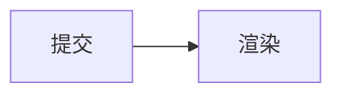

<!-- @case cf-ts-title | now=source | expect=rich | 期望：语言 ts + 文件名 src/main.ts 进标题行，正文走 typescript 高亮。今天整条 info string 被当语言名（标签显示 `ts title="src/main.ts"`，highlight.js 不认 → 整块未高亮）。 -->
```ts title="src/main.ts"
export function greet(name: string): string {
  return `hello ${name}`
}
```

<!-- @case cf-kotlin-filename | now=source | expect=rich | 期望：语言 kotlin + 文件名 MainActivity.kt。今天 `kotlin filename="MainActivity.kt"` 整串不识 → 未高亮、标签显示整串。 -->
```kotlin filename="MainActivity.kt"
class MainActivity : ComponentActivity() {
    override fun onCreate(savedInstanceState: Bundle?) {
        super.onCreate(savedInstanceState)
    }
}
```

<!-- @case cf-python-file | now=source | expect=rich | 期望：语言 python + 文件名 scripts/main.py。今天整串当语言名 → 未高亮。 -->
```python file="scripts/main.py"
def main() -> int:
    print("hello")
    return 0
```

<!-- @case cf-title-with-space | now=source | expect=rich | 引号内的空格必须原样进文件名（`deploy prod.sh`），不能被空格切成两个属性；语言仍须是 bash。 -->
```bash title="deploy prod.sh"
set -euo pipefail
./gradlew :app:assembleDebug
```

<!-- @case cf-unknown-attr | now=source | expect=rich | 未识别属性（`linenums=true start=42`）不得导致语言识别失败：语言仍是 kotlin、仍须高亮；属性可以忽略。今天整串不识。 -->
```kotlin linenums=true start=42
fun answer(): Int = 42
```

<!-- @case cf-no-info | now=source | expect=source | 没有 info string：不得猜语言、不得自动检测（pi 明确拒绝 cli-highlight 的自动检测）。今天无标签行、整块 mdCodeBlock 色；升级后仍是普通代码块。 -->
```
plain text, no language
```

<!-- @case cf-uppercase | now=source | expect=source | `Kotlin` 已被 normalize 成 `kotlin`（`PiCodeLanguage.normalize` trim+lowercase），今天就能高亮。这是护栏：升级不得把已经正确的大小写归一弄丢。 -->
```Kotlin
val x = 1
```

<!-- @case cf-language-prefix | now=source | expect=source | `language-kotlin` 不是 highlight.js 的语言名，pi 也不剥这个前缀。**有意保持源码**：方案没有要求支持 `language-` 前缀，加它会偏离 pi。 -->
```language-kotlin
val x = 1
```

<!-- @case cf-mermaid-title | now=approx | expect=rich | mermaid 判定只看首个空白分隔 token（`PiMarkdownComponents.kt` 的 `rememberPiMermaidArt`），所以 `title="登录流程"` 被忽略、今天仍出 ASCII 图。升级后应为 SVG；title 是否进图题**待父代理决定**。 -->


<!-- @case cf-long-line | now=source | expect=source | 单行 300 字符：今天只有 horizontalScroll，不折行。升级后需要「自动换行 / 横向滚动」切换（`tools` 那部分属 Phase 1），但内容仍应是代码块——它靠真机截图验收，不在文本断言里。 -->
```javascript
const payload = { id: "a1b2c3d4e5f6", kind: "code-fence-long-line", detail: "this single line exists to make horizontal scrolling visible on a phone narrower than the line", retries: 3, timeoutMs: 750, note: "no wrap today" }
```
