<!-- @case mm-flowchart | now=approx | expect=rich | flowchart（含 subgraph、多种节点形状、边标签）。今天 `grok-mermaid 0.2.3` 画 Unicode 框线图，靠 horizontalScroll 看全；升级后应为可缩放 SVG。 -->
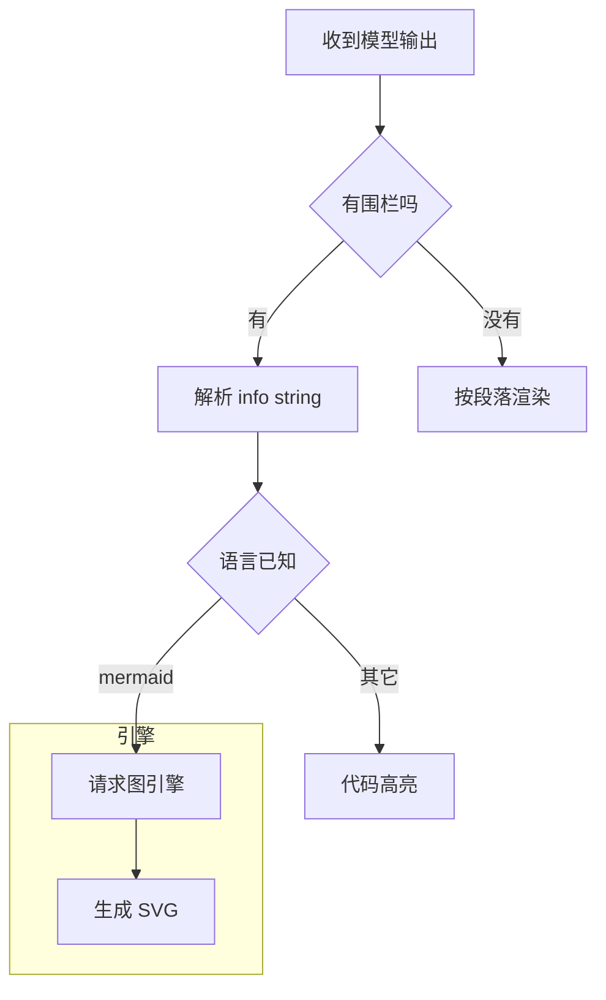

<!-- @case mm-sequence | now=approx | expect=rich | sequenceDiagram：participant / 实线虚线箭头 / Note / alt。今天 ASCII 时序图。 -->
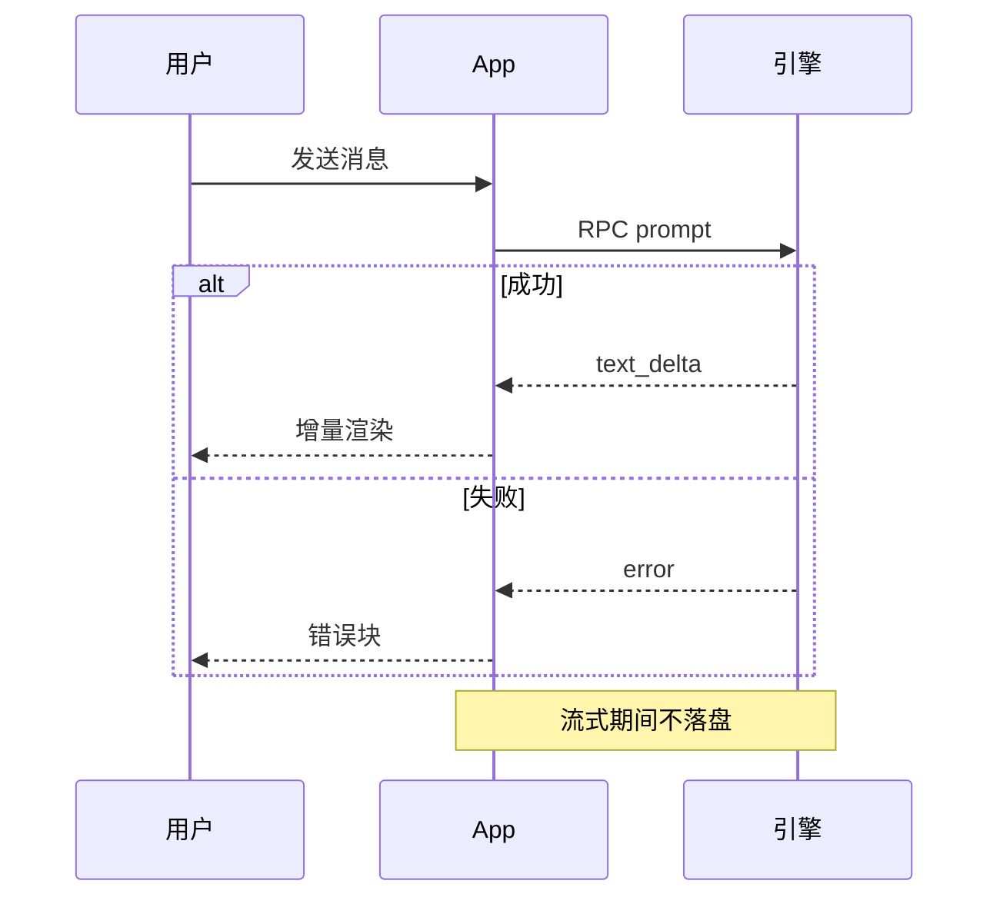

<!-- @case mm-class | now=approx | expect=rich | classDiagram：继承、组合、可见性标记。今天 ASCII 类图。 -->
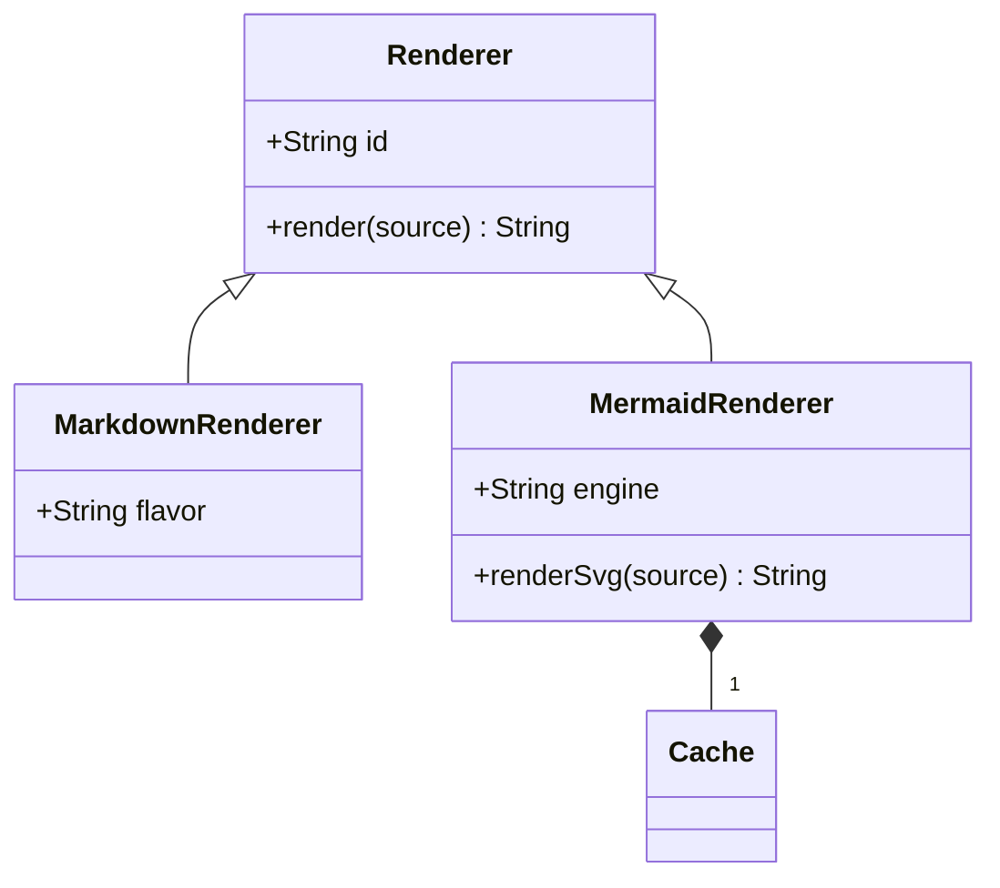

<!-- @case mm-state | now=approx | expect=rich | stateDiagram-v2：[*] 起止、命名迁移、复合状态。今天 ASCII 状态图。 -->
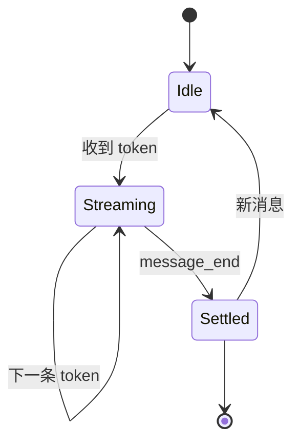

<!-- @case mm-er | now=approx | expect=rich | erDiagram：实体、关系基数、属性（PK）。今天 ASCII ER 图。 -->
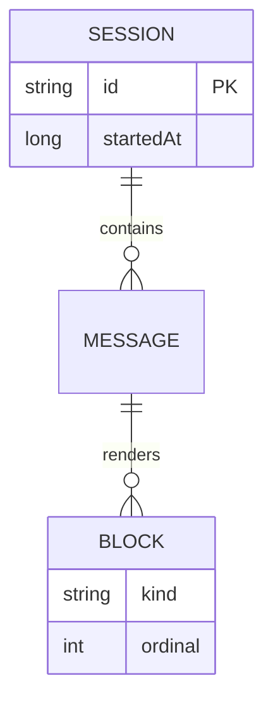

<!-- @case mm-gantt | now=source | expect=rich | gantt：`grok-mermaid 0.2.3` **不认甘特图**（其 README 明列只支持 flowchart/graph、state、class、ER、sequence），所以今天渲染结果是源码块。升级后必须由 Mermaid.js 出 SVG；这一条是「今天源码 → 升级后图形」的样本。 -->
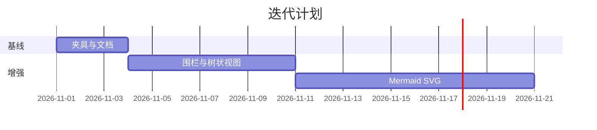

<!-- @case mm-mindmap | now=source | expect=rich | mindmap：今天不支持（同上）→ 源码。 -->
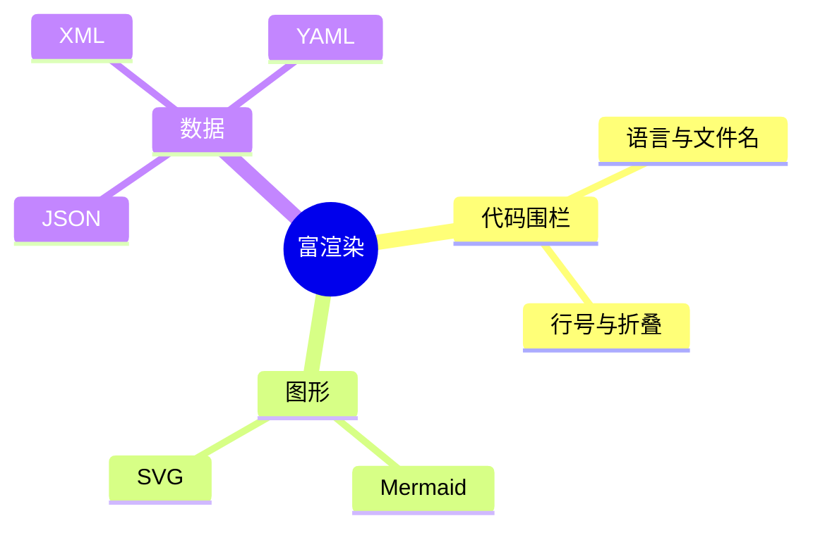

<!-- @case mm-pie | now=source | expect=rich | pie：今天不支持 → 源码。 -->
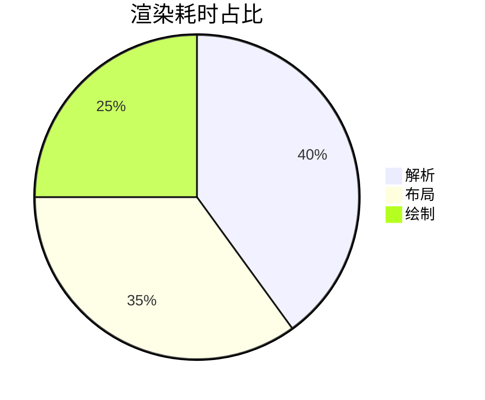

<!-- @case mm-gitgraph | now=source | expect=rich | gitGraph：今天不支持 → 源码。 -->
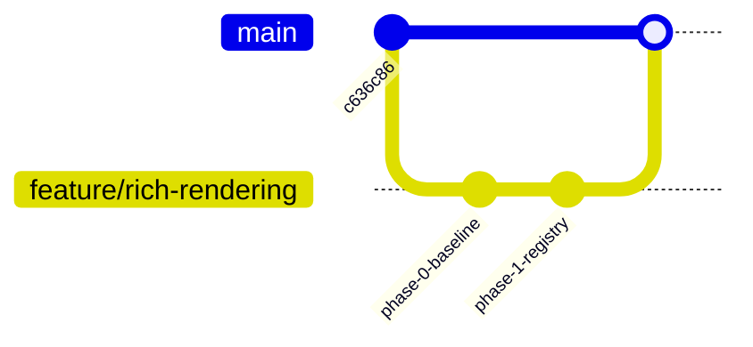

<!-- @case mm-timeline | now=source | expect=rich | timeline：今天不支持 → 源码。 -->
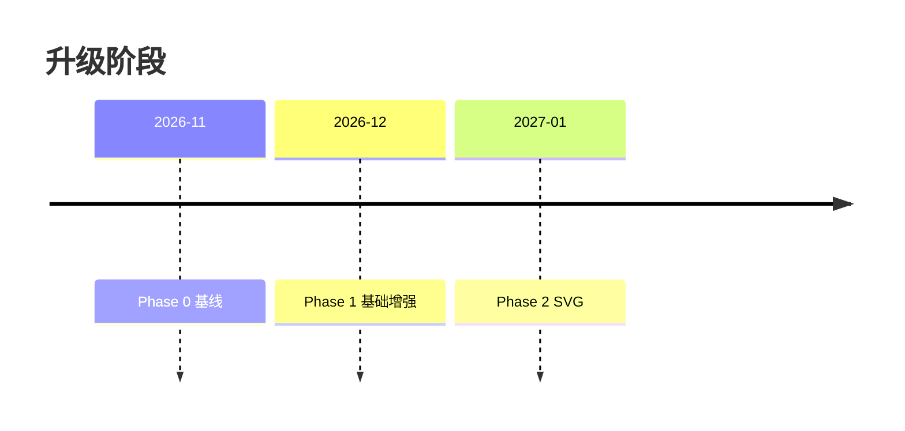

<!-- @case mm-quadrant | now=source | expect=rich | quadrantChart：今天不支持 → 源码。 -->
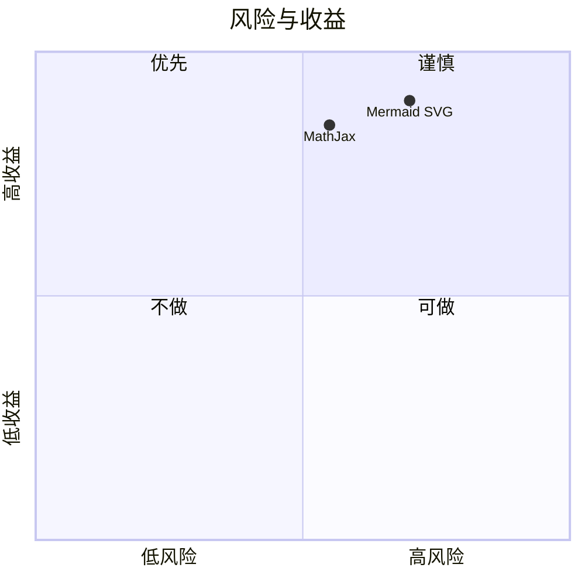

<!-- @case mm-sankey | now=source | expect=rich | sankey-beta：今天不支持 → 源码。语法是 Mermaid 10+ 的 `sankey-beta`，Phase 2 选定的 Mermaid.js 版本必须真的支持它，否则这条会永远停在源码。 -->
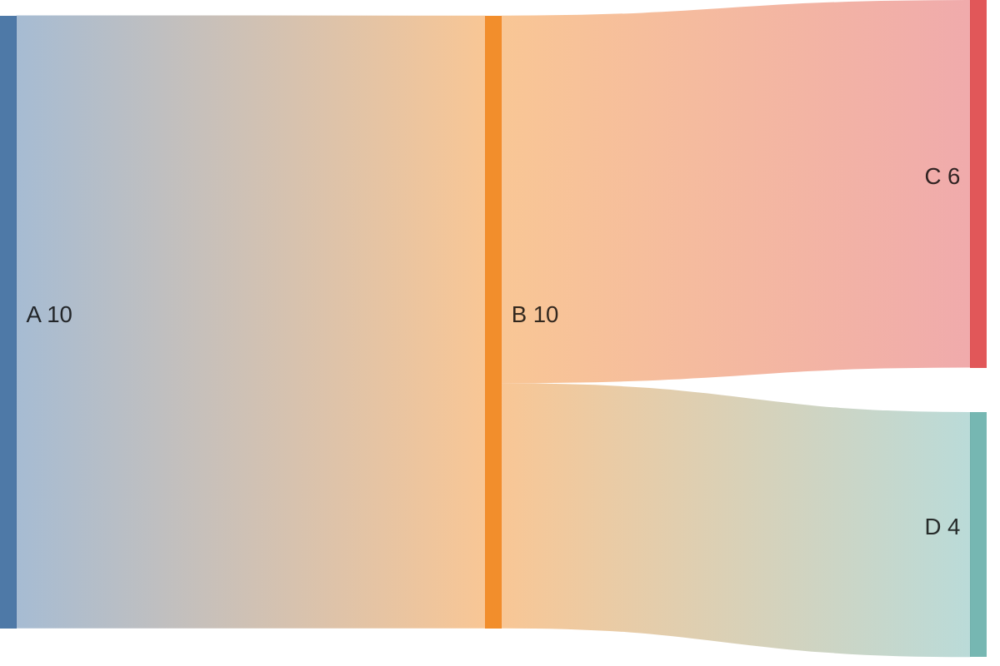
